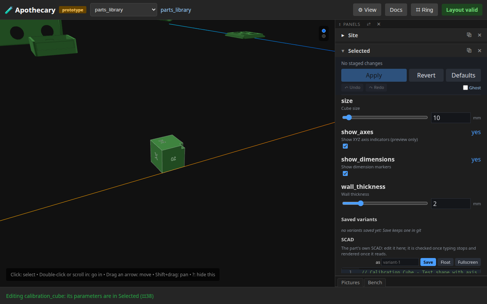
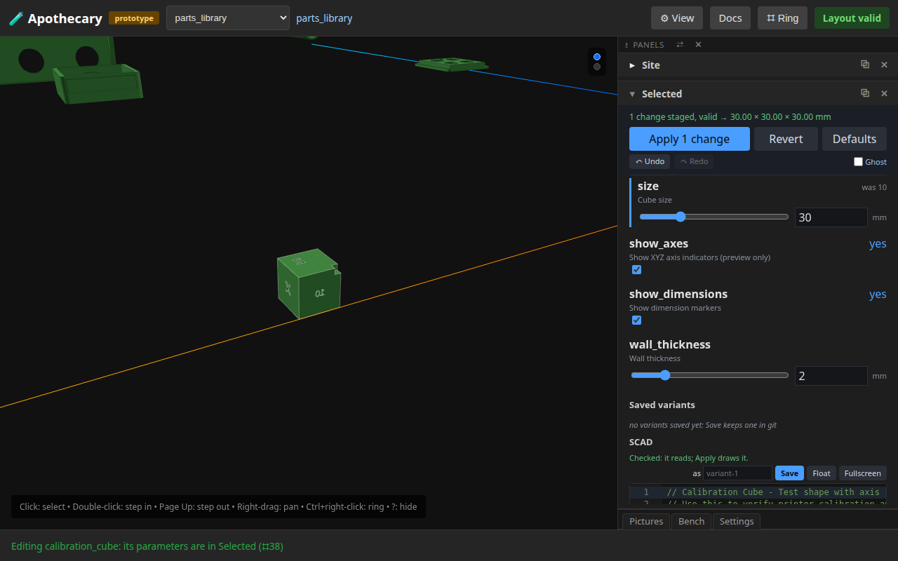
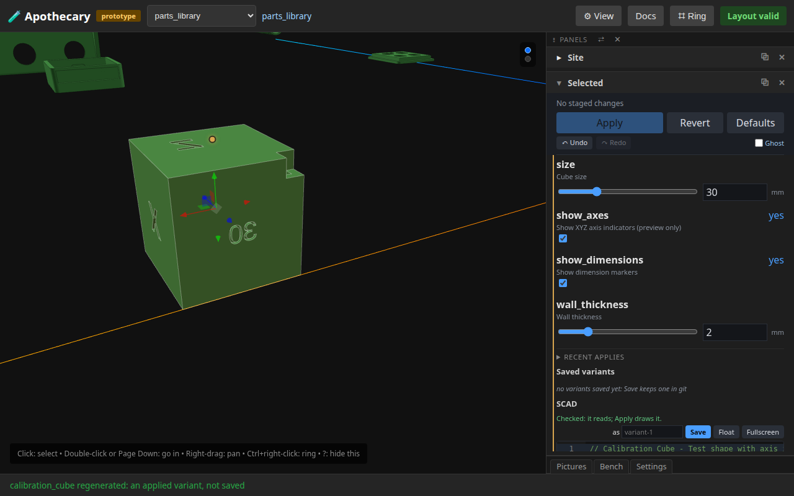
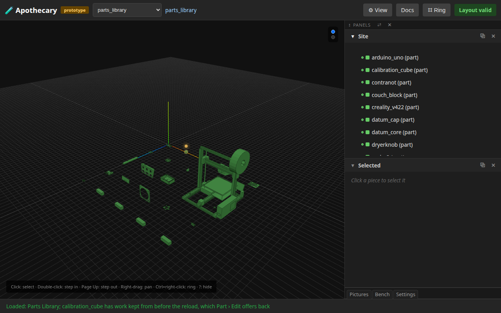
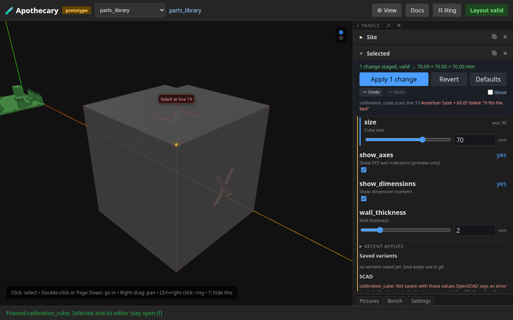
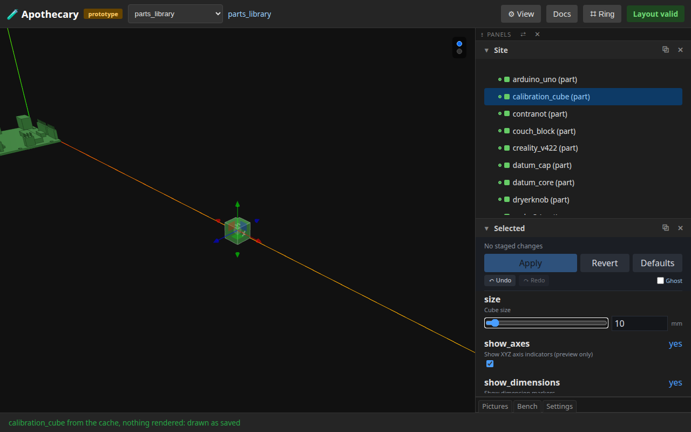
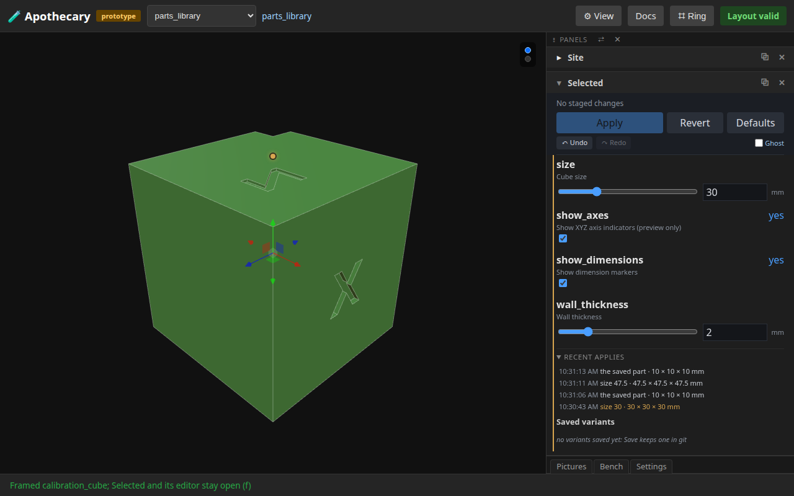
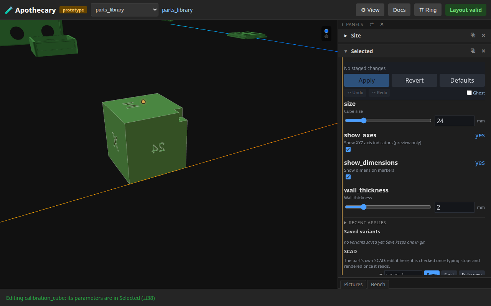

# 14 — Designing a part

**This page is written by the run it describes.** Every sentence below
was emitted by a test that had just asserted it, and the whole page is
rewritten by every run of the browser suite (`uv run apothecary test
all`), though not by the quicker `apothecary test run`. Editing it
by hand is editing the output of a program: the next run puts it back.

A part chosen from its ring, a size moved and checked, its box beside the slider in step, Apply drawing it in this tab where it stands, with what it measures beside what it declares, a reload drawing it again, OpenSCAD's refusal shown by line, put back, undone and redone, the saved part again for nothing; then round again, the size typed, an earlier apply drawn again from the cache, numbers staged kept over a reload, and two tabs applying at once. Every step is the page's own: a cell of a ring, a slider, a box, a key or a button, and every step's words name the next one.

**Runtime-bound.** It drives a real browser against a real server of its own, whose OpenSCAD is the one every test server runs, wrapped by the test so that it refuses a cube of 60 mm or more, as an assertion at the SCAD's size line would, so that the error met is OpenSCAD's own shape. Its cache of variants is a temporary folder. It needs no network, and refuses one.

Its pictures were taken once every part's STL that OpenSCAD version 2021.01, the OpenSCAD its server runs, can build was built by it; a part it cannot build is drawn from an STL already there, or as its box.

---

## 1. Part › Edit opens the part's editor at what is drawn

The parts library, /viewer/sites/parts_library (the site drop-down's parts_library): calibration_cube's row in Site, its ring, Part › Edit: its parameters in Selected. They start from what is drawn, the part's own STL as its params sidecar records it, and beside the envelope the part declares is what that STL measures. Nothing marks it: it is the saved part. The view is brought to it by hand, Shift+drag and the wheel, as the library frames a whole shelf of parts; in this page's pictures of the editor, Site is folded to its title by its ▾, so Selected has the rail. A slider is the next step.



```
envelope 10.00 × 10.00 × 10.00 mm · measured 10.00 × 10.00 × 10.00 mm (read from the STL)
```

## 2. A size dragged is checked once the slider rests

The size slider dragged through 5 values without a pause: one check, once it rests, against the part's own model, and the envelope the staged set would produce. Nothing is rendered yet; Apply is the next step.



```
1 change staged, valid → 30.00 × 30.00 × 30.00 mm
```

## 3. Apply draws the variant, marked as not saved

Apply: rendered into the cache of variants and drawn in this tab at the size staged, grown from where the part stood on the floor rather than centred on the envelope it had, and measured beside the envelope the part declares, Selected's Footprint following it. The editor's amber edge and its words, and an amber dot over the part in the world, say it is an applied variant and not the saved part; the status line says so too.



```
calibration_cube regenerated: an applied variant, not saved
envelope 30.00 × 30.00 × 30.00 mm · measured 30.00 × 30.00 × 30.00 mm (read from the STL)
```

## 4. A reload draws what the tab applied, marked at a glance

The tab's address keeps the variant, so a reload, a bookmark or a link draws it again, and no other tab is touched. At the library's own framing, with nothing selected, the amber dot over calibration_cube says it is drawn from a variant and not the saved part; its words, on hover, say so.



## 5. Reopened, the editor starts from the variant

Part › Edit again: the size slider stands at 30.00 mm, the variant's, the measured bounds are the variant's, and nothing is staged.

## 6. OpenSCAD's refusal, by line, drawn greyed

A size of 70 mm, which this run's OpenSCAD refuses -- the test's stand-in, which refuses a cube of 60 mm or more where a real OpenSCAD renders it; walkthrough 16 meets a refusal of the SCAD's own. Like a snapshot, it says the error and still writes the geometry it built: a failed render, never a variant. Apply answers with OpenSCAD's words, listed by file and line under the stage bar, the line marked in the part's source below, and carried on the status line; what it built is drawn greyed where the part stands, a red flag over it naming the line, the variant drawn before hidden under it -- f frames it. Part › Save refuses it in the same words. The refused size is still staged.



```
Error: STL generation failed: OpenSCAD said an error after writing part of it (calibration_cube.scad, line 19: Assertion '(size < 60.0)' failed: "it fits the bed"); what it built before the error is drawn greyed, flagged at line 19 -- a failed render, never a variant
```

## 7. Part › Revert puts back what was staged

calibration_cube's ring, Part › Revert: the refused size is put back to what is drawn, 30.00 mm, the greyed failure gone and the variant shown again, and nothing is staged. Part › Defaults is the way to the saved part.

```
calibration_cube: what was staged is put back to what is drawn; nothing is staged (⌗34)
```

## 8. Ctrl+Z and Redo step the staged numbers back and forward

Ctrl+Z, the slider holding the focus: the Revert undone, 70 mm staged again, its box saying so. The editor's Redo, under Apply: the Revert again, and nothing staged. Part › History holds the same two.

```
calibration_cube: the staged numbers one step forward again, nothing staged against what is drawn
```

## 9. Part › Defaults, then Part › Apply: the saved part again, for nothing

calibration_cube's ring, Part › Defaults: the part's own numbers staged in its editor, and the status line names Apply. Part › Apply renders nothing, since the cache already holds the saved part, and draws it: the amber marks are gone, and the address names no variant.



```
calibration_cube from the cache, nothing rendered: drawn as saved
```

## 10. Round two, the size typed in its box

A second size, 47.50 mm, typed a key at a time in the box beside the slider, which follows it; checked once, and applied from the part's ring, Part › Apply, as the editor's Apply applies it: rendered, drawn and marked. Then the editor's own Defaults and Apply: the saved part again, nothing rendered.

```
calibration_cube from the cache, nothing rendered: drawn as saved
```

## 11. Recent applies draws an earlier one again, from the cache

Recent applies, under the parameters, lists this tab's applies of calibration_cube, newest first. The first round's, 30.00 mm, clicked: drawn again from the cache of variants, nothing rendered, its numbers what is drawn; f frames it.



```
calibration_cube: drawn again from the cache, the variant applied then; nothing rendered
envelope 30.00 × 30.00 × 30.00 mm · measured 30.00 × 30.00 × 30.00 mm (read from the STL)
```

## 12. Numbers staged and not applied are kept over a reload

A size of 20 mm staged and not applied, and the page reloaded: the browser asks before leaving, the status line names the part with work kept, and Part › Edit offers it back. Restore stages it again; Discard would let it go.

```
Kept in this tab from before it was reloaded: size 20 staged. Restore puts it back; Discard lets it go.
```

## 13. Two tabs apply at once, and each draws its own

A second tab of the same page: this one stages 24.00 mm and the other 36.00 mm, and both Apply, neither waiting. Each renders into a file of its own and draws its own variant, its address naming it; each, reloaded, draws its own again. This is the first tab, reloaded, its editor open and the view brought to the cube by hand.



## What this page does not show

- **Editing the SCAD.** The part's source is in the editor below its parameters, its refused line marked there; editing it is walkthrough 16's.
- **A variant kept for good.** An applied variant lives in its tab's address and the cache, which keeps the most recently drawn of each part; saving one is a variant in git, walkthrough 16's too.
- **Which OpenSCAD measured.** The editor says whether the measured bounds are OpenSCAD's own summary of the render or were read off the STL; which it is depends on the machine's OpenSCAD, so the words here leave it out.
- **What changes from machine to machine.** A variant's key is a hash of what made it, its OpenSCAD among them; the address that carries it is not in the pictures, nor in the words.

Run it yourself:

```sh
uv run pytest tests/e2e/test_part_loop.py --start-server   # this page alone
uv run apothecary test all                                 # with every browser test
```
