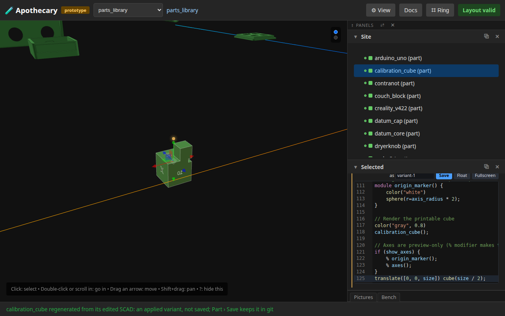
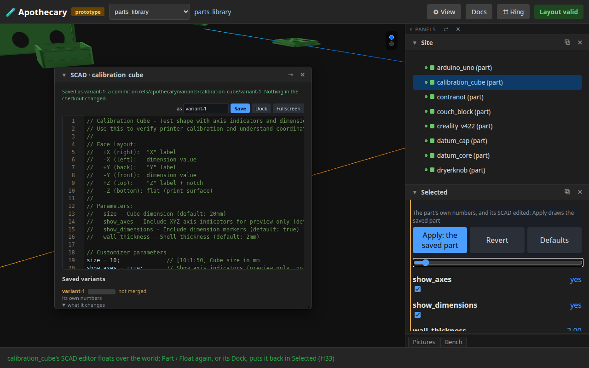
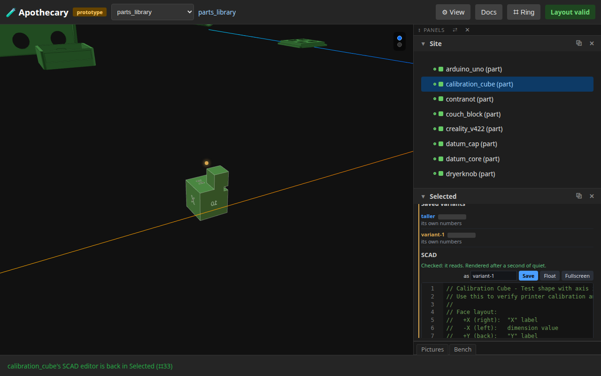

# 16 — Editing a part's SCAD

**This page is written by the run it describes.** Every sentence below
was emitted by a test that had just asserted it, and the whole page is
rewritten by every run of the browser suite (`uv run apothecary test
all`), though not by the quicker `apothecary test run`. Editing it
by hand is editing the output of a program: the next run puts it back.

A part's SCAD edited in the page: the editor where its source stood in Selected, a failing line checked once typing stops and marked where it is, a change rendered after a second of quiet and drawn as an applied variant, kept as a variant in git and listed with what it changes, the editor floated and made fullscreen; then round again, and the first variant drawn once more. Every step is the page's own: a cell of a ring, a key or a button, and every step's words name the next one.

**Runtime-bound.** It drives a real browser against a real server of its own, with the OpenSCAD every test server runs and a temporary cache of variants. A variant is saved into a clone of the checkout the server was given, never the checkout's own refs, which the run checks are as it found them. It needs no network, and refuses one.

Its pictures were taken once every part's STL that OpenSCAD version 2021.01, the OpenSCAD its server runs, can build was built by it; a part it cannot build is drawn from an STL already there, or as its box.

---

## 1. Part › Edit opens the SCAD where its source stood

calibration_cube's ring, Part › Edit: its parameters in Selected and, below them and the short list of its saved variants (none yet), its SCAD in an editor -- Site folded to its title by its ▾ here, so Selected has the rail. Typing in it is the next step.


## 2. A failing line is checked once typing stops, and marked where it is

An assertion typed at the end that this part fails. One check, once typing stops: OpenSCAD evaluates the edited SCAD beside the part and renders nothing, and its error is marked on line 125, listed under the stage bar and said above the code -- Site folded to its title by its ▾ here, so Selected has the rail. Nothing is rendered while it does not read; changing the line is the next step.


## 3. A change that reads is rendered after a second of quiet

The line replaced with a smaller cube on top. Checked once typing stops, and after a second of quiet rendered as Apply renders, from the edited SCAD written beside the part, and drawn in this tab, 15 mm tall now: an applied variant, not saved, the view brought to it by hand, Shift+drag and the wheel. The part's own SCAD is not touched. Part › Save is the next step.



```
calibration_cube regenerated from its edited SCAD: an applied variant, not saved; Part › Save keeps it in git
```

## 4. Part › Save keeps it as a variant in git

calibration_cube's ring, Part › Save: the edited SCAD and the numbers staged, committed to refs/apothecary/variants/calibration_cube/variant-1, the name the editor offered. Nothing in the checkout changes; merging is yours to do. It is listed under the part's parameters and, in the editor, with what it changes against the part's SCAD and that HEAD does not hold it. Floating the editor is the next step.


```
calibration_cube saved as the variant variant-1, a commit on refs/apothecary/variants/calibration_cube/variant-1; nothing in the checkout changed, and git merge refs/apothecary/variants/calibration_cube/variant-1 makes it the part's source (⌗39)
```

## 5. Part › Float puts the editor over the world

Part › Float: the editor out of Selected, a panel of its own over the world, clear of the header, the hint bar, the depth ladder and the closed panels' tabs; where it stood, Selected says where it is. Its Fullscreen is the next step.



## 6. Fullscreen covers the page

Its Fullscreen button: the editor over the whole page, the code as tall as it can be. Esc, the same button or Part › Fullscreen puts it back.


## 7. Round two: a name, a change and Save

In the floated editor: a name typed, taller, and the top made as big as the cube, rendered after a second of quiet, 20 mm tall; then the editor's Save. Both variants are listed, newest first. Drawing the first again is the next step.


```
calibration_cube saved as the variant taller, a commit on refs/apothecary/variants/calibration_cube/taller; nothing in the checkout changed, and git merge refs/apothecary/variants/calibration_cube/taller makes it the part's source
```

## 8. Part › Variants draws the first again, and Part › Float docks it

calibration_cube's ring, Part › Variants › variant-1: its SCAD back in the editor, its numbers staged and drawn, 15 mm tall again, the name it saves under its own. Part › Float again puts the editor back in Selected.



## What this page does not show

- **Making a variant the part's source.** That is a merge you do (`git merge refs/apothecary/variants/<part>/<name>`); no control in the page writes the checkout.
- **A part without a model.** Its controls come from what its SCAD declares, where the OpenSCAD in use lists them; calibration_cube has a model.
- **When a variant was saved.** It differs on every run, so the lists' times are blanked in the pictures.
- **The way back to the saved part.** Part › Defaults, then Apply, draws the part's own SCAD and numbers again, as walkthrough 14 does for its numbers.

Run it yourself:

```sh
uv run pytest tests/e2e/test_scad_loop.py --start-server   # this page alone
uv run apothecary test all                                 # with every browser test
```
