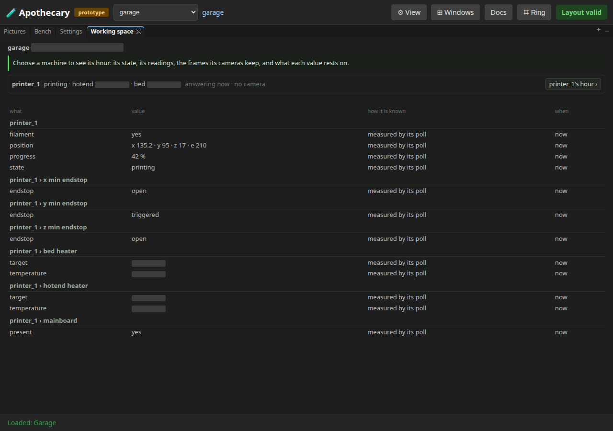
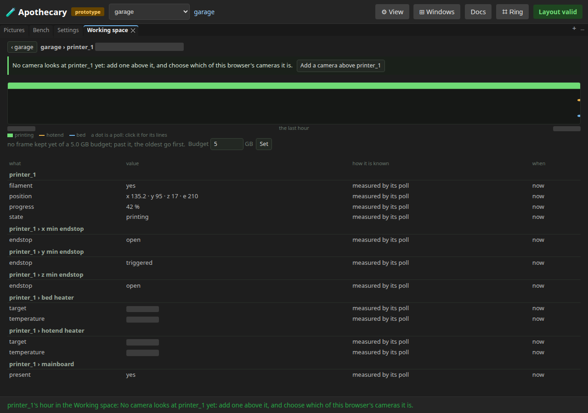
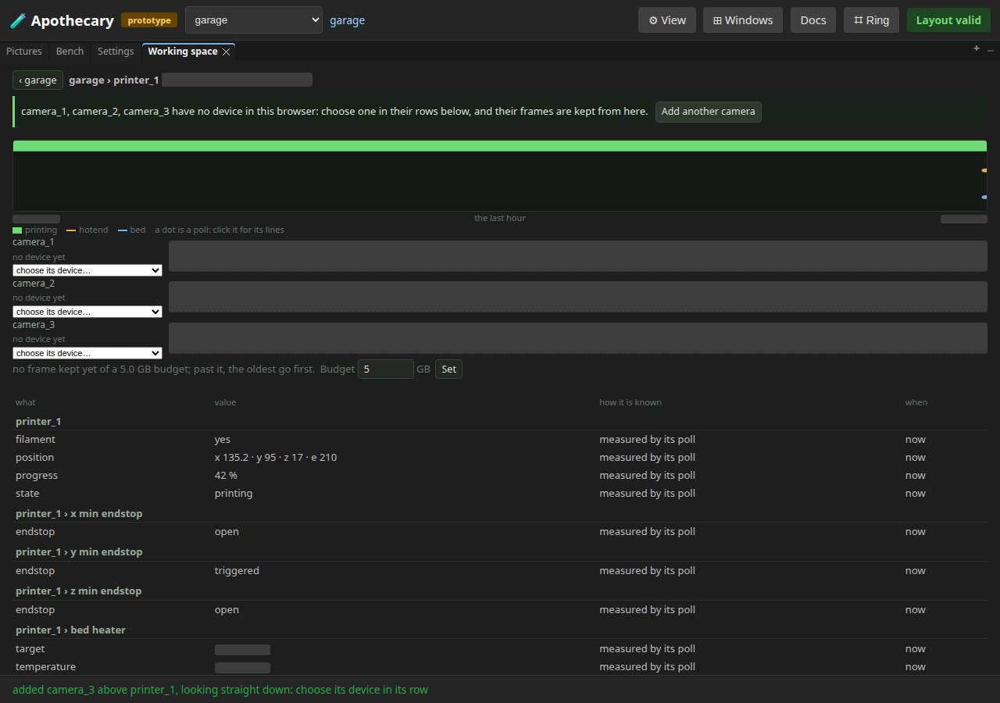
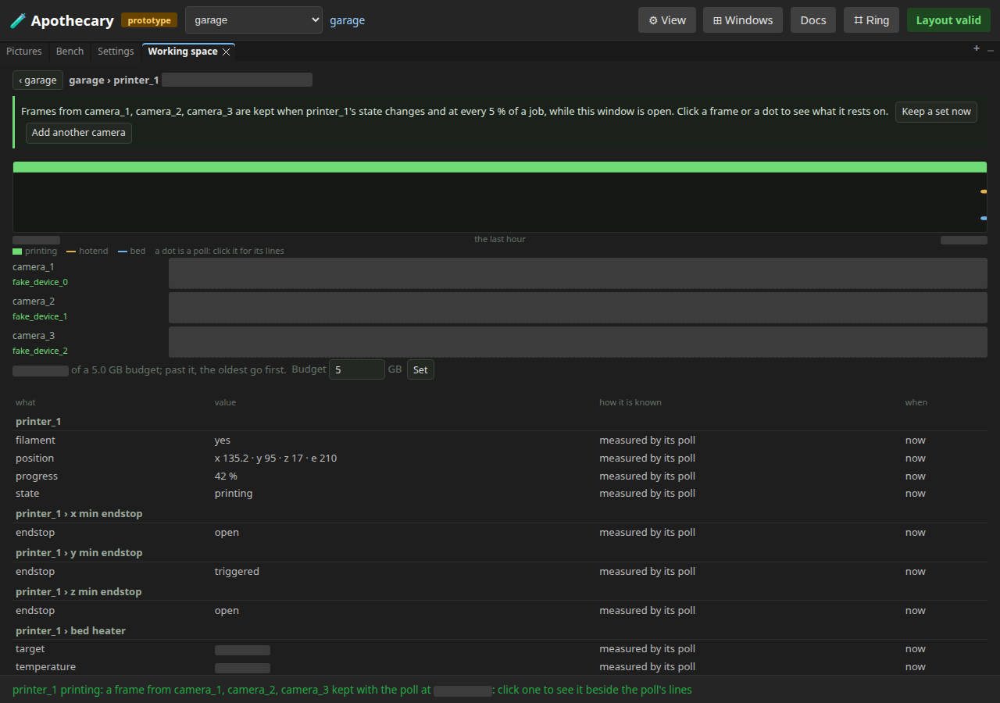
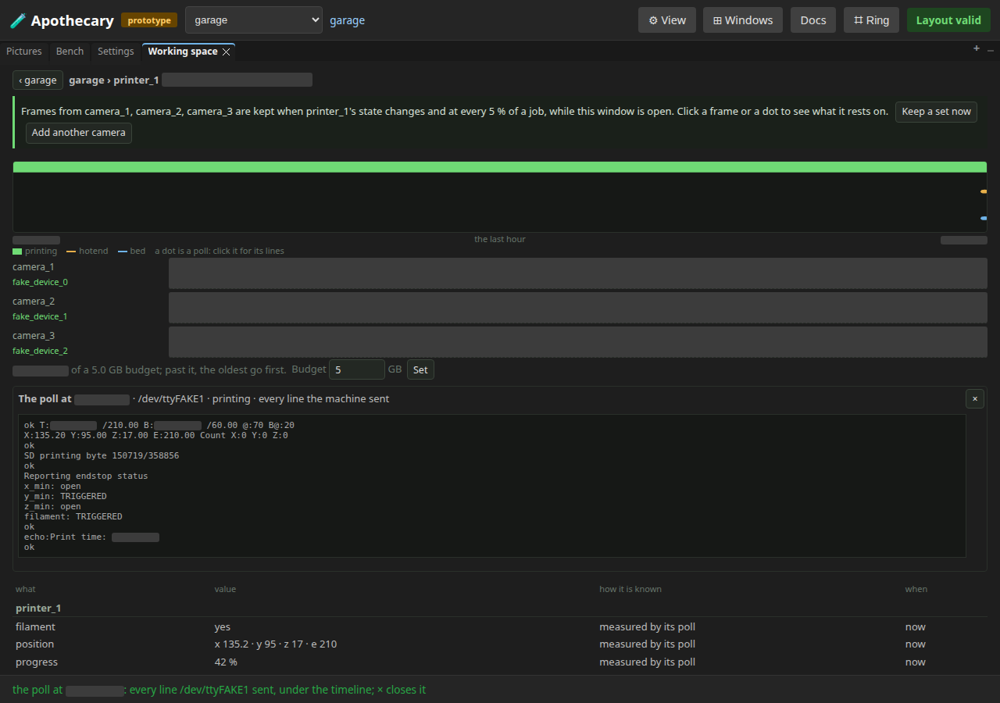
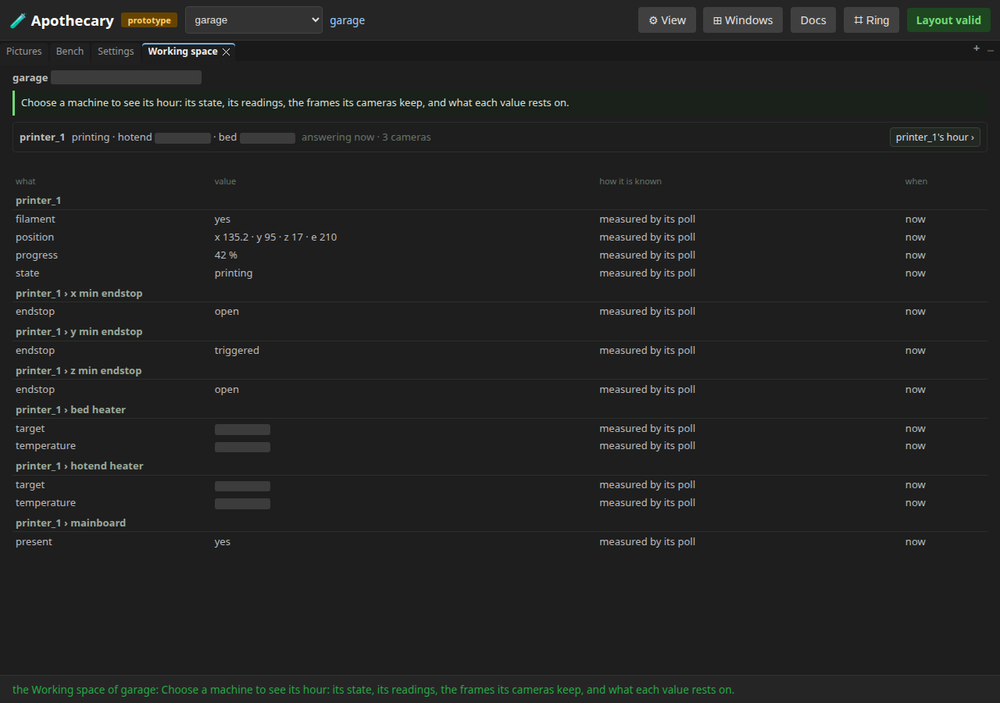

# 18 — The working space

Written by `tests/e2e/test_working_space.py`, and
rewritten by every run of the browser suite (`uv run apothecary test
all`), though not by the quicker `apothecary test run`.
Each numbered step is written as the run reaches it, after the assertions
before it pass, and what a step shows is what the run had then. The
opening, the notes under it and the list of what the page does not show
are the test's fixed words. Editing the page by hand is editing the output
of a program: the next run puts it back.

A site as its evidence has it, and a printer's hour in it: its state, its heaters, a frame from each camera that looks at it, kept with its polls, and what each value rests on. Three doors open it -- ⊞ Windows, a printer's ring and the canvas ring -- and whichever opens it, its first line, under the title, names the next step and carries the button that takes it. Every step is the page's own: a button, a menu, a box or a cell of a ring.

**Runtime-bound.** It drives a real browser against a real server of its own. The printer is the simulated one, printing, its progress held at 42 %, pinned to printer_1's board as the bench's real board is; the browser's three cameras are Chromium's fake ones, each playing its moving test picture. It needs no network, opens no serial port, and refuses both.

Its pictures draw every part that OpenSCAD version 2021.01, the OpenSCAD its server runs, can build from an STL it built; a part it cannot build is drawn from an STL already there, or as its box.

---

## 1. ⊞ Windows › Working space opens it on the site

The header's ⊞ Windows, Working space under Site: the window opens on the garage, maximised here by a double-click on its tab. Its first line names the next step: choose a printer. printer_1's row says what it is doing, that it is answering now and that no camera looks at it, and its button opens its hour. Under it, every subject the log has said of, named as a person names it, each value with how it is known and when.



```
Choose a machine to see its hour: its state, its readings, the frames its cameras keep, and what each value rests on.
```

## 2. printer_1's hour ›: its state, its heaters, and no camera yet

Its row's button: the window is printer_1's last hour, the strip its state, printing all along, and the lines its hotend and bed, a dot at each poll, with a key under them. ‹ garage goes back. No camera looks at printer_1, so the first line offers to add one above it.



```
printer_1's hour in the Working space: No camera looks at printer_1 yet: add one above it, and choose which of this browser's cameras it is.
```

## 3. Add a camera above printer_1, and two more

The first line's button stands camera_1 above printer_1, looking straight down, and Add another camera two more, each a step beside the last so none overlaps another and the header still says the layout is valid. Each is a row, saying it has no device in this browser yet, with a box to choose one, and the first line names them. On the bench each would then be moved where it looks -- the bed, the head, the room -- with its own ring's Move.



```
camera_1, camera_2, camera_3 have no device in this browser: choose one in their rows below, and their frames are kept from here.
```

## 4. Each camera's device, chosen in its row, keeps a frame with the next poll

Each row's box, one of this browser's three cameras: the row names it, and a camera newly this browser's has a frame kept with the next poll, ten seconds apart at the least, laid where it fell in the hour, and the line under the rows counts them against their budget. The first line says when frames are kept -- when printer_1's state changes and at every 5 % of a job, while the window is open -- and offers Keep a set now.



```
Frames from camera_1, camera_2, camera_3 are kept when printer_1's state changes and at every 5 % of a job, while this window is open. Click a frame or a dot to see what it rests on.
```

## 5. Keep a set now keeps one from every camera, with one poll

The first line's Keep a set now: a frame from each camera, all three kept with the same poll, and the status line names the next step.

```
printer_1 printing: a frame from camera_1, camera_2, camera_3 kept with the poll at …: click one to see it beside the poll's lines
```

## 6. A frame opens under the timeline, and the poll it rests on

A frame of camera_1's row, clicked: it opens large under the timeline, with a link to the poll it was kept with; the link shows that poll, every line the printer sent, its temperatures and its place in the print. A dot on a line, or a row of the table, opens its poll the same way, and × closes it.



```
the poll at …: every line /dev/ttyFAKE1 sent, under the timeline; × closes it
```

## 7. Budget, set under the camera rows

Under the camera rows, how much printer_1's kept frames take of their budget, 5 GB until set; past it, the oldest are forgotten first as the next are kept. 1 typed in its box and Set: the line says 1.0 GB.

```
printer_1's frames now live under 1 GB: past it, the oldest are forgotten as the next are kept
```

## 8. ‹ garage goes back to the site

‹ garage: the site again, printer_1's row now saying it has three cameras, and the subjects named as a person names them -- printer_1 › bed heater, printer_1 › x min endstop -- each id in its row's title.



```
the Working space of garage: Choose a machine to see its hour: its state, its readings, the frames its cameras keep, and what each value rests on.
```

## 9. Camera › Workspace on printer_1's ring, and Panels › Site › Workspace

The window restored to its place by a double-click on its tab. printer_1's ring, Camera › Workspace, opens the same hour, its cameras still this browser's; the canvas ring's Panels › Site › Workspace opens the site. The status line says the window's next step whichever door opened it.

```
printer_1's hour in the Working space: Frames from camera_1, camera_2, camera_3 are kept when printer_1's state changes and at every 5 % of a job, while this window is open. Click a frame or a dot to see what it rests on. (⌗96)
the Working space of garage: Choose a machine to see its hour: its state, its readings, the frames its cameras keep, and what each value rests on. (⌗483)
```

## What this page does not show

- **A real camera or a real printer.** The bench's three cameras -- the bed, the head, the room -- and where each stands are the working-space plan's slice 1 (docs/plans/working-space-view-2026-10-30.md); the frames here are the fake cameras' test picture, blanked, since it moves.
- **A print going by.** The progress is held still, so the frames kept at every 5 % of a job, and with each change of its state, are not shown; this page keeps a set when a camera is newly chosen and when asked.
- **What changes on every run.** The moments, how many observations the hour holds, where each poll fell in it, a temperature to its tenth and how much the frames take are blanked in the pictures and left out of the words.
- **Looking back past the hour.** The window shows the last hour; an earlier one is `apothecary evidence changed --since` and the evidence document's `at` and `since` (docs/working-space.md).

Run it yourself:

```sh
uv run pytest tests/e2e/test_working_space.py --start-server   # this page alone
uv run apothecary test all                                     # with every browser test
```
