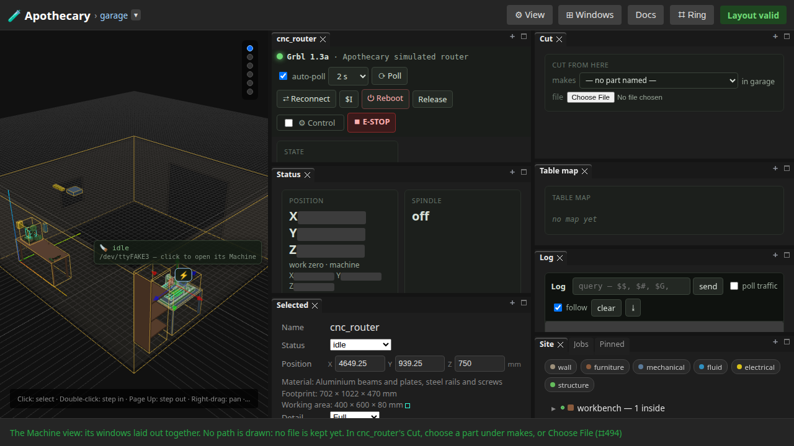
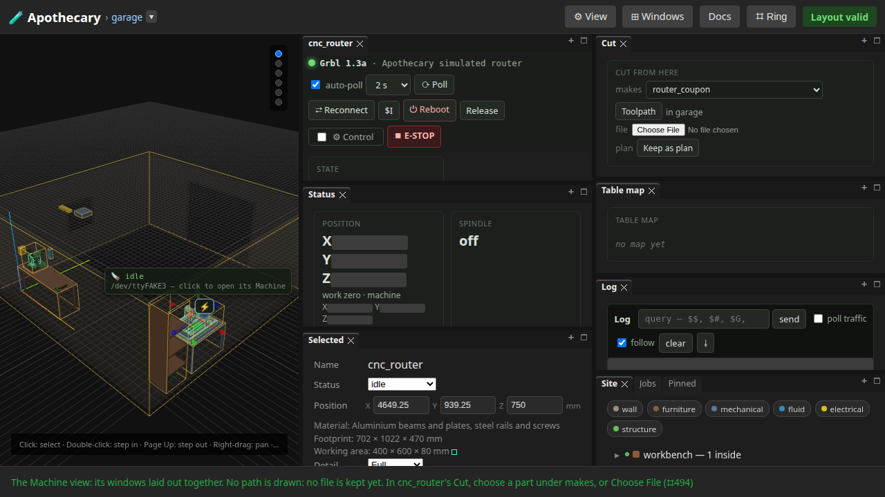
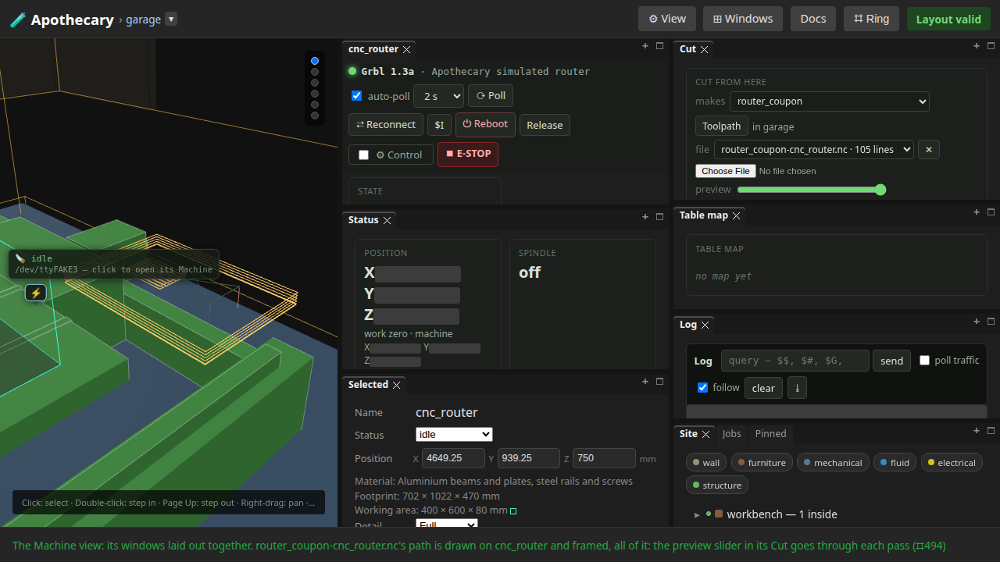
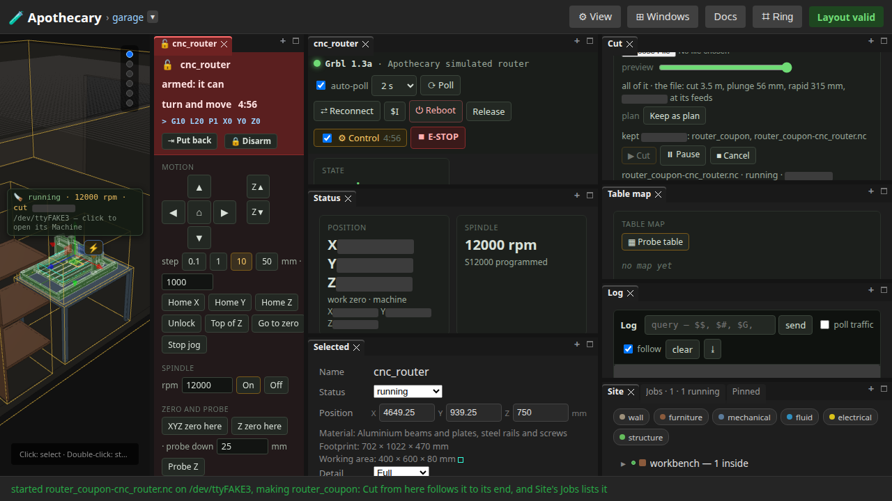
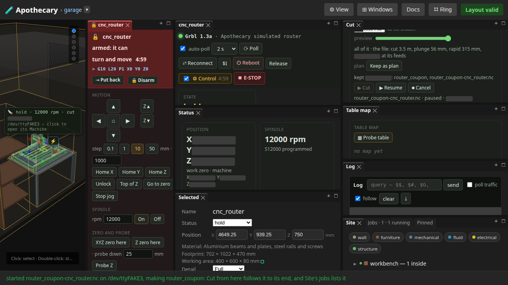
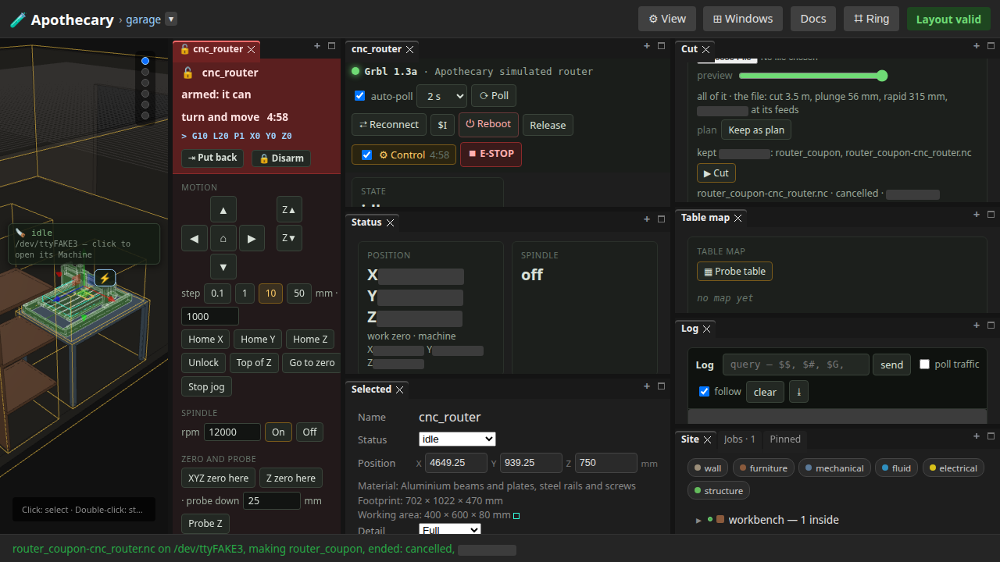

# 24 — A cut from the card

Written by `tests/e2e/test_router_ui.py`, and
rewritten by every run of the browser suite (`uv run apothecary test
all`), though not by the quicker `apothecary test run`.
Each numbered step is written as the run reaches it, after the assertions
before it pass, and what a step shows is what the run had then. The
opening, the notes under it and the list of what the page does not show
are the test's fixed words. Editing the page by hand is editing the output
of a program: the next run puts it back.

A cut from the router's Cut card, as a person goes round it: the coupon chosen under makes, its toolpath written and drawn on the table, kept as the router's plan, control armed and the work zeroed, the cut streamed, held, resumed and cancelled. The card shows each control once what it needs holds, and nothing before. [docs/cnc.md](../docs/cnc.md) is the router's reference and [docs/cam.md](../docs/cam.md) the toolpath's; [page 20](20-a-part-through-the-router.md) runs the same loop in this process, and [page 21](21-a-toolpath-previewed.md) the preview's core.

**Runtime-bound.** It drives a real browser against a real server of its own. The router is the simulated GRBL controller on a fake port, pinned to cnc_router's controller as the garage's real one is; its moves take a twentieth of real time. Nothing opens a real port, and the real router is section I of [docs/bench-checklist.md](../docs/bench-checklist.md).

Its pictures draw every part that OpenSCAD version 2021.01, the OpenSCAD its server runs, can build from an STL it built; a part it cannot build is drawn from an STL already there, or as its box.

---

## 1. cnc_router's Cut, opened: makes, and Choose File

cnc_router selected in Site, Open in its Device line, then the canvas ring's Panels › Windows › Machine view: the router's Machine and its windows laid out together. Its Cut card offers the two ways in, a part under makes or a CAM post's file from Choose File, and nothing else yet; the status line says so.



## 2. router_coupon under makes: Toolpath, and Keep as plan

The coupon on the router's table chosen under makes. Toolpath is there, since the part says how it is cut, and Keep as plan, since there is something to keep. ▶ Cut is not: there is no file yet.



## 3. Toolpath writes the coupon's cut: kept, chosen, said, and drawn on the table

Toolpath writes the cut from what the coupon declares, in GRBL's dialect, keeps it and chooses it: the file's row, its ✕, the preview and ▶ Cut are there now, and the card says each operation with its passes and what it bored to the tool. The Machine view, pressed again, lands on the file: all of its path drawn on the table from the router's work zero, and the world framed on it.



## 4. Keep as plan keeps the part and the file as the router's plan

The plan row says what is kept and when. cnc_router's Machine chooses the coupon and its toolpath whenever it opens, its board connected or not.

```
kept <moment>: router_coupon, router_coupon-cnc_router.nc
```

## 5. ⚙ Control armed: the pad, Probe table offered, and the work zeroed

⚙ Control arms the latch for five minutes of activity and opens the control pad, a loud window beside the world. The Table map's Probe table is there now, since it moves the machine. The tool jogged over the stock's corner, the pad's XYZ zero here makes that the work zero, and the path drawn moves with it.


## 6. ▶ Cut streams it: Pause and Cancel while it runs, the operation named

▶ Cut asks first, then streams the file one line per ok. The progress line names the operation and the pass the cut is in, the badge in the world says the cut, and Pause and Cancel are there while it runs; ▶ Cut waits, disabled, until it ends.



## 7. Pause holds the controller: Resume takes Pause's place

Pause is GRBL's feed hold: the controller stops where it is and nothing more is fed, the state card says Hold, and Resume stands where Pause did.



## 8. Cancel, pressed twice: the cut ends, and the card is at rest with its history

Cancel asks to be pressed again, then holds and resets the controller: the queue empties and the spindle is off. The progress line says cancelled, the job is in the card's history and in Site's Jobs, and ▶ Cut is offered again, the file still chosen.



## What this page does not show

- **The real router.** Every line here goes to the simulated controller; the bench checklist's section I is the same cut on the AnoleX.
- **The toolpath's numbers.** What Toolpath writes, pass by pass, and the holes bored to the tool are [page 20](20-a-part-through-the-router.md)'s.
- **A cut run to its end.** The cut is held, resumed and cancelled, so the card's three verbs are seen; a cut that ends is a job done, listed the same way.
- **What changes on every run.** Moments, the lines streamed and the tool's position are blanked in the pictures.

Run it yourself:

```sh
uv run pytest tests/e2e/test_router_ui.py --start-server   # this page alone
uv run apothecary test all                                 # with every browser test
```
