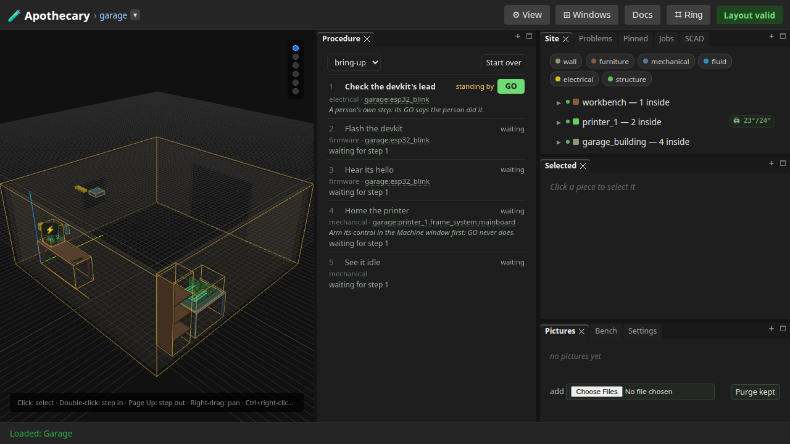
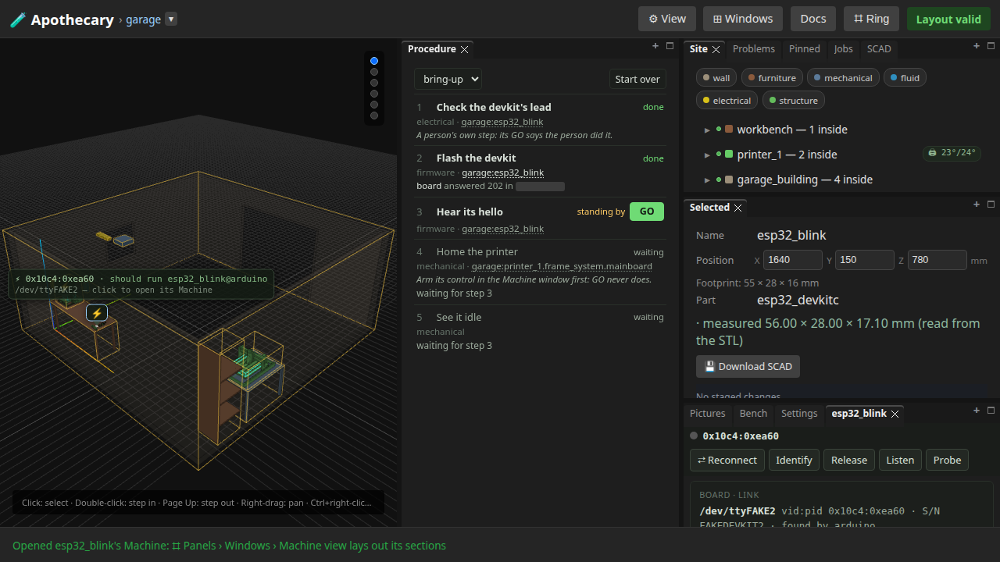
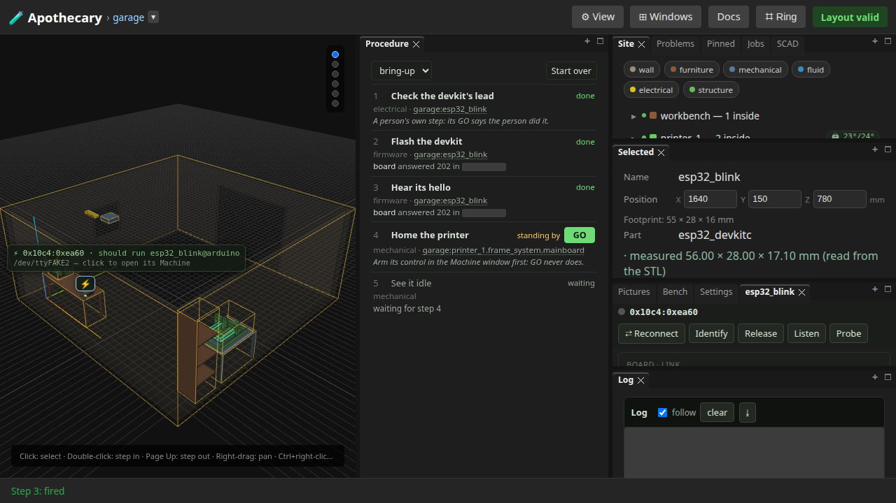
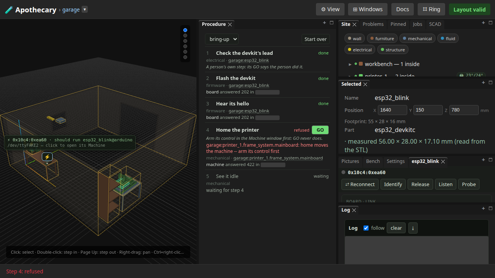
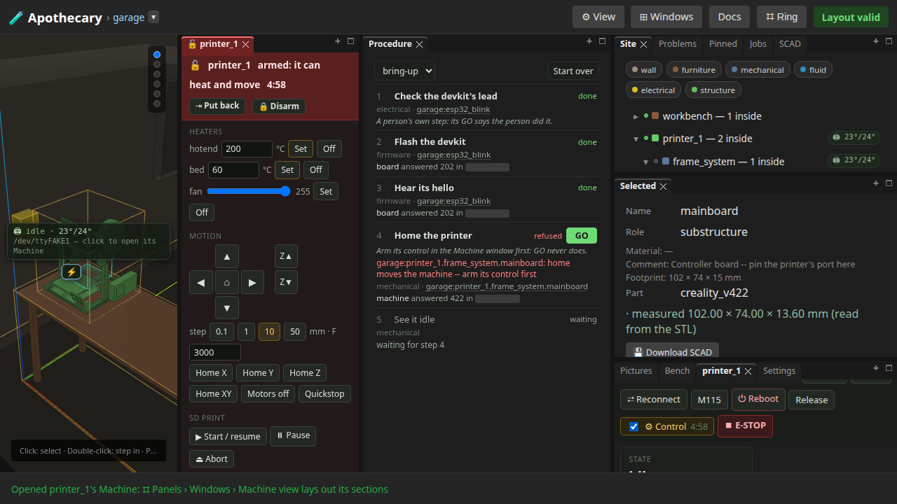
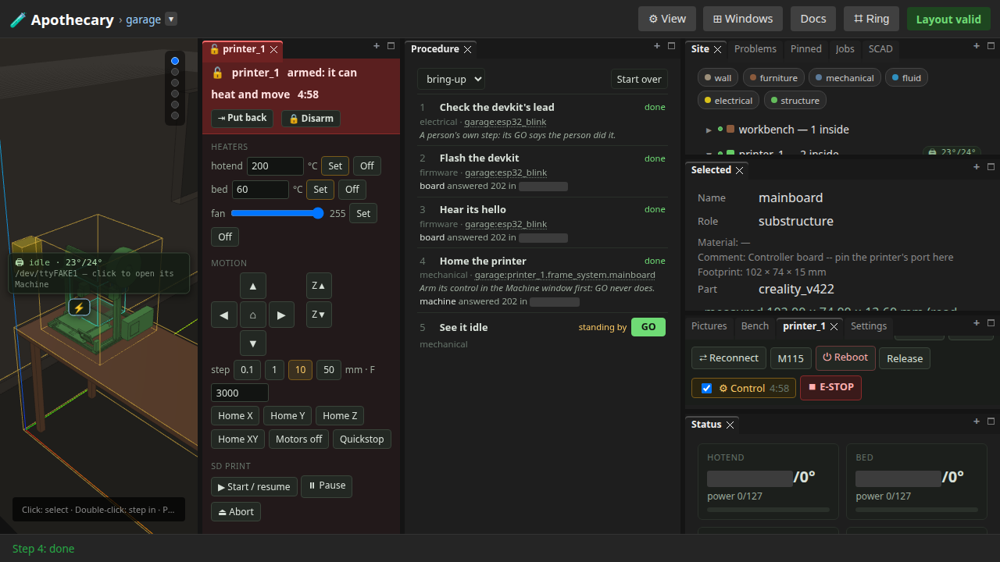
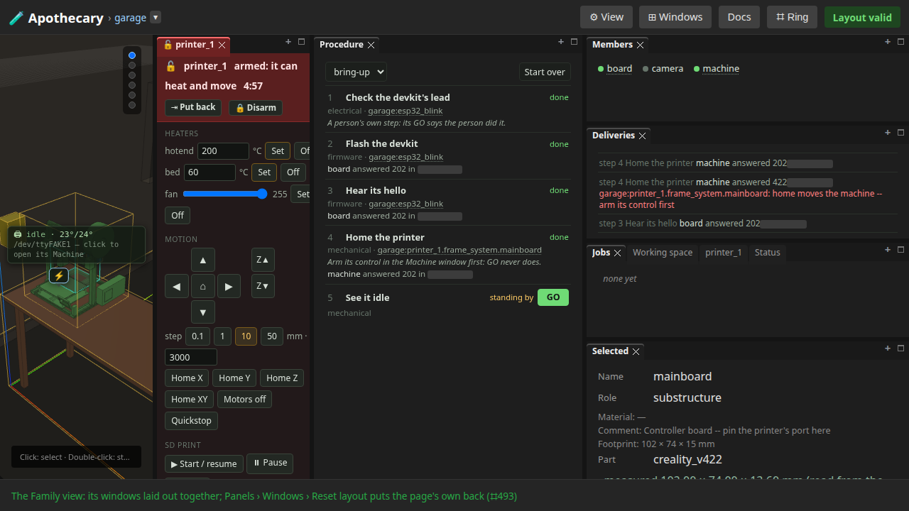

# 25 — A procedure through the window

Written by `tests/e2e/test_procedure_window.py`, and
rewritten by every run of the browser suite (`uv run apothecary test
all`), though not by the quicker `apothecary test run`.
Each numbered step is written as the run reaches it, after the assertions
before it pass, and what a step shows is what the run had then. The
opening, the notes under it and the list of what the page does not show
are the test's fixed words. Editing the page by hand is editing the output
of a program: the next run puts it back.

A site's procedure through the Procedure window, as a person goes through it on the simulated bench: GO on a step, a step's node as a door to the window its work is in, a fire opening the section its member works in, a machine's step refused in the member's words with its door after them, the latch armed through that door, the step fired again, and the Family view's Members and Deliveries. [docs/family.md](../docs/family.md) is the reference, and [page 23](23-a-procedure.md) runs a procedure in this process.

**Runtime-bound.** It drives a real browser against a real server of its own, the family's own members hosted in it. The simulated Ender stands idle on a fake port, pinned to printer_1's mainboard; the simulated devkit is on another, flashed by the scripted arduino-cli. Nothing opens a real port.

Its pictures draw every part that OpenSCAD version 2021.01, the OpenSCAD its server runs, can build from an STL it built; a part it cannot build is drawn from an STL already there, or as its box.

---

## 1. The Procedure, beside the world: the steps

The garage has a procedure, so the Procedure stands beside the world without being asked for. Each step has its number, its discipline and its node, a door to the window its work is in; the first stands by with its GO, the rest wait.



## 2. GO on a person's own step: done, and the next stands by

The first step is a person's own, with nothing handed to a member: its GO says the person did it, and the flash stands by.

```
1 done · 2 standing by
```

## 3. A node's door with its board not connected: why not, said

esp32_blink's board is pinned but not connected until a port runs its sketch: its door opens no window, and the status line says so.

```
esp32_blink's board is pinned to a board, but not connected: connect it, or ⟳ Rescan in its Device section
```

## 4. GO flashes the devkit through the board member, and its door opens its Machine

GO hands the flash to the board member, which builds the sketch and uploads it to the devkit's port; the step is done once that work ends, and the outcome says what the member answered. The devkit's port runs the sketch now, so the node's door opens its Machine, a tab beside Pictures. No Machine was open when the step fired, so the fire opened nothing.



## 5. GO hears its hello: the Log opens, where the Machine is open

The board member listens on the port for the sketch's hello, and the step is done once it is heard. The devkit's Machine being open, the fire opens its Log, the section the member works in.



## 6. The printer's step, refused: the member's words, and the node's door after them

GO on the printer's step with its control down is refused in the machine member's own words, and the node's door stands right after them: the latch is one press away. The step may be fired again.



## 7. The door opens the printer's Machine; ⚙ Control armed there

The printer's Machine takes the devkit's place, one Machine at a time. ⚙ Control arms the latch for five minutes of activity and opens the control pad: GO never does.



## 8. GO again: homed through the member, its Status open, and the next step stands by

Armed, the step goes through: the machine member homes the printer, and the fire opens the Machine's Status. The next step waits for evidence, the printer idle in the log, which the homing's poll writes; it stands by.



## 9. The Family view: Members and Deliveries

Panels › Windows › Family view lays the Procedure tall beside the world, Members and Deliveries under it. Members is the hub's own three: machine and board, hosted here, are doors, and camera, a pull member a page reads, is a name. Deliveries is the hub's audit, newest first: each step's delivery with the member that took it and how it was answered.



## 10. A member's name is a door: board's opens the devkit's Machine

A member hosted here leads to the window of the node its next step names, the last it worked on when none is left: board's name opens esp32_blink's Machine.

```
Opened esp32_blink's Machine: ⌗ Panels › Windows › Machine view lays out its sections
```

## 11. Start over counts what came before no more; the ring's GO and Start over do the same

Start over puts every step back, what came before staying in the log. The canvas ring's Panels › Site › Procedure › GO fires the step the window offers it on, and its Start over is the window's.

```
1 standing by
```

## What this page does not show

- **Members beside the hub.** carlos and joe are not started here, so no member's name opens a page in a new tab: the family is the hub's own three.
- **The camera's work.** A camera is a pull member, a page's to read, and no step here fires one.
- **What each member answered, beyond the audit's recent deliveries.** The hub keeps a few of them; a step shows the outcome of its own last fire.
- **What changes on every run.** Moments, how long a member took to answer, the devkit's log and the flash's output are blanked in the pictures.

Run it yourself:

```sh
uv run pytest tests/e2e/test_procedure_window.py --start-server   # this page alone
uv run apothecary test all                                        # with every browser test
```
