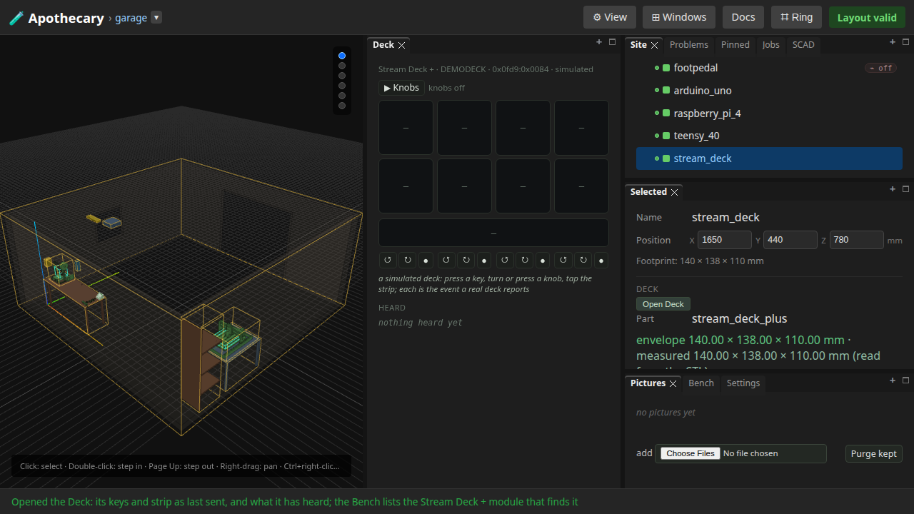
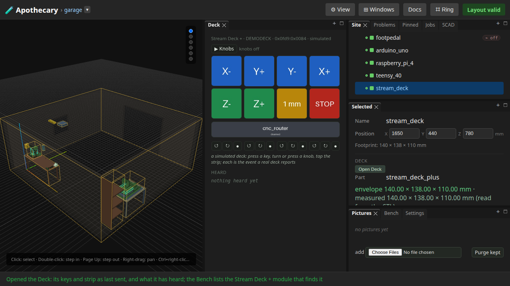
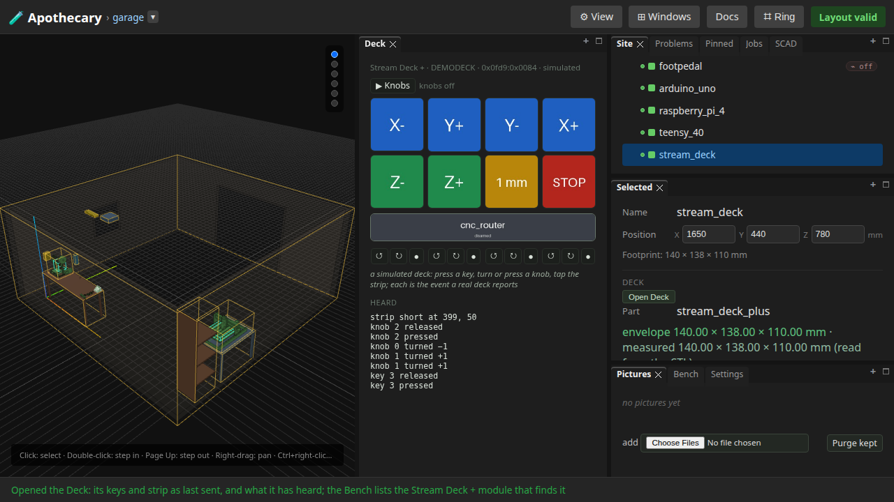

# 26 — The Stream Deck +

Written by `tests/e2e/test_deck.py`, and
rewritten by every run of the browser suite (`uv run apothecary test
all`), though not by the quicker `apothecary test run`.
Each numbered step is written as the run reaches it, after the assertions
before it pass, and what a step shows is what the run had then. The
opening, the notes under it and the list of what the page does not show
are the test's fixed words. Editing the page by hand is editing the output
of a program: the next run puts it back.

An Elgato Stream Deck + at the garage's bench, found on USB, its keys and its touch strip drawn from here, and its keys, knobs and touches heard. The deck in this page is simulated, so every step can be shown; the device's own reports are the same events.

**Runtime-bound.** It drives a real browser against a real server of its own, with one simulated deck under the simulated serial engine. No HID device is listed or opened and nothing reaches the network.

Its pictures draw every part that OpenSCAD version 2021.01, the OpenSCAD its server runs, can build from an STL it built; a part it cannot build is drawn from an STL already there, or as its box.

---

## 1. The stream_deck piece's Open Deck opens the Deck window

The Stream Deck + stands on the bench's right end; its piece's Open Deck opens the Deck window on the one deck found, a simulated one, named with Elgato's vendor id and the model's product id. Nothing has been drawn on it yet.



## 2. A program draws its eight keys and its strip

Each key and the strip were set by a PUT to the deck's routes: a label on a colour, drawn here and sent as the JPEG the device takes. The window shows what was sent, since a deck cannot be asked what it shows.



## 3. A key pressed, knobs turned and pressed, the strip tapped

Key 3 pressed, knob 1 turned two steps clockwise, knob 0 one step the other way, knob 2 pressed and the strip tapped: each is the event a real deck reports, listed here newest first and kept by the server, which a program reads with `GET /firmware/decks/{id}/events`. The strip's tap carries its position in the strip's own pixels, 800 across.



## What this page does not show

- **A real deck.** What only a deck shows -- its screen, its knobs' feel, the udev rule -- is section J of the bench checklist (docs/bench-checklist.md).
- **The knobs jogging a machine.** That is the controller (docs/stream-deck.md).

Run it yourself:

```sh
uv run pytest tests/e2e/test_deck.py --start-server   # this page alone
uv run apothecary test all                            # with every browser test
```
