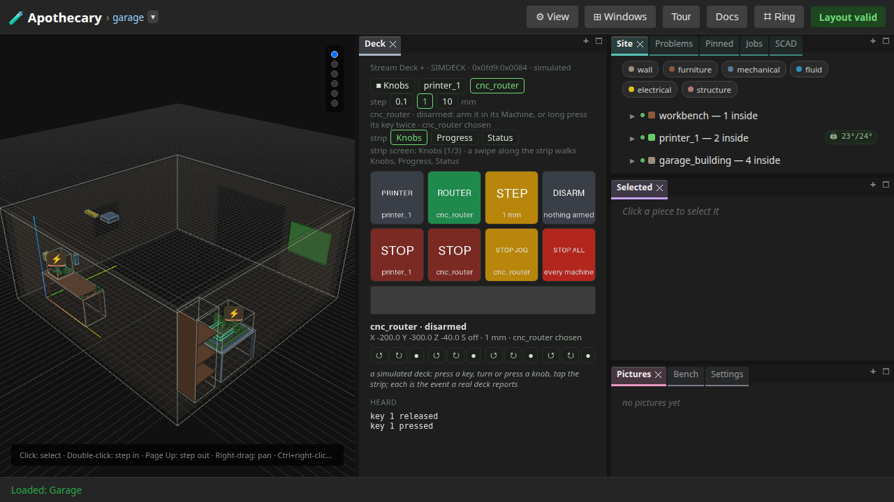
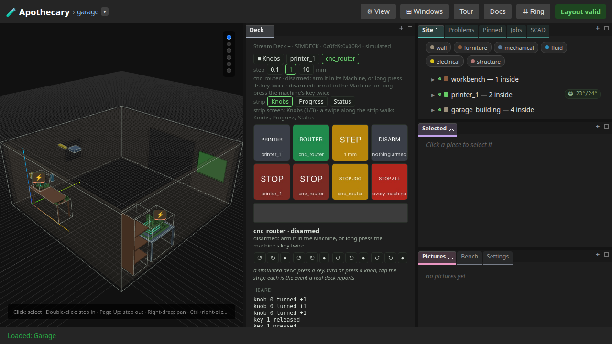
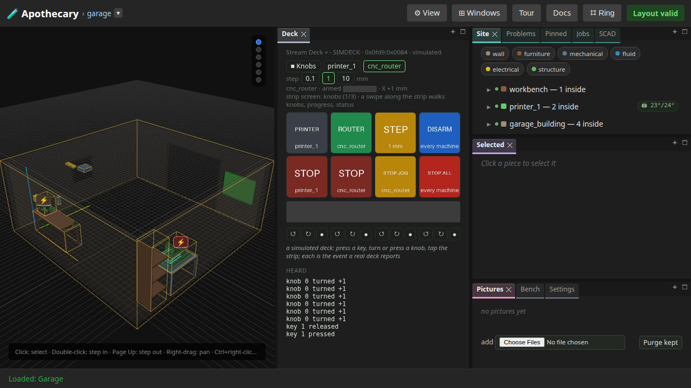
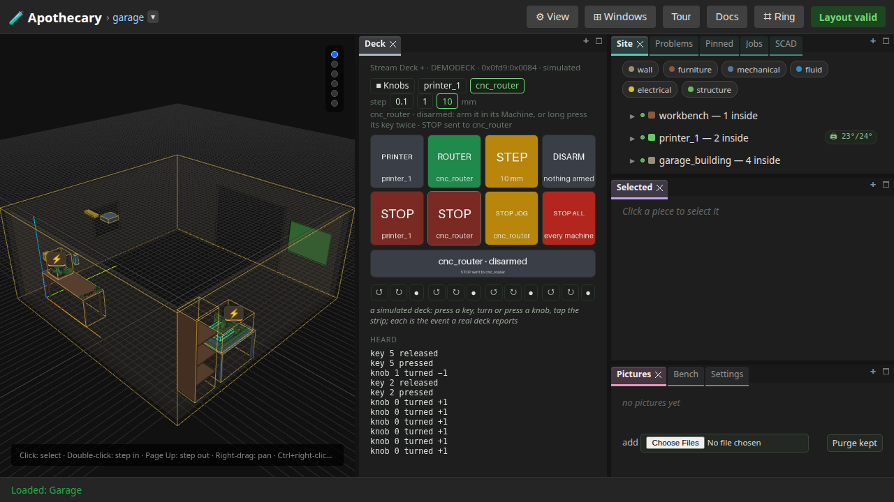
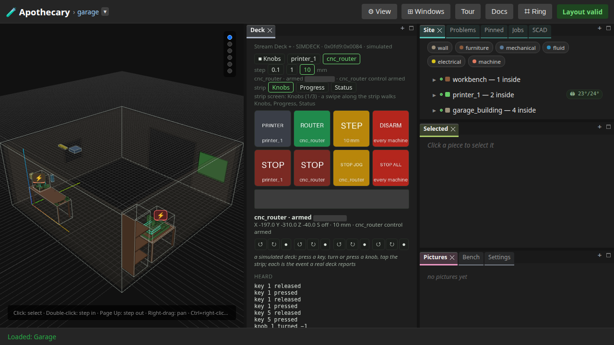
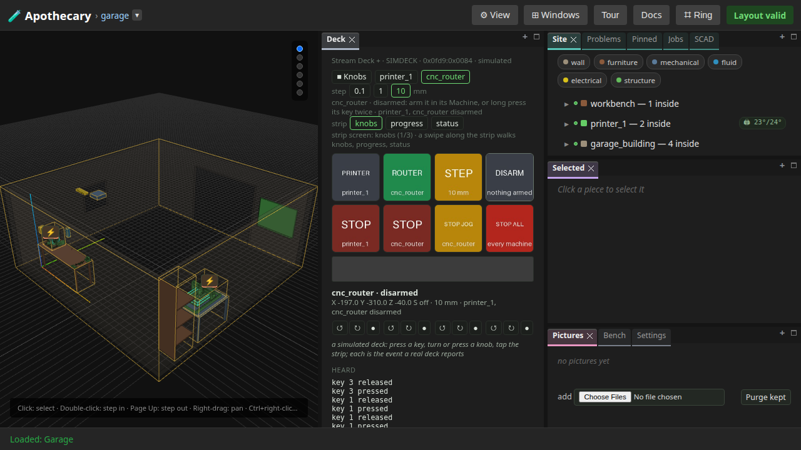
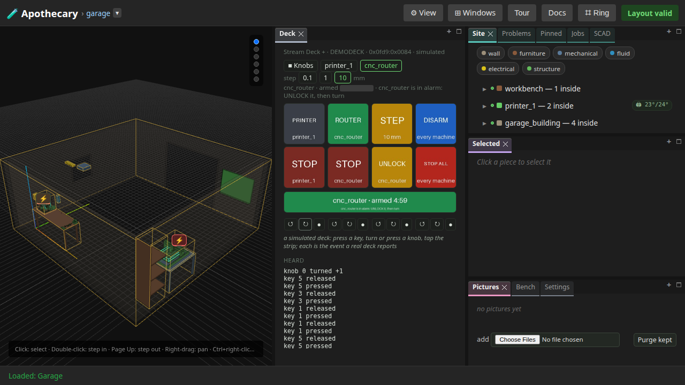
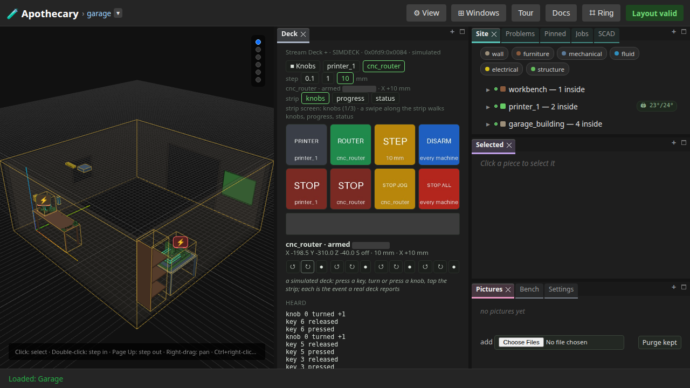

# 27 — The deck jogging the machines

Written by `tests/e2e/test_deck_jog.py`, and
rewritten by every run of the browser suite (`uv run apothecary test
all`), though not by the quicker `apothecary test run`.
Each numbered step is written as the run reaches it, after the assertions
before it pass, and what a step shows is what the run had then. The
opening, the notes under it and the list of what the page does not show
are the test's fixed words. Editing the page by hand is editing the output
of a program: the next run puts it back.

The Stream Deck +'s knobs jog the garage's machines, through the control path the page's own pad uses: control armed in the Machine window or by two long presses of a machine's key and let go by DISARM, the dialect's bounds, the machine's own stop, and UNLOCK after an alarm. The deck in this page is simulated and so are the router and the printer, so every step can be shown; a turn is the report a real deck sends.

**Runtime-bound.** It drives a real browser against a real server of its own, with one simulated deck whose layout is started, the simulated printer idle and the simulated router, each pinned to its node. No HID device or serial port is opened and nothing reaches the network.

Its pictures draw every part that OpenSCAD version 2021.01, the OpenSCAD its server runs, can build from an STL it built; a part it cannot build is drawn from an STL already there, or as its box.

---

## 1. The deck's layout, drawn by the server, with the router chosen

The top row's first two keys choose the machine, each a tile of what it is doing, the chosen one framed; the third is the screen's own, STEP on Jog, cycling the step. The bottom row holds the stops, one per machine and a bright red STOP ALL last, nearest the knobs. The strip names the deck's six screens along its top, Jog lit, and over each knob what it moves and where the tool is; under them, that its control is disarmed.



## 2. Disarmed, three turns of knob one move nothing

Control is armed in the Machine window, or by two long presses of the machine's key, and until then the strip says *disarmed* and nothing is sent. The router has not moved.



## 3. Armed, three turns jog X by 3 mm and the X key shows where the tool is

Each click is one `$J=G91 G21 X1 F1000`, GRBL's own jog line, sent through the same function as the page's pad; the X key reads the tool's new position from the next poll.



## 4. The router's stop key stops it and disarms it

The step key made the last click 10 mm. The router's own stop key, the bottom row's second, sends its soft reset whatever the latch says, and disarms the router: the spindle that was turning is off, and the next turn moves nothing until its control is armed again. The machine's own red button is faster, and stays the stop to reach for.



## 5. Two long presses of the router's key arm it, and DISARM is lit

The router's key, the top row's second, held a second, let go, and held a second again: the first says to press again within 5 s, the second arms the router's control for the latch's five minutes, as ⚙ Control in its Machine does. DISARM, the top row's last, is lit while any machine is armed.



## 6. DISARM lets go of every machine's control

The printer armed in its own Machine meanwhile, and DISARM pressed once: both machines' control is let go, the strip names them, and DISARM is grey with nothing armed. A turn moves nothing again.



## 7. After a stop mid-move the router is in alarm, and UNLOCK is lit

The router sent 100 mm along X slowly and the router's stop key pressed while it moved: the controller is in alarm, as a real one is after a reset mid-move, and UNLOCK lights in the middle of the bottom row. Armed again, a turn moves nothing, and the strip says to press UNLOCK.



## 8. UNLOCK sends $X, and the next turn moves the router

UNLOCK pressed: it sends the router's `$X` through the latch, the alarm is cleared and the key is STOP JOG again, and the next turn of knob one jogs X.



## What this page does not show

- **A real deck or machine.** What only they show -- the knobs' feel, a gantry that stops, which stop is faster -- is section J of the bench checklist (docs/bench-checklist.md). The machine's own red button is faster than the deck's stop key, and the docs say so.
- **The printer.** The same turns jog it as `G91`, `G1 .. F3000`, `G90`, and its fourth knob extrudes within the bound the firmware guide names; tests/test_firmware_deck_control.py holds both.
- **The strip's picture, armed.** The server draws the time an armed control has left into it, which differs on every run, so after the first step it is greyed in the pictures; the window writes its words under it, the time blanked there as everywhere.

Run it yourself:

```sh
uv run pytest tests/e2e/test_deck_jog.py --start-server   # this page alone
uv run apothecary test all                                # with every browser test
```
