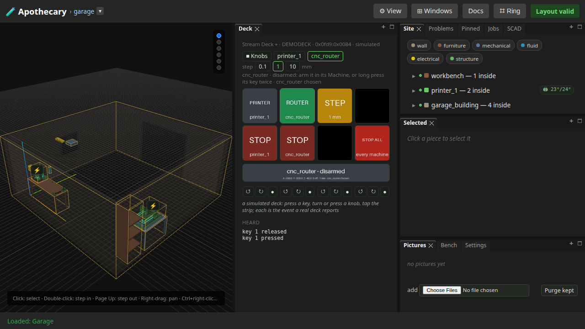
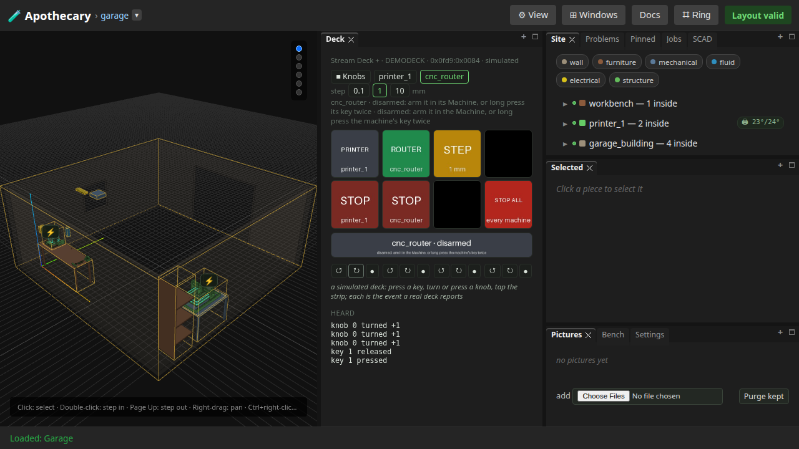
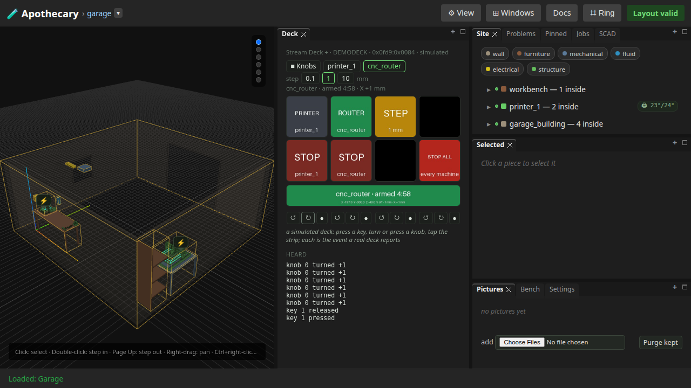
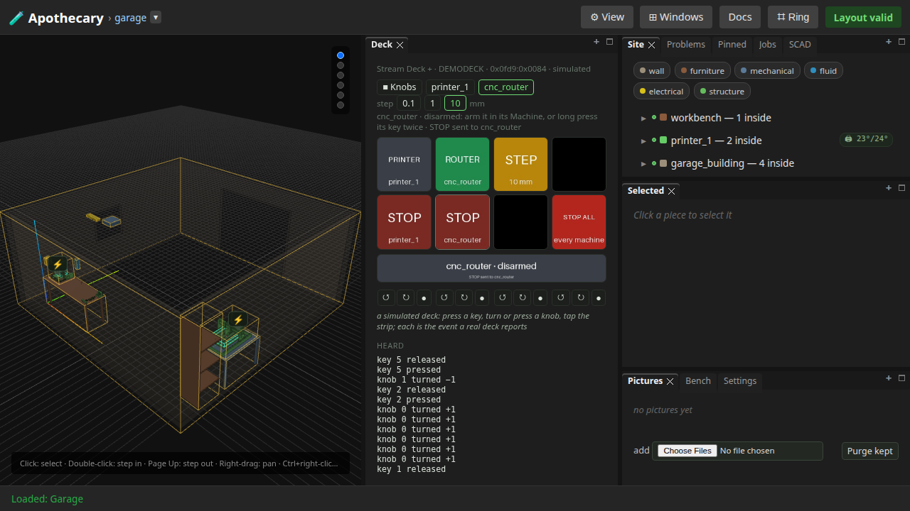

# 27 — The deck jogging the machines

Written by `tests/e2e/test_deck_jog.py`, and
rewritten by every run of the browser suite (`uv run apothecary test
all`), though not by the quicker `apothecary test run`.
Each numbered step is written as the run reaches it, after the assertions
before it pass, and what a step shows is what the run had then. The
opening, the notes under it and the list of what the page does not show
are the test's fixed words. Editing the page by hand is editing the output
of a program: the next run puts it back.

The Stream Deck +'s knobs jog the garage's machines, through the control path the page's own pad uses: control armed in the Machine window, the dialect's bounds, and the machine's own stop. The deck in this page is simulated and so are the router and the printer, so every step can be shown; a turn is the report a real deck sends.

**Runtime-bound.** It drives a real browser against a real server of its own, with one simulated deck whose layout is started, the simulated printer idle and the simulated router, each pinned to its node. No HID device or serial port is opened and nothing reaches the network.

Its pictures draw every part that OpenSCAD version 2021.01, the OpenSCAD its server runs, can build from an STL it built; a part it cannot build is drawn from an STL already there, or as its box.

---

## 1. The deck's layout, drawn by the server, with the router chosen

The top row's keys choose the machine and cycle the step; the bottom row holds the stops, one per machine and a bright red STOP ALL last, nearest the knobs. The strip says which machine, its position and that its control is disarmed.



## 2. Disarmed, three turns of knob one move nothing

Control is armed in the Machine window, or by two long presses of the machine's key, and until then the strip says *disarmed* and nothing is sent. The router has not moved.



## 3. Armed, three turns jog X by 3 mm and the X key shows where the tool is

Each click is one `$J=G91 G21 X1 F1000`, GRBL's own jog line, sent through the same function as the page's pad; the X key reads the tool's new position from the next poll.



## 4. The router's stop key stops it whatever the latch says

The step key made the last click 10 mm. The router's own stop key, the bottom row's second, then sent its soft reset with the latch disarmed: the spindle that was turning is off. The machine's own red button is faster, and stays the stop to reach for.



## What this page does not show

- **A real deck or machine.** What only they show -- the knobs' feel, a gantry that stops, which stop is faster -- is section J of the bench checklist (docs/bench-checklist.md). The machine's own red button is faster than the deck's stop key, and the docs say so.
- **The printer.** The same turns jog it as `G91`, `G1 .. F3000`, `G90`, and its fourth knob extrudes within the bound the firmware guide names; tests/test_firmware_deck_control.py holds both.

Run it yourself:

```sh
uv run pytest tests/e2e/test_deck_jog.py --start-server   # this page alone
uv run apothecary test all                                # with every browser test
```
