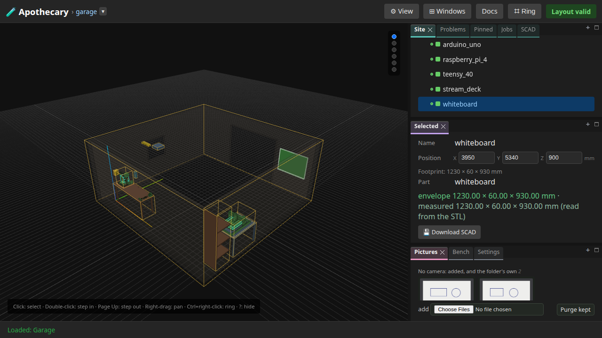
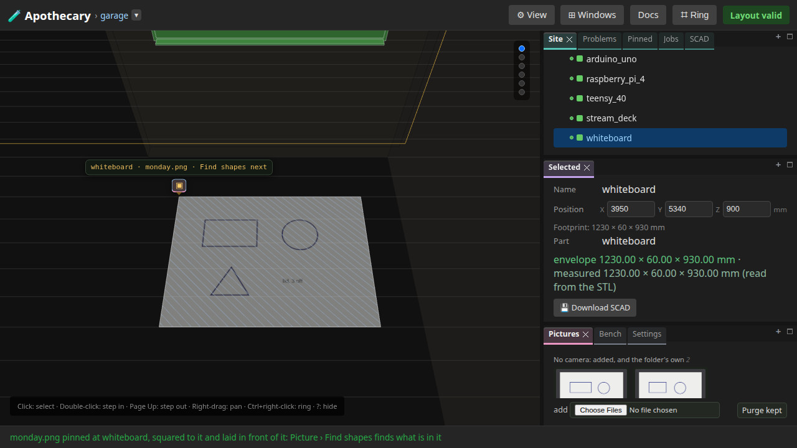
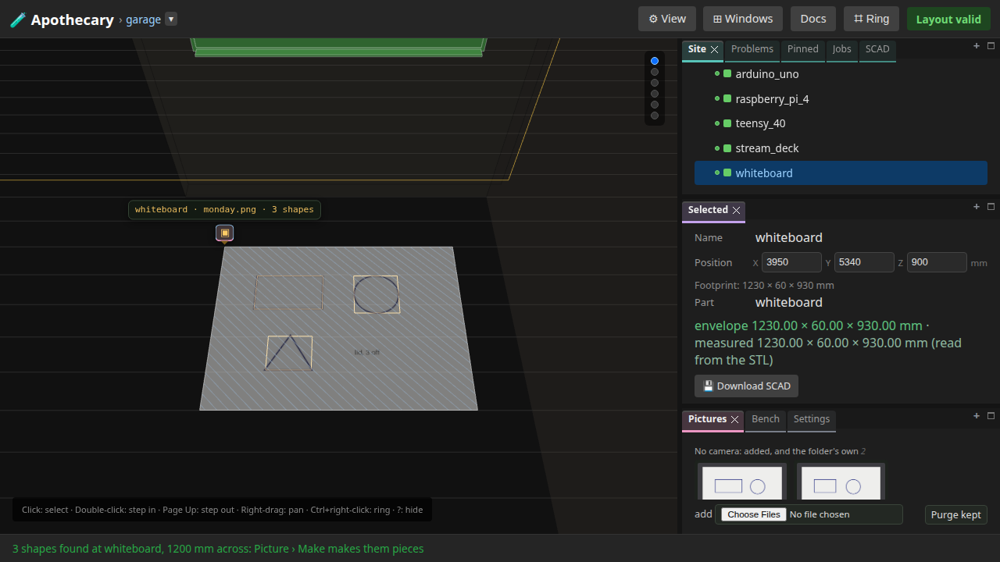
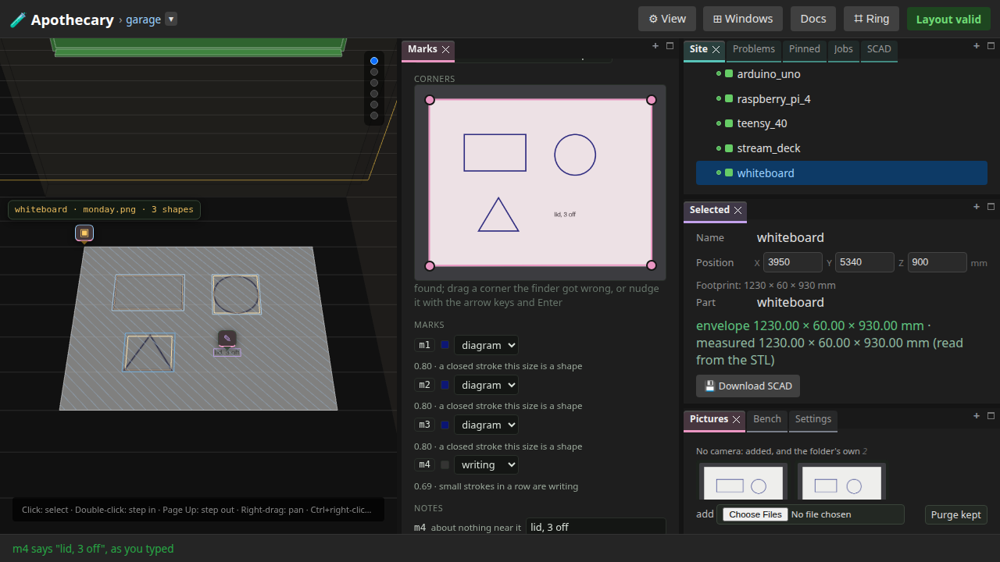
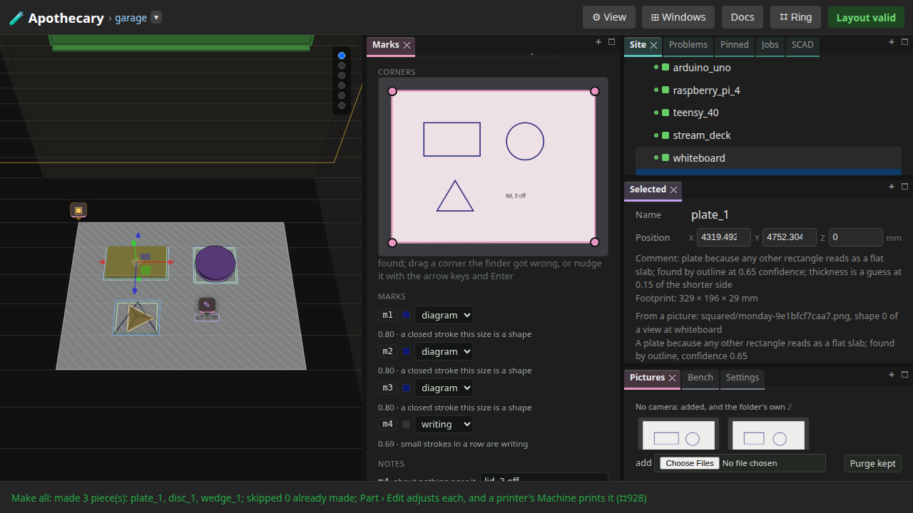
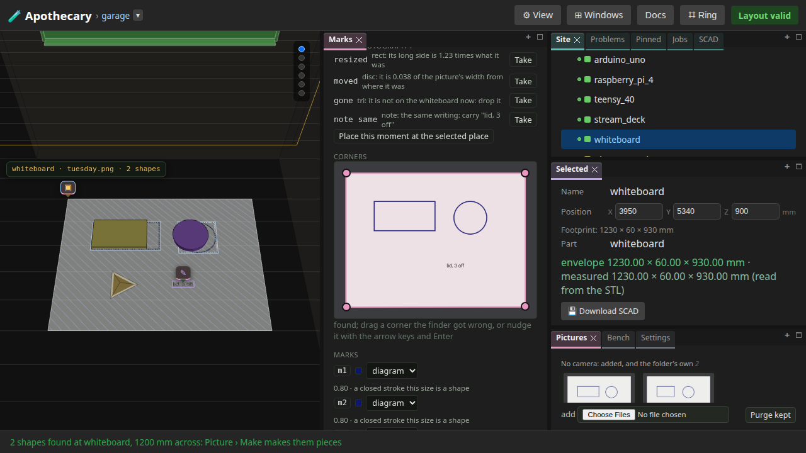
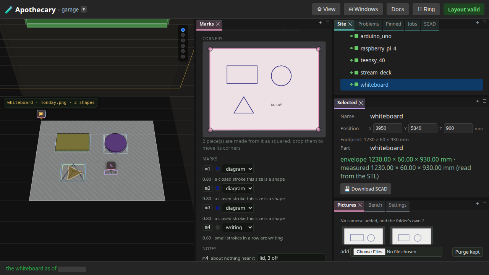
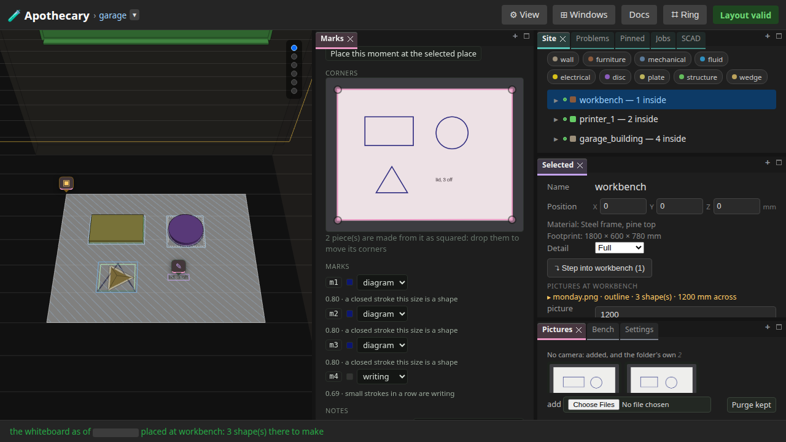

# 30 — A whiteboard, round twice through the page

Written by `tests/e2e/test_whiteboard_round_twice.py`, and
rewritten by every run of the browser suite (`uv run apothecary test
all`), though not by the quicker `apothecary test run`.
Each numbered step is written as the run reaches it, after the assertions
before it pass, and what a step shows is what the run had then. The
opening, the notes under it and the list of what the page does not show
are the test's fixed words. Editing the page by hand is editing the output
of a program: the next run puts it back.

A drawing on the garage's whiteboard to pieces on its floor, and round again when the drawing changes, as a person goes through it in the page: a photograph pinned at the whiteboard from its ring, squared to it and laid in front of it; its shapes found, its writing typed in Marks and its shapes made; then a second photograph of the changed drawing, the whiteboard's history, a change taken, and a moment of it placed on the bench. [docs/pictures.md](../docs/pictures.md#a-whiteboards-history) is the reference, and [page 29](29-a-whiteboard-round-twice.md) goes round by the commands.

**Runtime-bound.** It drives a real browser against a real server of its own. The two photographs are drawn to order, a whiteboard on a wall square on, and lie in the server's picture folder. It needs no network.

Its pictures draw every part that OpenSCAD version 2021.01, the OpenSCAD its server runs, can build from an STL it built; a part it cannot build is drawn from an STL already there, or as its box.

---

## 1. The whiteboard, on the garage's south wall

The garage's whiteboard hangs on its south wall beside the door, facing the room: a part, its width and height its writing surface's. Selected, its ring holds Picture, as any place a picture can lie does.



## 2. Picture › Folder pins a photograph: squared, sized and laid in front

The whiteboard's ring, Picture › Folder › monday: the photograph's corners are found and it is redrawn square on, as wide as the whiteboard's surface with no width typed, and laid flat on the floor in front of it, its top towards the wall.



## 3. Find shapes › outline outlines each closed stroke

Picture › Find shapes › outline: the plate, the disc and the wedge, outlined where they lie in front of the whiteboard. The writing is not a shape.



## 4. Marks: each mark sorted, and the writing typed

⊞ Windows › Marks lists the photograph's marks, each a diagram's or writing, and its one note; what it says is typed and said with Enter. Over the picture in the world, each mark's box in its kind's colour, and the note's ✎ where it is written.



## 5. Make all stands each shape up as a piece, at full size

Picture › Make › Make all: the plate, the disc and the wedge stand on the floor in front of the whiteboard where they were drawn, as big as they are drawn on it.



## 6. Tuesday's photograph, and what changed since Monday

The drawing changed: the plate wider, the disc moved, the wedge rubbed out. Pinned and searched as the first was, it is the whiteboard now, and Marks shows its history under When -- a tick for each photograph, word and piece -- and what changed since Monday, a row each. Nothing has changed yet: Monday's pieces stand.



```
resized rect: its long side is 1.23 times what it was
moved disc: it is 0.038 of the picture's width from where it was
gone tri: it is not on the whiteboard now: drop it
note same note: the same writing: carry "lid, 3 off"
```

## 7. Take on one row changes that piece and no other

The disc's row taken: its piece is dropped and made again from Tuesday's photograph, where the disc is now. The plate and the wedge, their rows left, stand as Monday made them.

```
taken: disc_1 made; disc_1 dropped
```

## 8. Earlier, the whiteboard as it stood on Monday

The canvas ring's Panels › Pictures › Marks › Earlier steps the slider to the event before, twice: to Tuesday's photograph, then to Monday's pieces being made. Monday's photograph is drawn in front of the whiteboard again, its note's words as they were then.



## 9. A moment placed on the bench

The bench selected in the world, Place: Monday's drawing is pinned on the bench, as wide as it was on the whiteboard and searched by the same finder, with its words, its shapes there to make beside the pieces.



## What this page does not show

- **A real photograph.** Both are drawn to order; a whiteboard seen from one side is squared in tests/test_whiteboard.py, and its corners moved in tests/e2e/test_marks_window.py.
- **Anything kept across a restart.** The photographs' views, their words and the pieces made are kept in the server's memory.
- **A note sent out.** Neither looksatwords nor qmcp is reached here.
- **What changes on every run.** The moments on the status line and under When are blanked in the pictures.

Run it yourself:

```sh
uv run pytest tests/e2e/test_whiteboard_round_twice.py --start-server   # this page alone
uv run apothecary test all                                              # with every browser test
```
