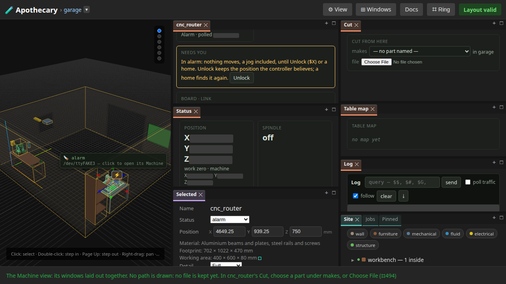
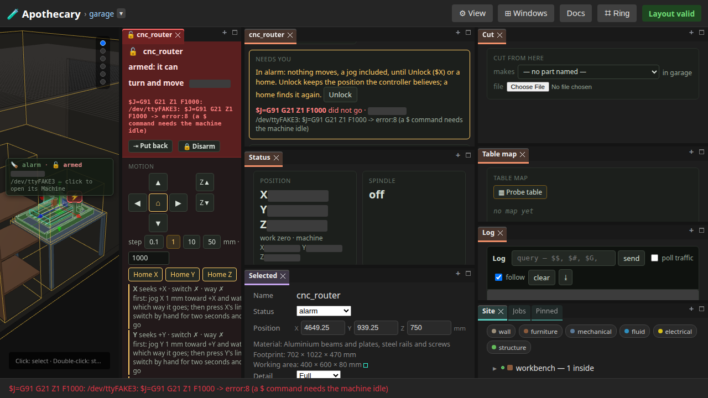
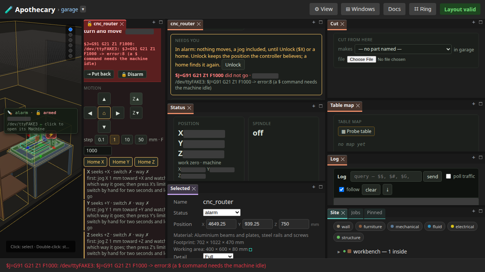
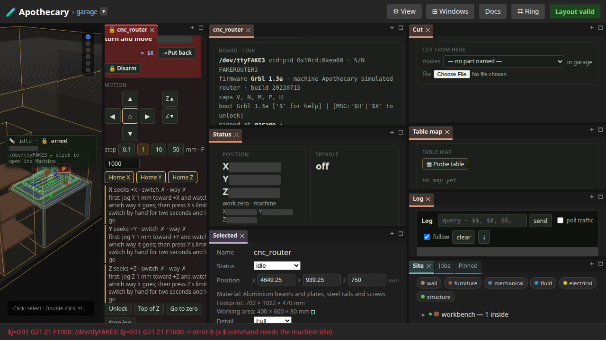
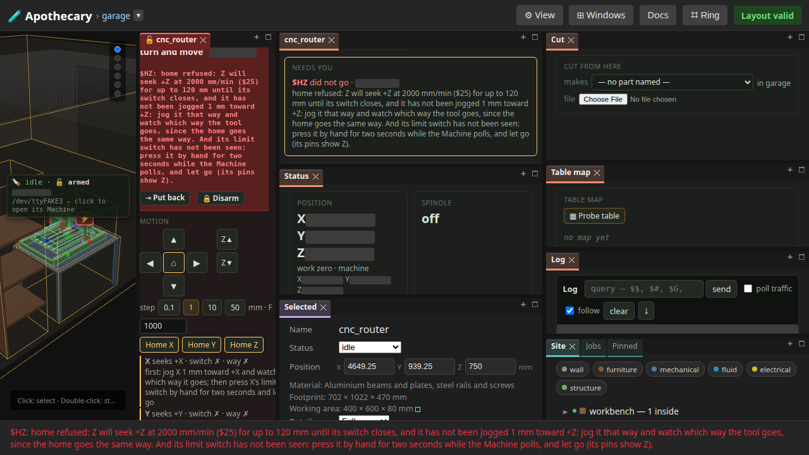
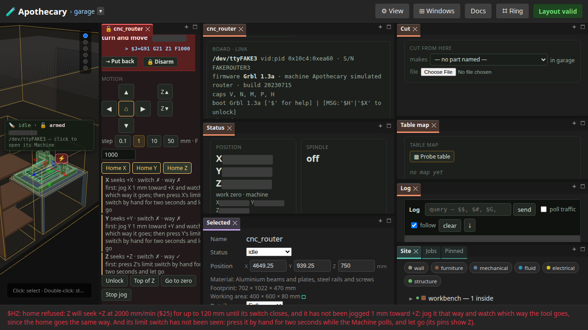
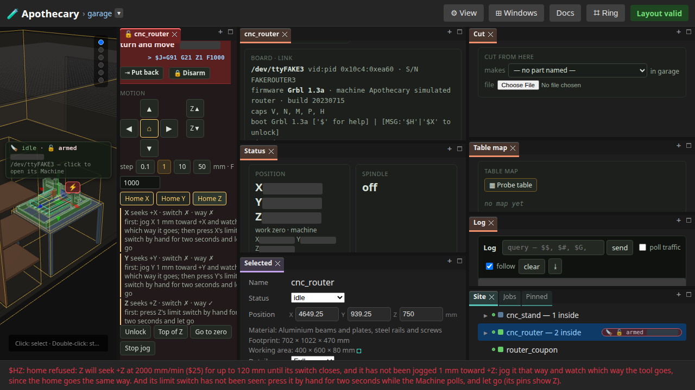

# 31 — What the router needs

Written by `tests/e2e/test_router_needs.py`, and
rewritten by every run of the browser suite (`uv run apothecary test
all`), though not by the quicker `apothecary test run`.
Each numbered step is written as the run reaches it, after the assertions
before it pass, and what a step shows is what the run had then. The
opening, the notes under it and the list of what the page does not show
are the test's fixed words. Editing the page by hand is editing the output
of a program: the next run puts it back.

What stops a person at the router, read in its Machine and not in its log: a controller in alarm says what clears it before anything moves, a line that did not go stays in the **Needs you** card until one goes, each axis's home says beside its button which way it will seek and what the port must show first, and a home not proved does not go. [docs/cnc.md](../docs/cnc.md#what-the-state-asks-of-a-person) is the reference; [page 24](24-a-cut-from-the-card.md) is a cut from the same Machine once nothing is asked.

**Runtime-bound.** It drives a real browser against a real server of its own. The router is the simulated GRBL controller on a fake port, pinned to cnc_router's controller, started in alarm and held to the homing proof as the real one is. Nothing opens a real port.

Its pictures draw every part that OpenSCAD version 2021.01, the OpenSCAD its server runs, can build from an STL it built; a part it cannot build is drawn from an STL already there, or as its box.

---

## 1. In alarm, Needs you says what clears it

cnc_router selected in Site, Open in its Device line, then the canvas ring's Panels › Windows › Machine view. The controller came up in alarm, and before anything is asked the Machine's **Needs you** card says so, and that nothing moves until Unlock (`$X`) or a home.



## 2. A jog in alarm did not go, and the card keeps why

⚙ Control armed, the pad's step at 1 mm and Z+ pressed. The controller refused the jog, and the card keeps the line that did not go with the controller's own error beside it until a line goes.



## 3. Each axis's home, beside its button: not proved, and what to do first

Under the pad, each axis says which way its home will seek, whether its switch has been seen and whether the axis has been jogged that way, and what to do first. A Home not yet proved is outlined.



## 4. Unlock in the card: nothing is asked any more

The card's own Unlock sends `$X`. The alarm is cleared, the line that went clears the one that did not, and the card is gone: nothing is asked of a person now.



## 5. A home not proved does not go, and the card says why

Home Z pressed before Z has shown its switch or its way. Nothing is sent to the controller and the router has not moved; the card says `$HZ` did not go, in the controller's own figures for where Z will seek and how fast.



## 6. Jogged the way it homes, Z has shown its way

Z+ pressed: the jog went, so the card is gone, and Z's line says its way is shown. Its switch is not, so its Home is still outlined; a switch is pressed by hand at the bench.



## 7. Armed, the router says so on its badge and its row in Site

Control was armed in the Machine at the second step, and the router's badge in the world and its row in Site say so, with the time its control has left; the deck's two long presses arm it the same way.



## What this page does not show

- **A limit switch pressed.** The simulated router has no switch for a hand to press, so no home here is proved; pressing each is section I of [docs/bench-checklist.md](../docs/bench-checklist.md).
- **What changes on every run.** Moments, the time an armed latch has left, the tool's position and the log are blanked in the pictures.

Run it yourself:

```sh
uv run pytest tests/e2e/test_router_needs.py --start-server   # this page alone
uv run apothecary test all                                    # with every browser test
```
