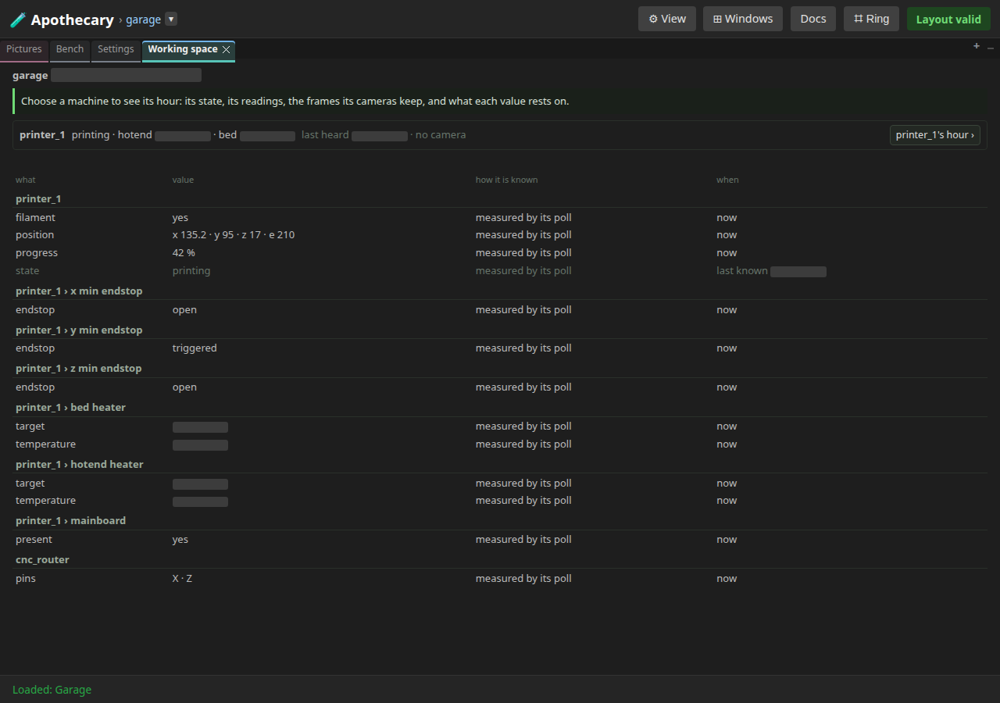
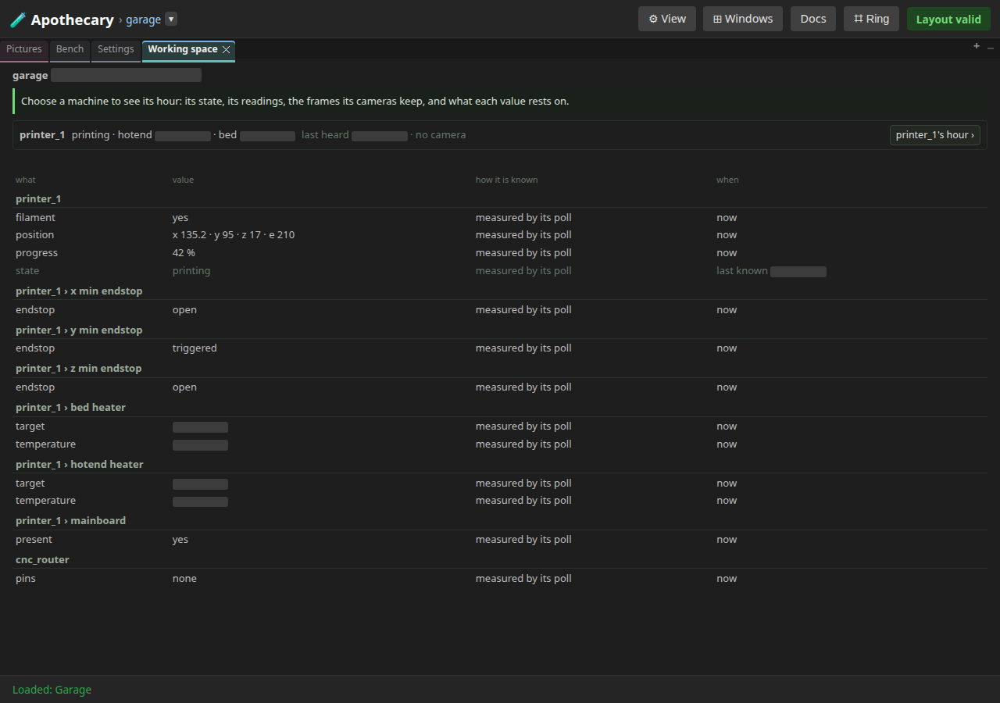

# 32 — A quiet board, and a router's pins

Written by `tests/e2e/test_working_space.py`, and
rewritten by every run of the browser suite (`uv run apothecary test
all`), though not by the quicker `apothecary test run`.
Each numbered step is written as the run reaches it, after the assertions
before it pass, and what a step shows is what the run had then. The
opening, the notes under it and the list of what the page does not show
are the test's fixed words. Editing the page by hand is editing the output
of a program: the next run puts it back.

Two values as the Working space's table reads them from the site's evidence. A board that has not answered lately is last heard at its last answer, and each of its values is last known then, not at the poll that last changed it: every answer says a value again. A value that is a list -- the pins a router's poll says are on, its `Pn:` -- reads as its items, or none. [Page 18](18-the-working-space.md) is the window from each of its doors; [docs/working-space.md](../docs/working-space.md#the-window) is the reference.

**Runtime-bound.** It drives a real browser against a real server of its own, page 18's: the simulated Ender, printing and answering every poll, and no router. So the site's document, as the page reads it, is given what neither can say: a printer_1 whose board last answered ten minutes ago and whose state last changed two hours ago, and a cnc_router whose pins are X and Z, then none. What the window makes of that document is its own. It needs no network and opens no serial port.

Its pictures draw every part that OpenSCAD version 2021.01, the OpenSCAD its server runs, can build from an STL it built; a part it cannot build is drawn from an STL already there, or as its box.

---

## 1. printer_1 not heard for ten minutes: last heard, and its state last known, then

⊞ Windows › Working space, maximised by a double-click on its tab. printer_1's board last answered ten minutes ago: its row says last heard then, and its state's row under it says last known at that same moment, not two hours ago when a poll last changed the state, since each answer says the state again. Its other rows were heard now.



```
printer_1
printing · hotend … °C · bed … °C
last heard … · no camera
printer_1's hour ›
state	printing	measured by its poll	last known …
```

## 2. A router's pins read as their items

Under cnc_router, at the foot of the table in the picture above, its pins row: the pins its poll's `Pn:` says are on, X and Z, read as their items, as its Machine's Status card reads them.

```
pins	X · Z	measured by its poll	now
```

## 3. No pin on reads as none

The window asks for the site's document again every five seconds, and the next says no pin is on: the row reads none, as the Status card does, and not a blank cell.



```
pins	none	measured by its poll	now
```

## What this page does not show

- **A board going quiet at the bench.** The simulated printer answers every poll; a board unplugged is the bench's ([docs/bench-checklist.md](../docs/bench-checklist.md)).
- **A switch held.** The pins a real router reports are its switches and its probe; pressing each is section I of [docs/bench-checklist.md](../docs/bench-checklist.md).
- **What changes on every run.** The moments and a temperature to its tenth are blanked in the pictures and left out of the words.

Run it yourself:

```sh
uv run pytest tests/e2e/test_working_space.py --start-server   # this page alone
uv run apothecary test all                                     # with every browser test
```
