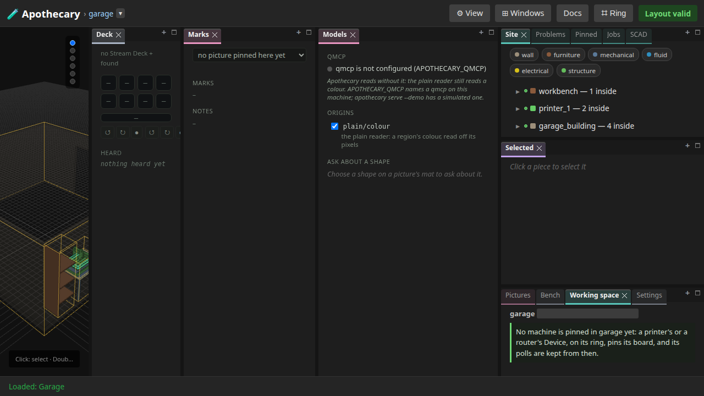
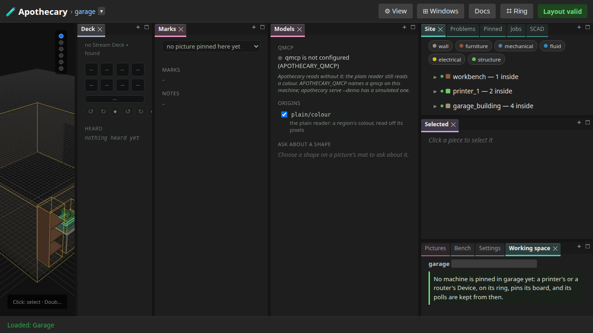

# 33 — Windows kept over a reload

Written by `tests/e2e/test_windows_over_a_reload.py`, and
rewritten by every run of the browser suite (`uv run apothecary test
all`), though not by the quicker `apothecary test run`.
Each numbered step is written as the run reaches it, after the assertions
before it pass, and what a step shows is what the run had then. The
opening, the notes under it and the list of what the page does not show
are the test's fixed words. Editing the page by hand is editing the output
of a program: the next run puts it back.

The windows a person opens are the page's layout from then: a reload lays them out again where they were, and the world keeps the room it had. Four windows the page's own layout leaves closed -- Models, Marks, the Working space and the Deck -- are opened from ⊞ Windows and the page is reloaded. [docs/viewer.md](../docs/viewer.md#the-windows) is the reference.

**Runtime-bound.** It drives a real browser against a real server of its own, on the garage as the code has it. The layout is remembered in the browser, as a person's is; nothing is kept on the server.

Its pictures draw every part that OpenSCAD version 2021.01, the OpenSCAD its server runs, can build from an STL it built; a part it cannot build is drawn from an STL already there, or as its box.

---

## 1. Models, Marks, the Working space and the Deck, opened from ⊞ Windows

The header's ⊞ Windows, four times: Models, Marks and the Deck each a column beside the world, the last opened nearest it, and the Working space a tab of the stack under Selected, beside Pictures, Bench and Settings, each in front as it opens. The browser remembers the layout a moment after each change.



## 2. Reloaded, each is open where it was, and the world as wide

The page reloaded: the four are open again, each in the stack it was in, and the world has the room it had. No window of the page is one a reload closes. The Working space's tab comes back last in its stack, where the remembered layout holds it; before the reload the tab row drew it ahead of Settings.



## What this page does not show

- **Another browser.** The layout is this browser's own: another browser, or this one with its site data cleared, opens the page's own layout.
- **What changes on every run.** Moments, how many observations the Working space's hour holds and a temperature are blanked in the pictures.

Run it yourself:

```sh
uv run pytest tests/e2e/test_windows_over_a_reload.py --start-server   # this page alone
uv run apothecary test all                                             # with every browser test
```
