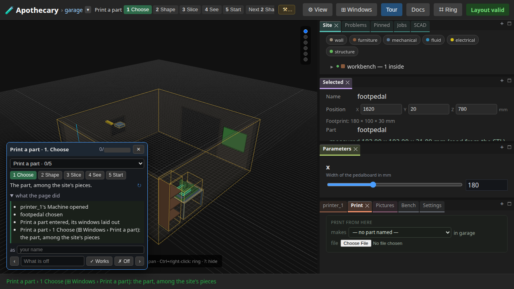
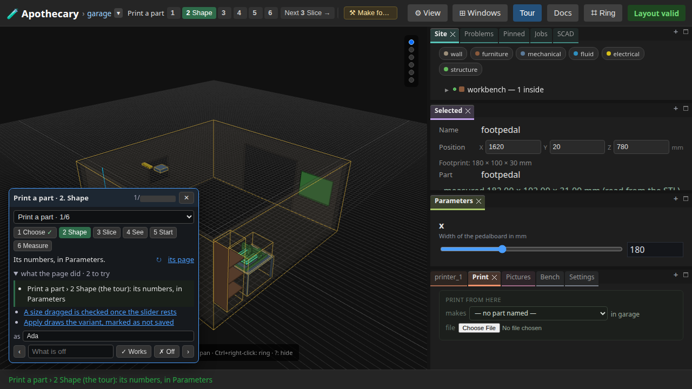
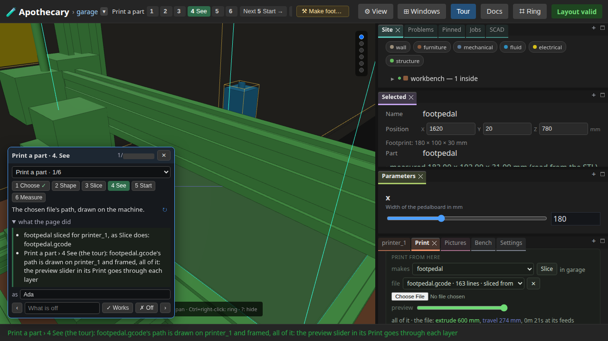
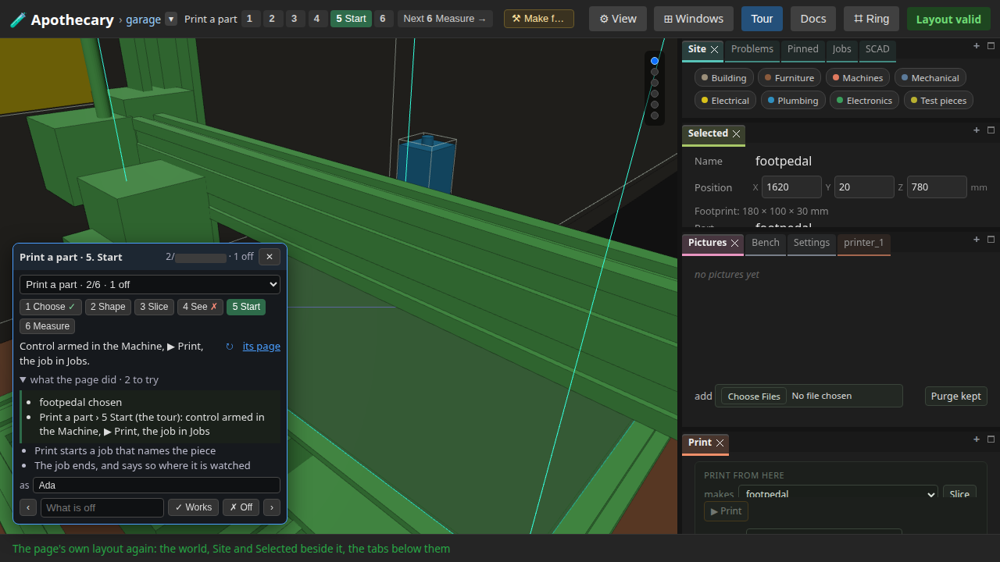
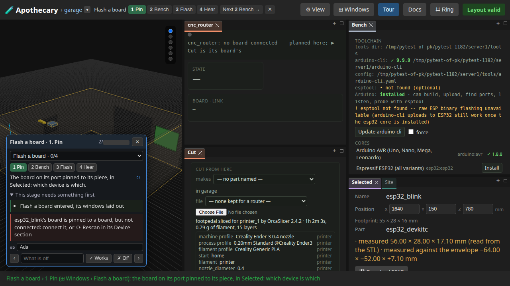

# 34 — The tour

Written by `tests/e2e/test_tour.py`, and
rewritten by every run of the browser suite (`uv run apothecary test
all`), though not by the quicker `apothecary test run`.
Each numbered step is written as the run reaches it, after the assertions
before it pass, and what a step shows is what the run had then. The
opening, the notes under it and the list of what the page does not show
are the test's fixed words. Editing the page by hand is editing the output
of a program: the next run puts it back.

The page's journeys a stage at a time, in a box over the page: going to a stage takes the page there, a person explores it where it stands, and one word is kept on the stage -- it works, or it is off, with what is off. The box is the one place a journey is chosen and stepped, and says nothing of its own: a stage's words are its step's. [docs/tour.md](../docs/tour.md) is the reference.

**Runtime-bound.** It drives a real browser against a real server of its own, its printer a simulation pinned to printer_1's mainboard, its router's controller not pinned, and its slicer a script that answers as OrcaSlicer's command line does. Its state folder is this test's, so the feedback it keeps is its own.

Its pictures draw every part that OpenSCAD version 2021.01, the OpenSCAD its server runs, can build from an STL it built; a part it cannot build is drawn from an STL already there, or as its box.

---

## 1. Tour, in the header, opens a box over the page on the first stage

Tour in the header: a box above the windows, on the first stage with no word on this build, which is where the journeys begin: Design a part, at Choose. Its head names the stage and how many have a word on them, its drop-down holds the journeys in their order, and under it are this journey's stages. A word was said of this stage while the server ran an earlier commit: it is shown, as that, and the stage waits for a word again. Nothing in the page beneath has moved: ↻ beside the stage's words takes the page there.


```
✓ Works -- said by Grace …, of an earlier build (0000000): this stage waits for a word again
```

## 2. A journey chosen takes the page to its first stage

Print a part, chosen in the box's drop-down. The page is taken to its first stage: printer_1's Machine opened and the footpedal chosen, as a person would do each, and the journey entered at Choose, its windows laid out. The box keeps what the page did, then what the page said, folded under one line, opened here. The stage is there to explore.



```
printer_1's Machine opened
footpedal chosen
footpedal named under makes in printer_1's Print window
Print a part entered, its windows laid out
Print a part › 1 Choose (the tour): a part, among the site's pieces
```

## 3. ✓ Works keeps the word and takes the page to the next stage, with what to try

✓ Works is kept under a name: with none given the box asks for it, once, and this browser keeps it. Named, the server keeps the word, and the box goes to Shape and takes the page there, Parameters in front. Folded under one line with what the page did is what there is to try on this stage, each a link to the step on its walkthrough page, where its picture is.



```
A size dragged is checked once the slider rests
Apply draws the variant, marked as not saved
```

## 4. See is reached from nothing: the piece sliced, its path drawn

See, chosen among the journey's stages: the stage draws the chosen file's path, and no file is kept, so the page does the stage before it -- the footpedal sliced for printer_1, as Slice does -- and the path is drawn on the machine and framed.



```
footpedal chosen
footpedal sliced for printer_1, as Slice does: footpedal.gcode
Print a part › 4 See (the tour): footpedal.gcode's path is drawn on printer_1 and framed, all of it: the preview slider in its Print goes through each layer
```

## 5. ✗ Off keeps what is off, and only with it

✗ Off with the field empty is refused, the box saying what it needs and staying on the stage; with what is off typed, it is kept, and the box goes to Print and takes the page there, the Print window, where ▶ Print is, and Jobs in front. Nothing is armed.

```
Print a part › 5 Print (the tour): control armed in the Machine, ▶ Print, the job in Jobs
```

## 6. A view laid out moves the windows, and not the box

⚙ View › Reset layout: every window goes where the page's own layout has it, and the box is where it was, open on the stage it showed. The journey's stages wear what was said of each.



```
3/… · 1 earlier · 1 off
```

## 7. Panels › Windows › Tour: its cells are its buttons

The canvas ring's Panels › Windows › Tour: Back goes to See, the page taken there again, where the box shows what was said of it; Works says otherwise now, and the latest word is the stage's. Off, Next, Take me here, Its page and Who, the name's field, are cells there too, and Tour opens and closes the box.

```
Print a part · 5. Print
```

## 8. Reloaded, it is open where it was

The page reloaded: the box is open again on the stage it showed, where it was left; this browser keeps where it was, the server what was said.

```
Print a part · 5. Print
```

## 9. A machine whose board is not connected is taken as the site plans it

Cut a part, chosen: its stages are on the router's Machine, and this server's router is not connected. Its Machine opens all the same, as its badge opens it: what it makes is planned there, its toolpath written and drawn, and ▶ Cut is its board's once it is connected.

```
cnc_router's Machine opened, not connected: what it makes is planned there
router_coupon chosen
router_coupon named under makes in cnc_router's Cut window
Cut a part entered, its windows laid out
Cut a part › 1 Choose (the tour): a part that says how it is cut, among the site's pieces
```

## 10. A stage that needs what only a person brings says what it needs

Flash a board, chosen: its first stage is the board on its port pinned to its piece, and no board of esp32_blink's is connected. Which device is which is a person's to say, so nothing is pinned for them: the page leaves the rest, enters the stage all the same, so Selected is in front, where a board is pinned, and the box opens on what the stage needs. ↻ takes the page the rest of the way once it is there.



```
esp32_blink's board is pinned to a board, but not connected: connect it, or ⟳ Rescan in its Device section
```

## 11. Every word kept is given back, oldest first

`GET /tour/feedback`: every word said, none rewritten, each with its stage, who said it, the moment, and the commit the server ran. The latest for a stage is its feedback; the rest is there for whoever reviews what was found.

```
design/choose	works	Grace
make/choose	works	Ada
make/see	off	Ada	the job's row is cut off at the window's foot
make/see	works	Ada
```

## 12. The box closed leaves the journey

The box's ✕, or Tour in the header pressed again: the journey is left. Its windows stay where they are, the address names no journey, and the status line says so. Tour opens the box again on the stage it showed, and the page is on no journey until ↻ or a stage takes it to one.

```
Left Flash a board: its windows stay where they are
```

## 13. An address that names a journey and a stage opens the box on it

`?journey=make&step=shape` at the end of the page's address, as a link or a bookmark holds it: the box opens on that stage and the page is taken there as a reload takes it, so no job is started on the way and the windows stand as this browser has them.

```
Print a part · 2. Shape
```

## What this page does not show

- **A stage armed or started.** Print's stage brings the Print window and Jobs forward; arming control and starting a print are a person's.
- **What changes on every run.** Moments are blanked in the pictures and left out of the words, and so is how many stages the tour holds, which any stage added to a journey changes.

Run it yourself:

```sh
uv run pytest tests/e2e/test_tour.py --start-server   # this page alone
uv run apothecary test all                            # with every browser test
```
