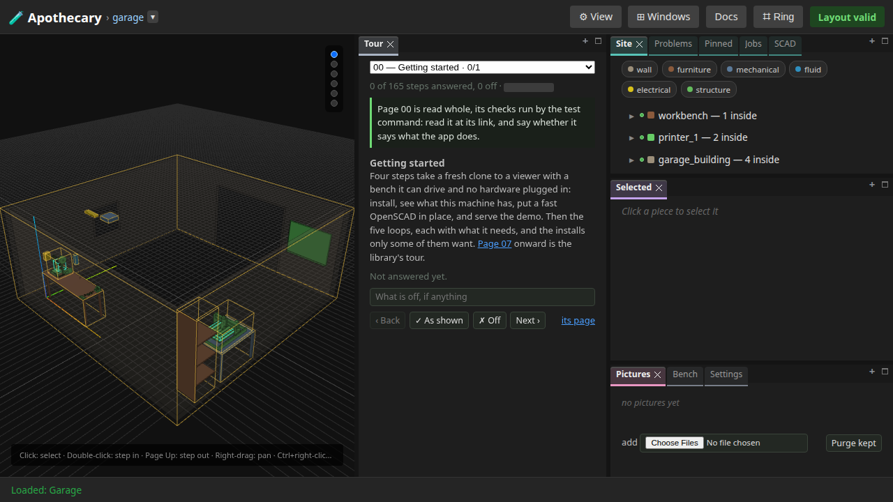
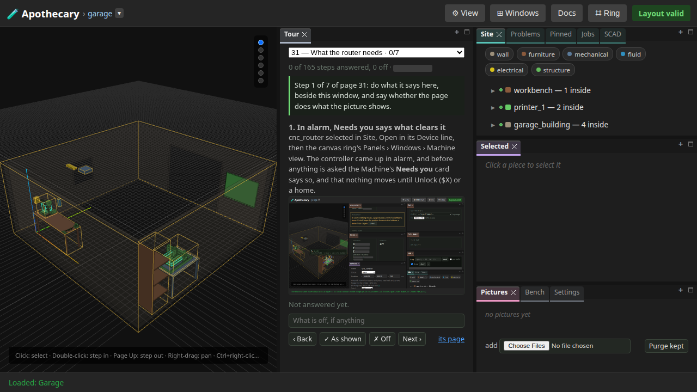
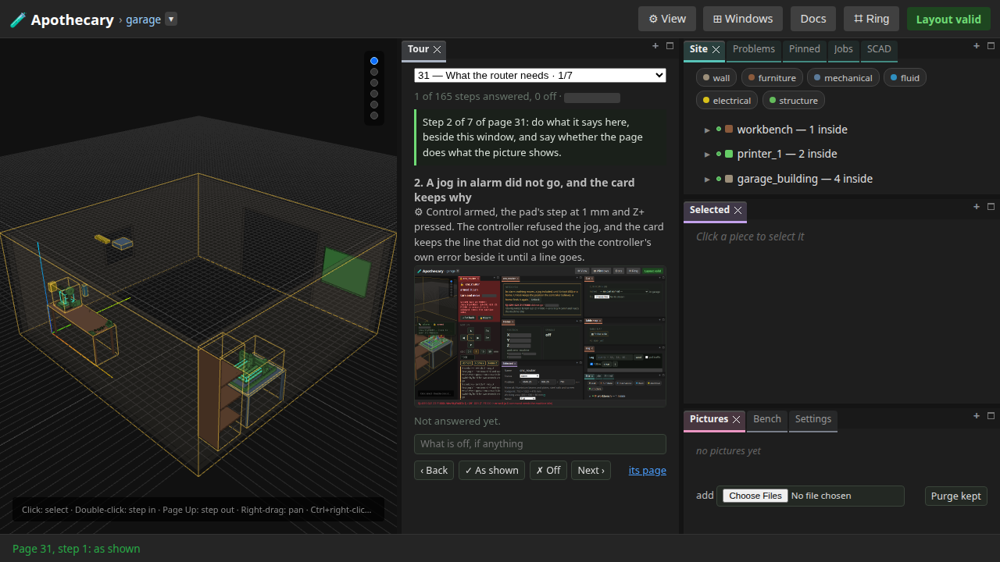
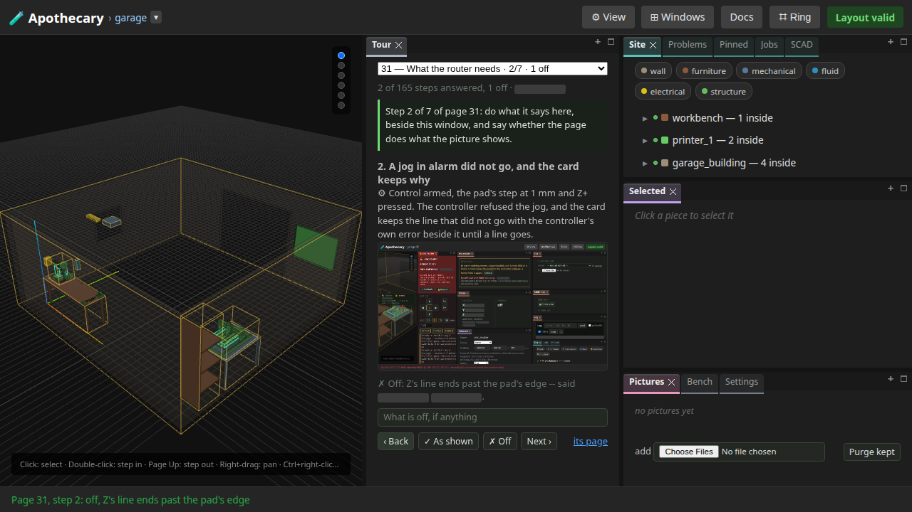

# 34 — The tour

Written by `tests/e2e/test_tour.py`, and
rewritten by every run of the browser suite (`uv run apothecary test
all`), though not by the quicker `apothecary test run`.
Each numbered step is written as the run reaches it, after the assertions
before it pass, and what a step shows is what the run had then. The
opening, the notes under it and the list of what the page does not show
are the test's fixed words. Editing the page by hand is editing the output
of a program: the next run puts it back.

The walkthrough a step at a time, beside the live page: each step as the test that writes its page recorded it -- its heading, its words, the picture taken after its assertions, what it showed -- and a person's word on it, kept with the commit the server ran. The words say what to do in the page; the picture is what the page did when the test did it. A page no test writes is read whole at its link. [docs/tour.md](../docs/tour.md) is the reference.

**Runtime-bound.** It drives a real browser against a real server of its own, whose state folder is this test's, so the words it keeps are its own and `apothecary tour` reads them from there. The steps it shows are the walkthrough's pages as committed.

Its pictures draw every part that OpenSCAD version 2021.01, the OpenSCAD its server runs, can build from an STL it built; a part it cannot build is drawn from an STL already there, or as its box.

---

## 1. ⊞ Windows › Tour opens beside the world, on the first step not answered

The header's ⊞ Windows, Tour under Tools: the walkthrough beside the world, nothing answered yet, so on its first page. Page 00 is written by hand and its checks run with the tests, so it is read whole: the window gives its first words and its page's link, and asks whether it says what the app does.



```
Page 00 is read whole, its checks run by the test command: read it at its link, and say whether it says what the app does.
```

## 2. Page 31 chosen: its first step, as its test recorded it

The window's drop-down, page 31: its first step's heading and words, which say what a person does in the page beside it, and the picture its test took after the step's assertions passed. A click on the picture opens it whole in a tab of its own; its page is the link at the foot.



```
Step 1 of 7 of page 31: do what it says here, beside this window, and say whether the page does what the picture shows.
```

## 3. ✓ As shown keeps the word and goes to the next step

✓ As shown: the server keeps it, with the moment and the commit it runs, and the window goes to step 2. The drop-down counts the page's steps answered, and the line under it the whole tour's.



```
Page 31, step 1: as shown
```

## 4. ✗ Off keeps what is off, and only with it

✗ Off with the box empty is refused, the window saying what it needs and staying on the step; with what is off typed in the box, it is kept, and the window goes on.

```
Page 31, step 2: off, Z's line ends past the pad's edge
```

## 5. ‹ Back shows the word kept on the step

‹ Back to step 2: under its picture, what was said of it, when, and against which commit; the drop-down says the page has one step off.



```
✗ Off: Z's line ends past the pad's edge -- said … against ….
```

## 6. Panels › Windows › Tour: its cells are its buttons

The canvas ring's Panels › Windows › Tour: Next goes to step 3, and As shown keeps a word on it and goes to step 4. Back, Off, Its page and Its picture are cells there too.

```
Step 4 of 7 of page 31: do what it says here, beside this window, and say whether the page does what the picture shows.
```

## 7. Reloaded, it is open where it was

The page reloaded: the Tour is open again beside the world, as any window is, on the step it showed; this browser keeps where it was, the server what was said.

```
Step 4 of 7 of page 31: do what it says here, beside this window, and say whether the page does what the picture shows.
```

## 8. `apothecary tour` reads back what was said

At the command line, `apothecary tour --page 31`: each step answered, with what is off, and the commit and moment each was said against; `--off` lists only what is off, across every page.

```
31 What the router needs: 2 as shown, 1 off, 4 not yet
  ✓ 1. In alarm, Needs you says what clears it (…)
  ✗ 2. A jog in alarm did not go, and the card keeps why: Z's line ends past the pad's edge (…)
  ✓ 3. Each axis's home, beside its button: not proved, and what to do first (…)
```

## What this page does not show

- **Doing a step.** The tour shows a step's words and picture beside the page; doing what the words say is the person's, in the page beside it, and is each page's own test.
- **What changes on every run.** Moments and the commit the server runs are blanked in the pictures and left out of the words.

Run it yourself:

```sh
uv run pytest tests/e2e/test_tour.py --start-server   # this page alone
uv run apothecary test all                            # with every browser test
```
