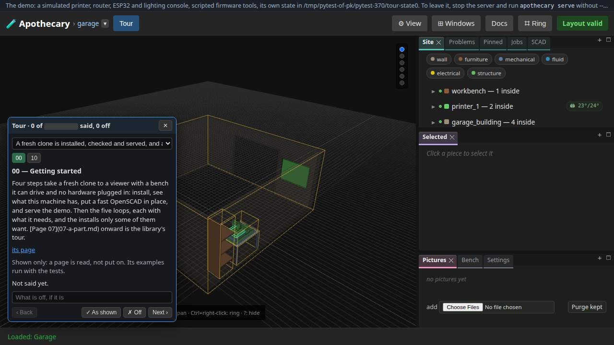
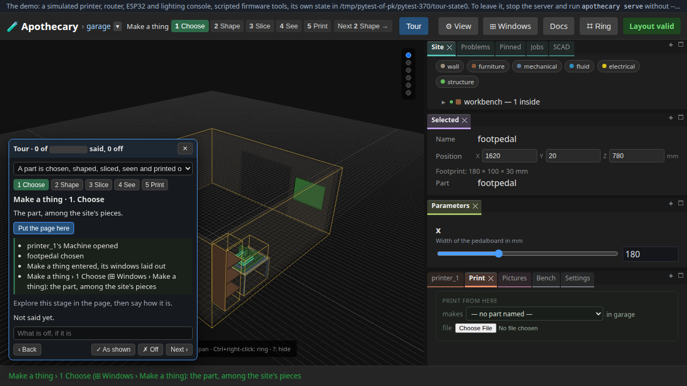
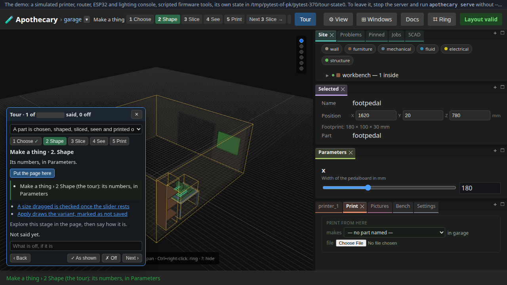
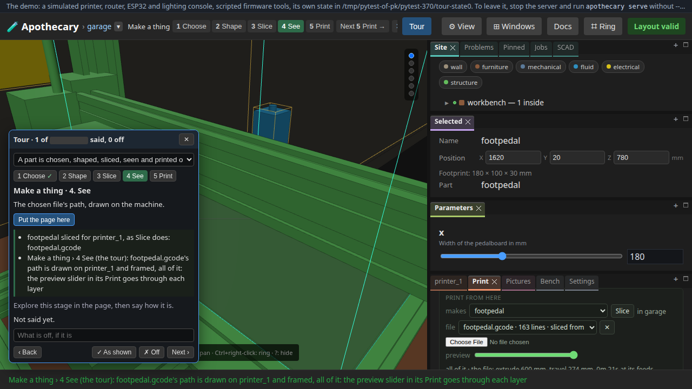

# 34 — The tour

Written by `tests/e2e/test_tour.py`, and
rewritten by every run of the browser suite (`uv run apothecary test
all`), though not by the quicker `apothecary test run`.
Each numbered step is written as the run reaches it, after the assertions
before it pass, and what a step shows is what the run had then. The
opening, the notes under it and the list of what the page does not show
are the test's fixed words. Editing the page by hand is editing the output
of a program: the next run puts it back.

What the roadmap claims, a stop at a time, in a box over the page: [docs/ROADMAP.md](../docs/ROADMAP.md) orders it, each of its lines naming a journey, whose stages are stops the page is put on, or walkthrough pages, each a stop that is read. A person explores a stage where it stands, and one word is kept on the stop with the commit the server ran. The box says nothing of its own: a stop's words are the journey's or the page's. [docs/tour.md](../docs/tour.md) is the reference.

**Runtime-bound.** It drives a real browser against a real server of its own that says it is the demo, its printer a simulation and its slicer a script that answers as OrcaSlicer's command line does. Its state folder is this test's, so the answers it keeps are its own. The roadmap and the pages are as committed.

Its pictures draw every part that OpenSCAD version 2021.01, the OpenSCAD its server runs, can build from an STL it built; a part it cannot build is drawn from an STL already there, or as its box.

---

## 1. Tour, in the header, opens a box over the page on the roadmap's first stop

Tour in the header: a box above the windows, on the first stop of the roadmap nobody has said anything of. That is page 00, and a page is shown only: its first words, its link, and a word asked on the whole of it. Nothing in the page beneath has moved.



```
Shown only: a page is read, not put on. Its examples run with the tests.
```

## 2. A journey's line chosen puts the page on its first stage

The box's drop-down holds the roadmap's lines under its headings, in its order; the line of Making a thing that names the journey Make a thing, chosen. Its stages are the stops, and the page is put on the first: printer_1's Machine opened and the footpedal chosen, as a person would do each, and the journey entered at Choose, its windows laid out and its rail in the header. The box says what it did, then what the page said. The stage is there to explore.



```
printer_1's Machine opened
footpedal chosen
Make a thing entered, its windows laid out
Make a thing › 1 Choose (⊞ Windows › Make a thing): the part, among the site's pieces
```

## 3. ✓ As shown keeps the word and puts the next stage on, with what to try there

✓ As shown: the server keeps it with the commit it runs, and the box goes to Shape and puts the page there, Parameters in front. Under what it did are the steps this stage's tests recorded, each a link to its picture: what to try.



```
A size dragged is checked once the slider rests
Apply draws the variant, marked as not saved
```

## 4. See is put on from nothing: the piece sliced, its path drawn

See, chosen among the line's stops: the stage draws the chosen file's path, and no file is kept, so the page does the stage before it -- the footpedal sliced for printer_1, as Slice does -- and the path is drawn on the machine and framed.



```
footpedal sliced for printer_1, as Slice does: footpedal.gcode
Make a thing › 4 See (the tour): footpedal.gcode's path is drawn on printer_1 and framed, all of it: the preview slider in its Print goes through each layer
```

## 5. ✗ Off keeps what is off, and only with it

✗ Off with the field empty is refused, the box saying what it needs and staying on the stop; with what is off typed, it is kept, and the box goes to Print and puts the page there, the Machine and Jobs in front. Nothing is armed.

```
Make a thing › 5 Print (the tour): control armed in the Machine, ▶ Print, the job in Jobs
```

## 6. A view laid out moves the windows, and not the box

The Default view laid out: every window goes where that view has it, and the box is where it was, open on the stop it showed. The line's stops wear what was said of each.


```
Tour · 2 of … said, 1 off
```

## 7. Panels › Windows › Tour: its cells are its buttons

The canvas ring's Panels › Windows › Tour: Back goes to See, put on again, where the box shows what was said of it; As shown says otherwise now, and the latest word is the stop's. Off, Next, Put here and Its page are cells there too, and Tour opens and closes the box.

```
Make a thing · 5. Print
```

## 8. Reloaded, it is open where it was

The page reloaded: the box is open again on the stop it showed, where it was left; this browser keeps where it was, the server what was said.

```
Make a thing · 5. Print
```

## 9. `apothecary tour` reads back what was said

At the command line, `apothecary tour`: the roadmap's lines under its headings, each with how many of its stops are as shown, off and not yet, and each stop answered with the commit and moment it was said against; `--off` lists only what is off.

```
Making a thing
  A part is chosen, shaped, sliced, seen and printed on a machine. 2 as shown, 0 off, 3 not yet
    ✓ Choose (…)
    ✓ See (…)
```

## What this page does not show

- **A server that is not the demo**, where the box shows a stage and puts nothing on.
- **A stage armed or started.** Print's stage brings the Machine and Jobs forward; arming control and starting a print are a person's.
- **What changes on every run.** Moments and the commit the server runs are blanked in the pictures and left out of the words, and so is how many stops the tour holds, which any line added to the roadmap changes.

Run it yourself:

```sh
uv run pytest tests/e2e/test_tour.py --start-server   # this page alone
uv run apothecary test all                            # with every browser test
```
