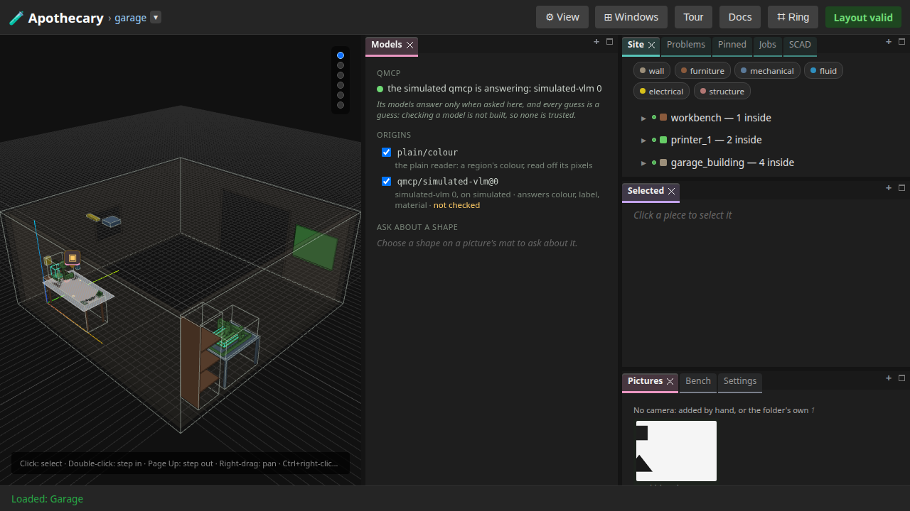
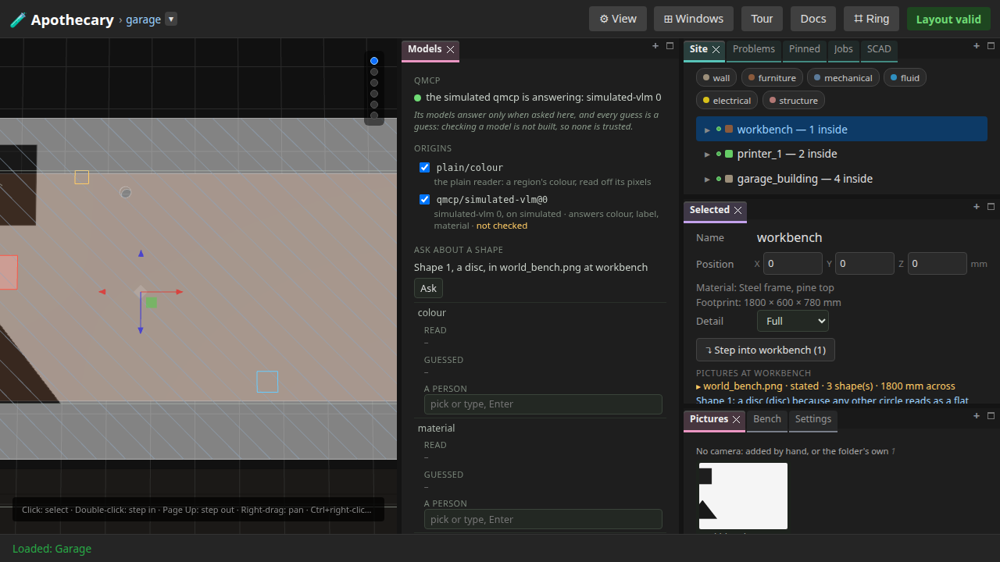
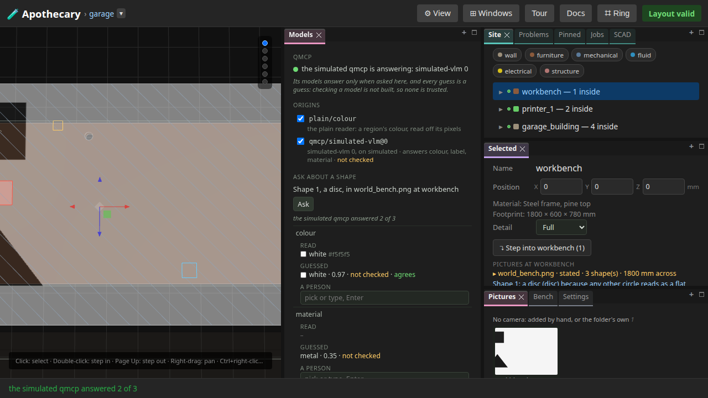
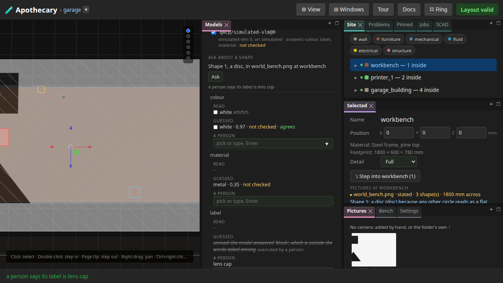
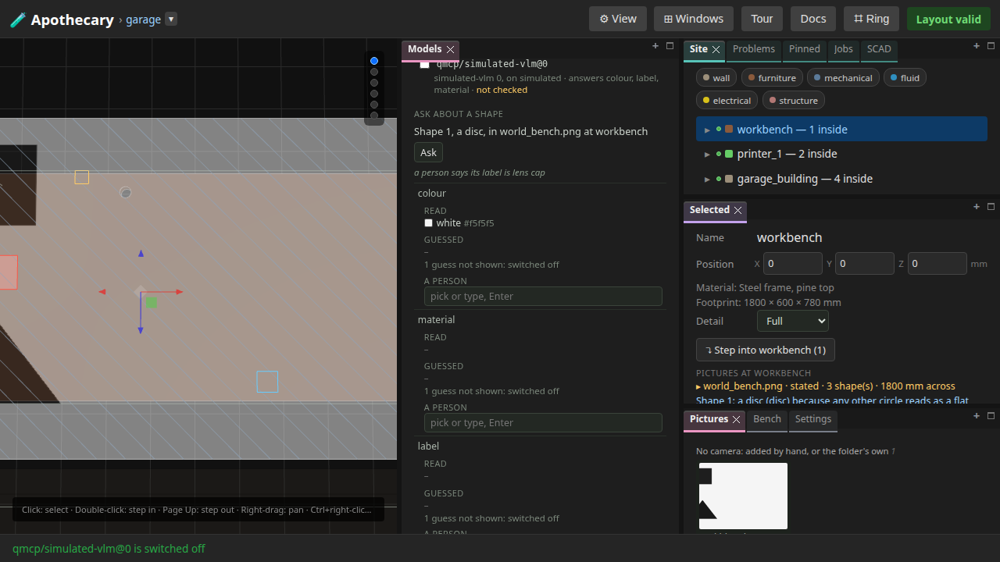

# 35 — The Models window

Written by `tests/e2e/test_models_window.py`, and
rewritten by every run of the browser suite (`uv run apothecary test
all`), though not by the quicker `apothecary test run`.
Each numbered step is written as the run reaches it, after the assertions
before it pass, and what a step shows is what the run had then. The
opening, the notes under it and the list of what the page does not show
are the test's fixed words. Editing the page by hand is editing the output
of a program: the next run puts it back.

Image models through qmcp, asked only when a person asks: a shape chosen on a picture's mat, its colour read off its pixels by the plain reader beside each model's guess at its colour, material and label, every guess shown and used for nothing, and a person's word ahead of any guess. [docs/models-checklist.md](../docs/models-checklist.md) walks the same paths by hand.

**Runtime-bound.** It drives a real browser against a real server of its own, with the simulated qmcp and its one model, and the stated picture pinned at the workbench, its shapes found. No model runs; nothing reaches a network.

Its pictures draw every part that OpenSCAD version 2021.01, the OpenSCAD its server runs, can build from an STL it built; a part it cannot build is drawn from an STL already there, or as its box.

---

## 1. ⊞ Windows › Models: qmcp answering, and no guess trusted

The header's ⊞ Windows, Models under Pictures: beside the world, qmcp answering with its one model, the plain reader and the model each with its switch, on. Checking a model is not built, so the window says none of its guesses is trusted. Nothing is chosen yet.



## 2. A shape clicked on the bench's mat is the one Models asks about

Looking straight down on the workbench's mat, the coin clicked: Models names it, its shape and the picture it is in, and offers Ask.



```
Shape 1, a disc, in world_bench.png at workbench
```

## 3. Ask: the colour read off its pixels, and each guess not checked

Ask: a row for each property asked -- colour, material, label -- the colour the plain reader read off the coin's pixels with its swatch, and the model's guess at each, marked not checked.



## 4. A person's word comes first, the model's guess struck through

lens cap typed in the label's row and Enter: a person's word is the label now, and the model's guess is struck through, overruled by a person.



## 5. The model switched off: its guesses leave every row

The model's switch, off: its guesses leave every row, each saying a guess is not shown, while what the plain reader read and what a person said stay.



## 6. Reloaded, the model is still switched off

The page opened again and Models with it: qmcp answering, the plain reader on, and the model still off, as it was left; switched on again after.

```
the simulated qmcp is answering: simulated-vlm 0
```

## What this page does not show

- **A real model.** The simulated qmcp answers the same each time; a model through a real qmcp is the checklist's.
- **Checking a model.** It is not built ([the plan](../docs/plans/image-models-through-qmcp-2026-10-30.md)), so no guess is trusted, and the window says so.
- **What changes on every run.** Moments are blanked in the pictures.

Run it yourself:

```sh
uv run pytest tests/e2e/test_models_window.py --start-server   # this page alone
uv run apothecary test all                                     # with every browser test
```
