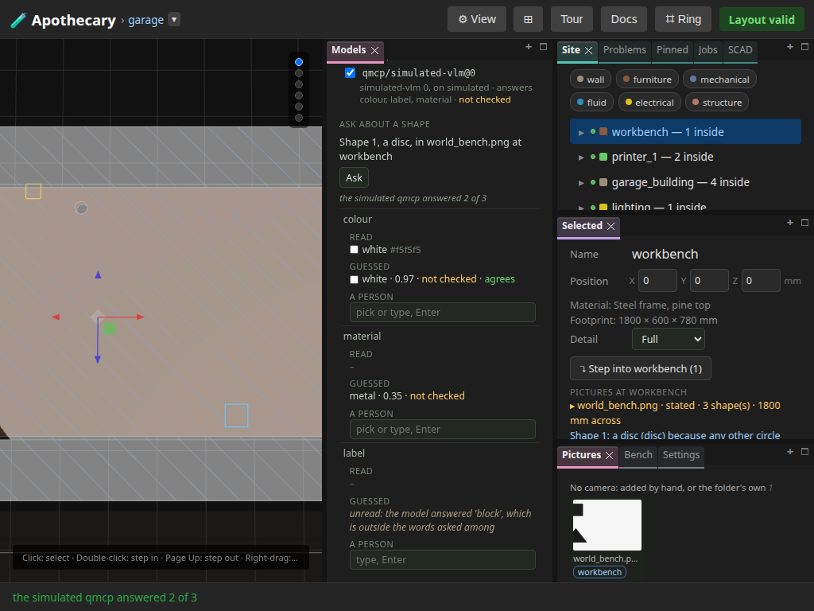
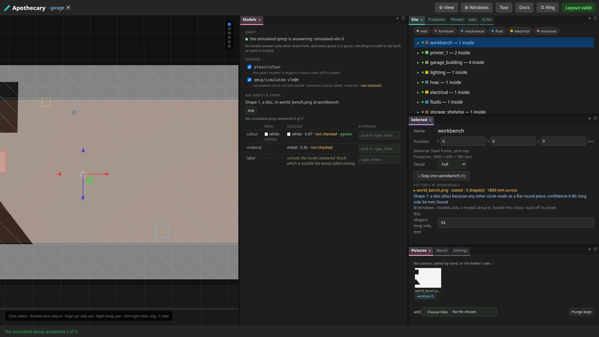

# 36 — The Models window, narrow and wide

Written by `tests/e2e/test_models_window.py`, and
rewritten by every run of the browser suite (`uv run apothecary test
all`), though not by the quicker `apothecary test run`.
Each numbered step is written as the run reaches it, after the assertions
before it pass, and what a step shows is what the run had then. The
opening, the notes under it and the list of what the page does not show
are the test's fixed words. Editing the page by hand is editing the output
of a program: the next run puts it back.

The Models window's table as wide as the window it is in: beside the world on a narrow page, each property reads down, Read, Guessed and A person each on a line of its own and named; on a wide one, it is a table. [Page 35](35-the-models-window.md) is the window from the start.

**Runtime-bound.** It drives a real browser against a real server of its own, as page 35's is: the simulated qmcp, and the stated picture pinned at the workbench. The page is 1024 px wide, then 1920.

Its pictures draw every part that OpenSCAD version 2021.01, the OpenSCAD its server runs, can build from an STL it built; a part it cannot build is drawn from an STL already there, or as its box.

---

## 1. Narrow, each property reads down

On a page 1024 px wide, Models beside the world, a shape asked about: each property's row reads down, Read, Guessed and A person each on a line of its own and named, and the box for a person's word inside the window, nothing reached by a scroll across.



## 2. Wide, it is a table

The page widened to 1920 px: the table's head shown, and each property's cells side by side under it, unnamed.



## What this page does not show

- **What changes on every run.** Moments are blanked in the pictures.

Run it yourself:

```sh
uv run pytest tests/e2e/test_models_window.py --start-server   # this page alone
uv run apothecary test all                                     # with every browser test
```
