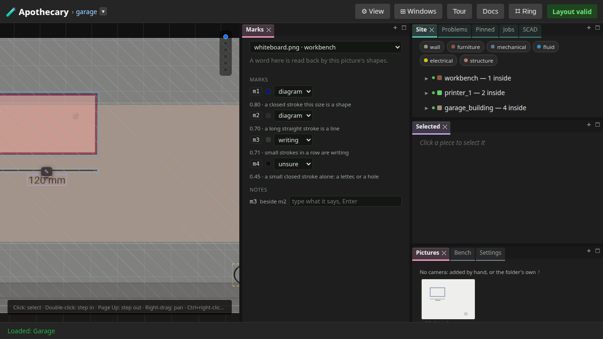
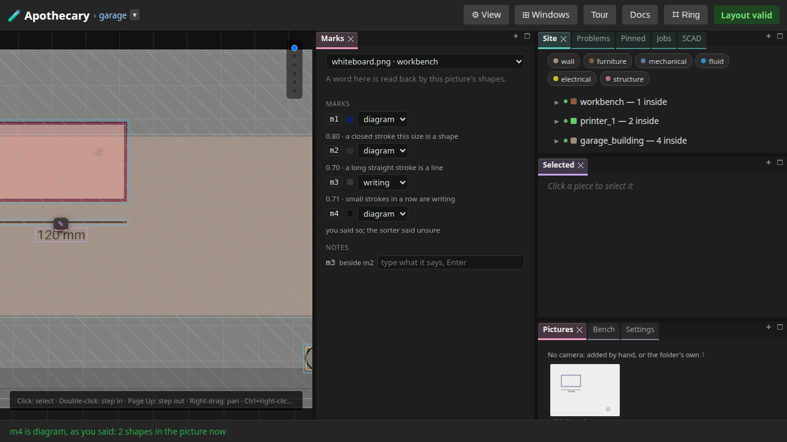
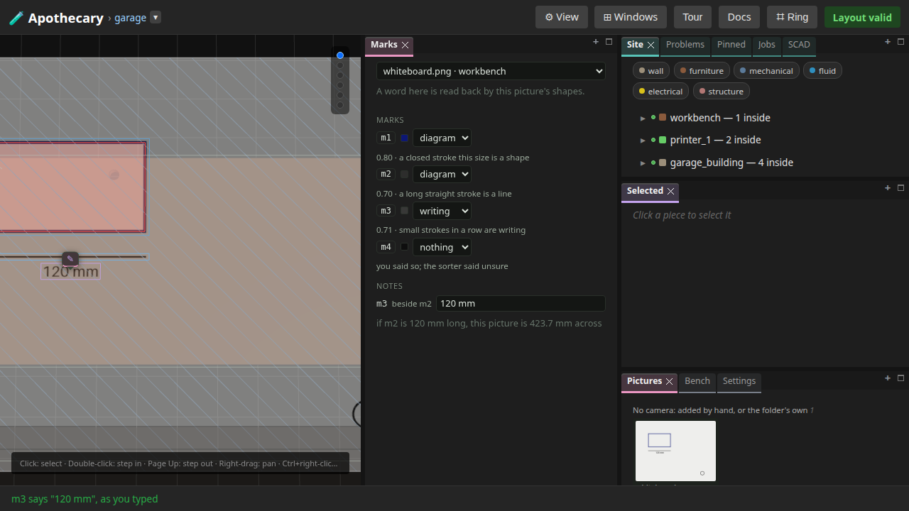

# 37 — Marks worn in the world

Written by `tests/e2e/test_marks_window.py`, and
rewritten by every run of the browser suite (`uv run apothecary test
all`), though not by the quicker `apothecary test run`.
Each numbered step is written as the run reaches it, after the assertions
before it pass, and what a step shows is what the run had then. The
opening, the notes under it and the list of what the page does not show
are the test's fixed words. Editing the page by hand is editing the output
of a program: the next run puts it back.

A whiteboard's marks as the Marks window sorts them, worn over its picture in the world: each mark's box in its kind's colour and each note a ✎ where it is written. A person's word on a mark is read back by the picture's shapes, and a note typed offers the size it states for its line. [docs/pictures.md](../docs/pictures.md#the-marks-window) is the reference; [page 30](30-a-whiteboard-round-twice-through-the-page.md) is a whiteboard round twice.

**Runtime-bound.** It drives a real browser against a real server of its own, a whiteboard drawn here -- a plate, a ring alone, a line and its size -- pinned at the workbench and read by the outline finder.

Its pictures draw every part that OpenSCAD version 2021.01, the OpenSCAD its server runs, can build from an STL it built; a part it cannot build is drawn from an STL already there, or as its box.

---

## 1. ⊞ Windows › Marks: four marks sorted, worn over the picture

The header's ⊞ Windows, Marks under Pictures: the whiteboard pinned at the workbench, its four marks each with the kind the sorter gave it -- two diagrams, writing, and the ring alone unsure -- and its one note. The camera turned to look straight down on the workbench: each mark's box is worn over the picture in its kind's colour, and the note is a ✎ where it is written.



```
A word here is read back by this picture's shapes.
```

## 2. A person's word: the ring is a diagram's, and a second shape there

The ring's drop-down, diagram: the row says a person said so and the sorter said unsure, and the picture's shapes read it back, a second shape there now.



```
m4 is diagram, as you said: 2 shapes in the picture now
```

## 3. Chosen, the ring's Nothing takes the shape away

The ring's row chosen, and Nothing -- the cell of Panels › Pictures › Marks, its verb handed to the window as the ring hands it: the ring is nothing, as a person said, and its shape is gone. With no mark chosen the cell says to choose one, and changes nothing.

```
choose a mark in Marks first: its number, at the start of its row
```

## 4. The note's ✎ opens its box; typed, it offers the size it states

The ✎ in the world pressed: the note's box in front in Marks. 120 mm typed and Enter: the note says it, its ✎ says it, and Marks offers the size it states for its line, this picture's width from it.



```
if m2 is 120 mm long, this picture is 423.7 mm across
```

## What this page does not show

- **A photograph.** The whiteboard is drawn by the test, square to the camera; a photograph from one side is [page 38](38-a-whiteboard-s-corners.md).
- **What changes on every run.** Moments are blanked in the pictures.

Run it yourself:

```sh
uv run pytest tests/e2e/test_marks_window.py --start-server   # this page alone
uv run apothecary test all                                    # with every browser test
```
