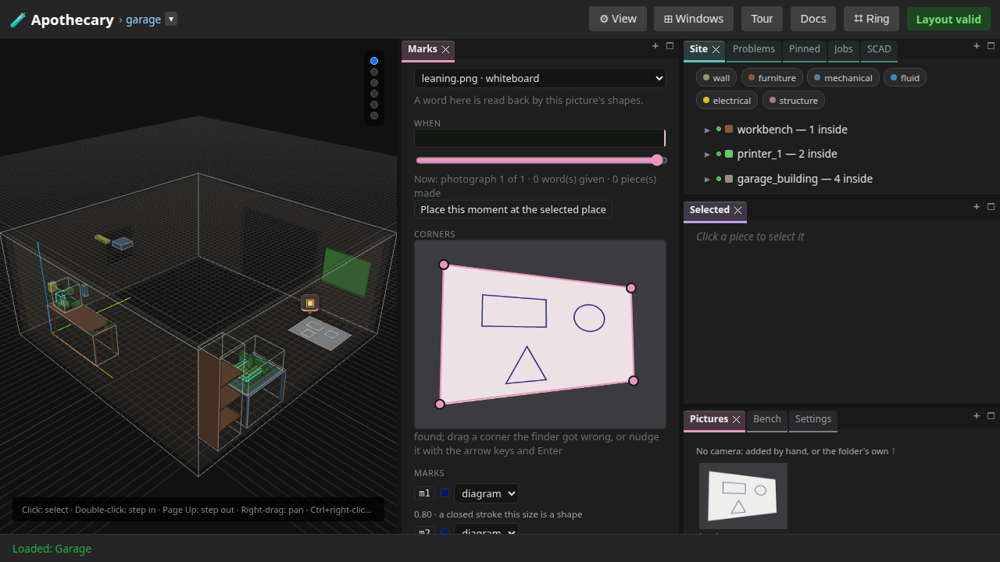
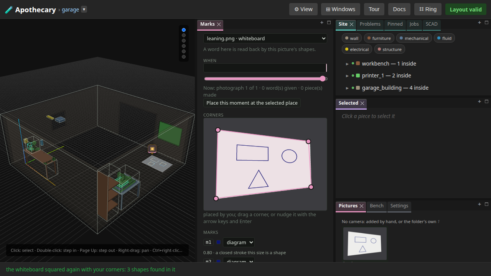

# 38 — A whiteboard's corners

Written by `tests/e2e/test_marks_window.py`, and
rewritten by every run of the browser suite (`uv run apothecary test
all`), though not by the quicker `apothecary test run`.
Each numbered step is written as the run reaches it, after the assertions
before it pass, and what a step shows is what the run had then. The
opening, the notes under it and the list of what the page does not show
are the test's fixed words. Editing the page by hand is editing the output
of a program: the next run puts it back.

A photograph pinned at a whiteboard is squared to it from the whiteboard's four corners, found on the photograph; the Marks window shows them as handles, and a corner dragged or nudged squares it again. [docs/pictures.md](../docs/pictures.md#pinned-at-a-whiteboard) is the reference.

**Runtime-bound.** It drives a real browser against a real server of its own: a whiteboard photographed from one side, drawn by the test, pinned at the garage's whiteboard and searched by the outline finder.

Its pictures draw every part that OpenSCAD version 2021.01, the OpenSCAD its server runs, can build from an STL it built; a part it cannot build is drawn from an STL already there, or as its box.

---

## 1. ⊞ Windows › Marks: the photograph it was squared from, its corners found

The header's ⊞ Windows, Marks: the photograph pinned at the whiteboard, as taken from one side, with the whiteboard's four corners found on it as handles.



```
found; drag a corner the finder got wrong, or nudge it with the arrow keys and Enter
```

## 2. A corner nudged and set: squared again with it

The top-right corner focused, the left arrow pressed five times and Enter: the whiteboard is squared again with the corners as placed, its shapes found again, and Marks says the corners were placed by you.



```
the whiteboard squared again with your corners: 3 shapes found in it
```

## What this page does not show

- **A corner dragged.** The corner here is nudged with the arrow keys; a drag sets it the same way, on release.
- **What changes on every run.** Moments are blanked in the pictures.

Run it yourself:

```sh
uv run pytest tests/e2e/test_marks_window.py --start-server   # this page alone
uv run apothecary test all                                    # with every browser test
```
