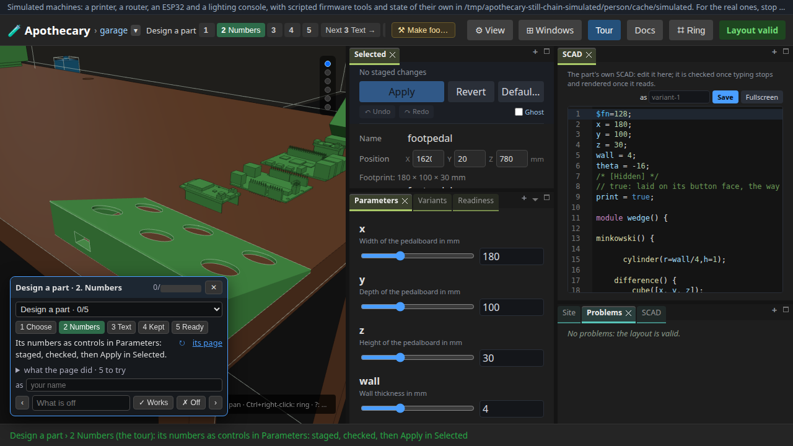
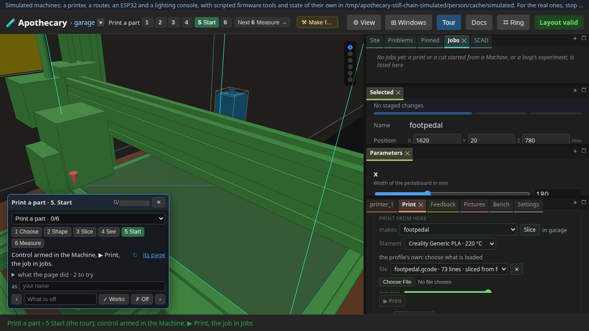
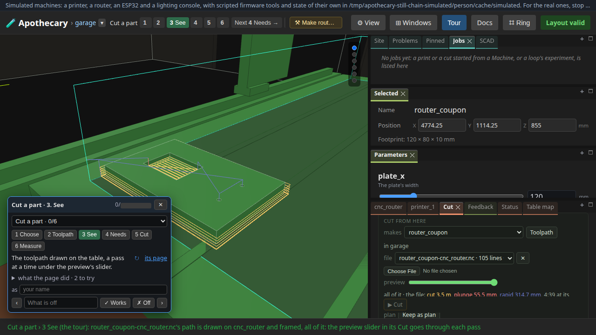
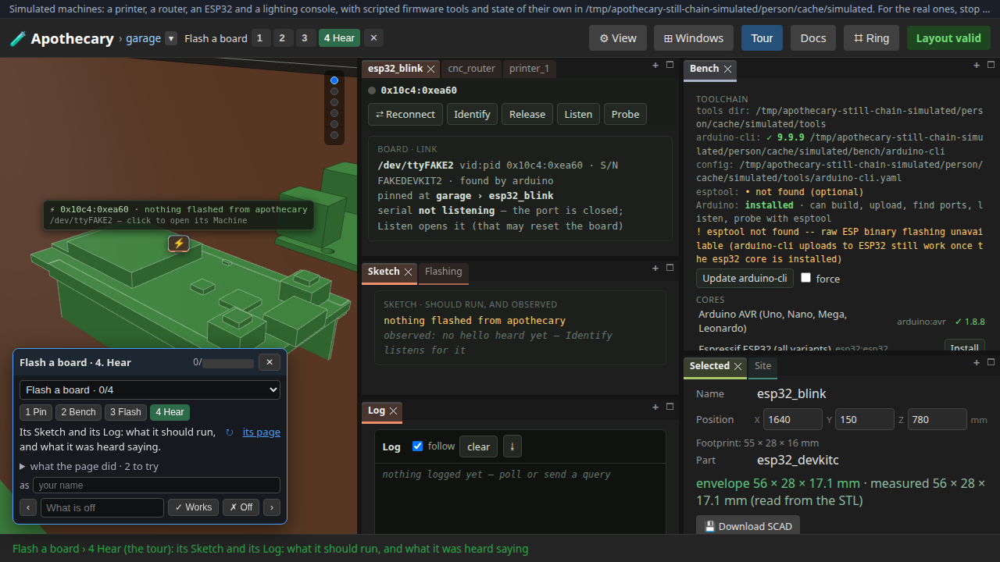
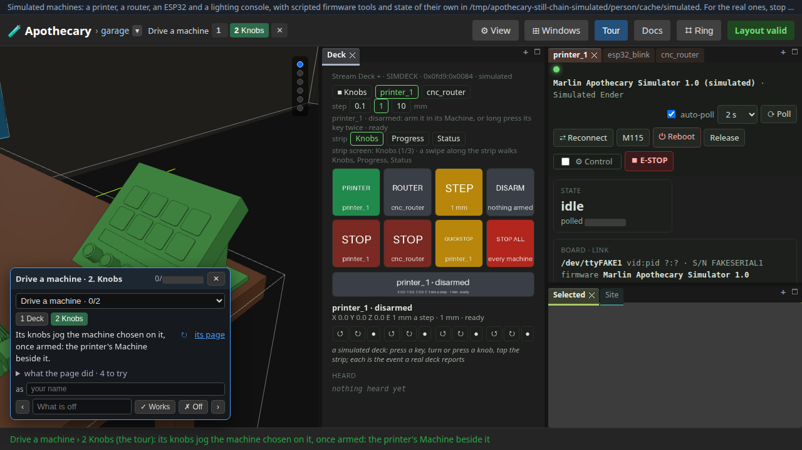
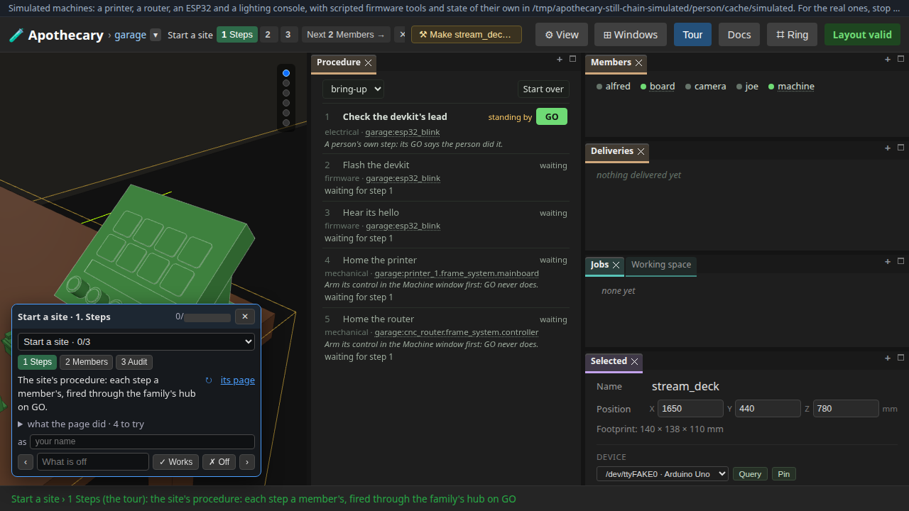
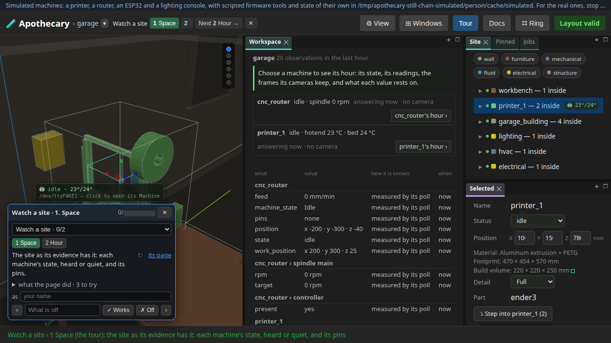
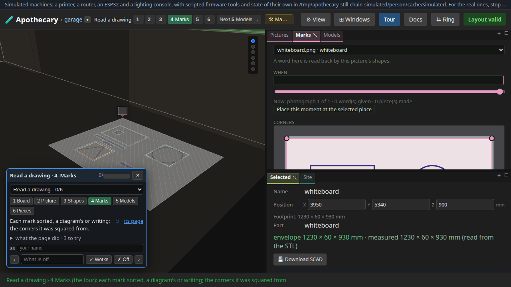
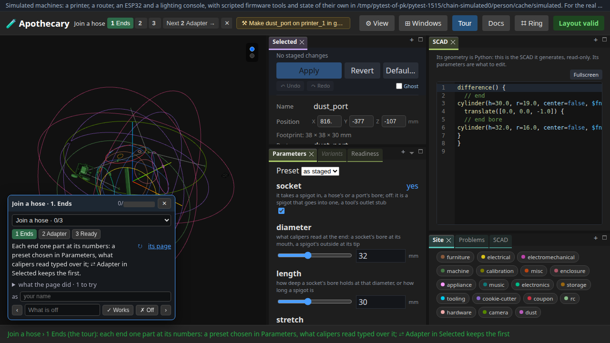

# 39 — The chain, a stage at a time

Written by `tests/e2e/test_the_chain.py`, and
rewritten by every run of the browser suite (`uv run apothecary test
all`), though not by the quicker `apothecary test run`.
Each numbered step is written as the run reaches it, after the assertions
before it pass, and what a step shows is what the run had then. The
opening, the notes under it and the list of what the page does not show
are the test's fixed words. Editing the page by hand is editing the output
of a program: the next run puts it back.

Every journey the page has, in the order of the chain it manages, the page taken to each stage by the [tour](34-the-tour.md): a part designed, made on the printer, cut on the router; the board a machine runs on; a deck's knobs on the machines; the site brought up and watched; a drawing photographed into shapes, which stand up as parts to design; and two ends joined by an adapter the server derives between them. Each journey hands the next what it made. Under each is what the tour's box said the page did to stand on each stage, then what the page said of it. [docs/tour.md](../docs/tour.md) is the reference.

**Runtime-bound.** It drives a real browser against `apothecary serve --simulated`, started as a person starts it: a simulated printer, router, devkit and Stream Deck, the scripted firmware tools, and a script that answers as OrcaSlicer's command line does. Every Python process of that server refuses a real serial port.

Its pictures draw every part that OpenSCAD version 2021.01, the OpenSCAD its server runs, can build from an STL it built; a part it cannot build is drawn from an STL already there, or as its box.

---

## 1. Design a part: its numbers, its text, what is kept of it, whether it is ready

The chain starts at a part. The footpedal is chosen among the garage's pieces; its editor is opened as Part › Edit opens it, its numbers controls in Parameters; its SCAD is opened in the editor beside the world; Variants and History hold what was saved and applied; Readiness and Problems say whether it can be made. The picture is Numbers. What this journey hands on is a part a machine can make.



```
1 Choose: footpedal chosen; footpedal framed in the world, as f does; Design a part entered, its windows laid out
    Design a part › 1 Choose (⊞ Windows › Design a part): the part, among the site's pieces: what it is drawn from, and its envelope
2 Numbers: footpedal's editor opened, as Part › Edit does
    Design a part › 2 Numbers (the tour): its numbers as controls in Parameters: staged, checked, then Apply in Selected
3 Text: footpedal's SCAD opened in its window, as Part › SCAD does
    Design a part › 3 Text (the tour): its SCAD in the editor: checked as typing stops, rendered once it reads
4 Kept: nothing more to do
    Design a part › 4 Kept (the tour): every variant saved of it, and this tab's applies, each drawn again from its row
5 Ready: nothing more to do
    Design a part › 5 Ready (the tour): whether it is ready to make, and what the site says is wrong
```

## 2. Print a part: the part sliced for the printer, its path drawn, the job ready

The part goes to a machine. printer_1's Machine is opened and the footpedal chosen; Slice's stage is the Machine's Print window with the part under makes; See needs a file, so the page slices the footpedal for printer_1 where none is kept, and its path is drawn on the bed; Start's stage is the Print window and Jobs. The picture is Start: the tour arms nothing and starts nothing.



```
1 Choose: printer_1's Machine opened; footpedal chosen; footpedal named under makes in printer_1's Print window; Print a part entered, its windows laid out
    Print a part › 1 Choose (⊞ Windows › Print a part): the part, among the site's pieces
2 Shape: footpedal chosen
    Print a part › 2 Shape (the tour): its numbers, in Parameters
3 Slice: footpedal chosen
    Print a part › 3 Slice (the tour): the machine's Print window: the part under makes, then Slice
4 See: footpedal chosen; footpedal sliced for printer_1, as Slice does: footpedal.gcode
    Print a part › 4 See (the tour): footpedal.gcode's path is drawn on printer_1 and framed, all of it: the preview slider in its Print goes through each layer
5 Start: footpedal chosen
    Print a part › 5 Start (the tour): control armed in the Machine, ▶ Print, the job in Jobs
6 Measure: footpedal chosen; footpedal's cabinet in Part › Feedback, a piece made elsewhere chosen, as Part › View › Feedback does
    Print a part › 6 Measure (the tour): the piece made, in its part's cabinet, Part › Feedback, a drawer a print, opened on it as its print ends: read under measured a feature a row and filed as the next turn of the printer's tuning, which says what the readings imply -- a box's sizes separate nothing, and print_coupon is the piece made to be measured; or looked at under seen, each fault none to bad, a look that moves one setting; Take turn takes either into the printer's next slices, for the filament the piece used
```

## 3. Cut a part: its toolpath written for the router, drawn on the table

The same path through another machine. cnc_router's Machine is opened in front, printer_1's kept open beside it, and the router_coupon chosen, a part that says how it is cut; Toolpath's stage is the router's Cut window; See writes the coupon's toolpath where none is kept and draws it on the table; Needs is the router's Status, where it says what it needs before it moves; Cut is the Machine and Jobs; Measure is the coupon's cabinet in Part › Feedback, its toolpath among its pieces and what it names to measure under measured. The picture is See.



```
1 Choose: cnc_router's Machine opened; router_coupon chosen; router_coupon named under makes in cnc_router's Print window; Cut a part entered, its windows laid out
    Cut a part › 1 Choose (⊞ Windows › Cut a part): a part that says how it is cut, among the site's pieces
2 Toolpath: router_coupon chosen
    Cut a part › 2 Toolpath (the tour): the router's Cut window: the part under makes, then Toolpath
3 See: router_coupon chosen; router_coupon's toolpath written for cnc_router, as Toolpath does: router_coupon-cnc_router.nc
    Cut a part › 3 See (the tour): router_coupon-cnc_router.nc's path is drawn on cnc_router and framed, all of it: the preview slider in its Cut goes through each pass
4 Needs: router_coupon chosen
    Cut a part › 4 Needs (the tour): what the router needs before it moves: its state, its pins, each axis's home
5 Cut: router_coupon chosen
    Cut a part › 5 Cut (the tour): control armed in the Machine, the work zeroed, ▶ Cut, the job in Jobs
6 Measure: router_coupon chosen; router_coupon's cabinet in Part › Feedback, a piece made elsewhere chosen, as Part › View › Feedback does
    Cut a part › 6 Measure (the tour): the piece cut, in its part's cabinet, Part › Feedback: each size it names typed under measured, checked against what was designed, filed, and the tool's allowance kept for the router's next toolpaths
```

## 4. Flash a board: its sketch on the Bench, its Flashing, what it says

A machine runs on a board, and a board on firmware. The simulated devkit stands on its port unpinned, so the page pins it to esp32_blink, as Pin in the piece's Device section does, and opens its Machine: Pin's stage is Selected, where the site says which device is which. The Bench is opened on esp32_blink's sketch, as its ring's Device › Flash sketch does: each build of it with its toolchain. Flash's stage is the board's Flashing window, Hear's its Sketch and its Log. The picture is Hear. Compile, upload and Listen are left to the person.



```
1 Pin: /dev/ttyFAKE2 pinned to esp32_blink, as Pin in its Device section does; esp32_blink's Machine opened; esp32_blink framed in the world, as f does; Flash a board entered, its windows laid out
    Flash a board › 1 Pin (⊞ Windows › Flash a board): the board on its port pinned to its piece, in Selected: which device is which
2 Bench: the Bench opened on esp32_blink@arduino, as esp32_blink's Device › Flash sketch does
    Flash a board › 2 Bench (the tour): the part's sketch on the Bench: each build of it with its toolchain, and Compile
3 Flash: nothing more to do
    Flash a board › 3 Flash (the tour): the board's Flashing window: the sketch built and uploaded to its port, after asking
4 Hear: nothing more to do
    Flash a board › 4 Hear (the tour): its Sketch and its Log: what it should run, and what it was heard saying
```

## 5. Drive a machine: the Stream Deck, and the printer beside it

Hands on what was made to move. The stream_deck piece is chosen and the Deck window brought forward: its keys and strip as the server draws them. Knobs opens printer_1's Machine beside it, the machine the deck has chosen, where its control is armed before a knob moves anything. The picture is Knobs, the printer disarmed.



```
1 Deck: stream_deck chosen; stream_deck framed in the world, as f does; Drive a machine entered, its windows laid out
    Drive a machine › 1 Deck (⊞ Windows › Drive a machine): the Stream Deck + as the server draws it: its keys, its strip, and what it heard
2 Knobs: printer_1's Machine opened
    Drive a machine › 2 Knobs (the tour): its knobs jog the machine chosen on it, once armed: the printer's Machine beside it
```

## 6. Start a site: the procedure, the family's members, the hub's audit

The machines one at a time become a site brought up in order. No machine is in this journey, so the one open is closed. Steps is the Procedure, each step a member's of the family and fired through the hub on GO; Members is each member and its door; Audit is the hub's deliveries. The picture is Steps: GO is a person's.



```
1 Steps: printer_1's, cnc_router's and esp32_blink's Machines closed: Start a site has no machine in it; Start a site entered, its windows laid out
    Start a site › 1 Steps (⊞ Windows › Start a site): the site's procedure: each step a member's, fired through the family's hub on GO
2 Members: nothing more to do
    Start a site › 2 Members (the tour): each member of the family: how it is reached, and its door to where its step works
3 Audit: nothing more to do
    Start a site › 3 Audit (the tour): the hub's deliveries, newest first: each step, its member, and how it answered
```

## 7. Watch a site: the Workspace, then one machine's hour

A site that is up is watched. Space is the Workspace on the garage; Hour chooses printer_1 and opens its hour there: its state poll by poll, and where a camera over it would keep its frames. The picture is Space.



```
1 Space: the Workspace opened: the Workspace of garage: Choose a machine to see its hour: its state, its readings, the frames its cameras keep, and what each value rests on.; Watch a site entered, its windows laid out
    Watch a site › 1 Space (⊞ Windows › Watch a site): the site as its evidence has it: each machine's state, heard or quiet, and its pins
2 Hour: printer_1 framed in the world, as f does; the Workspace opened: printer_1's hour in the Workspace: No camera looks at printer_1 yet: add one above it, and choose which of this browser's cameras it is.
    Watch a site › 2 Hour (the tour): one machine's hour: its state and heaters poll by poll, and the cameras over it
```

## 8. Read a drawing: the whiteboard photographed, squared, read

Last, what is seen becomes parts, and the chain closes. The whiteboard is chosen on the garage's wall; Picture pins the folder's photograph of it there, as its ring's Picture › Folder does, squared and laid in front; Shapes finds its closed strokes; Marks sorts each mark; Models is where an image model is asked and never trusted; Pieces is where Picture › Make stands each shape up, which is left to the person: a piece made is a part, to design. The picture is Marks.



```
1 Board: whiteboard chosen; whiteboard framed in the world, as f does; Read a drawing entered, its windows laid out
    Read a drawing › 1 Board (⊞ Windows › Read a drawing): the whiteboard on the garage's wall: a place a picture can lie
2 Picture: whiteboard.png pinned at whiteboard, as its Picture › Folder does
    Read a drawing › 2 Picture (the tour): a photograph of it pinned there: squared to it, sized by it, laid in front
3 Shapes: 3 shapes found at whiteboard, as its Picture › Find shapes › outline does
    Read a drawing › 3 Shapes (the tour): each closed stroke outlined as a shape, with a word for it and how sure it is
4 Marks: nothing more to do
    Read a drawing › 4 Marks (the tour): each mark sorted, a diagram's or writing; the corners it was squared from
5 Models: nothing more to do
    Read a drawing › 5 Models (the tour): an image model asked about a shape chosen on the picture, and never trusted
6 Pieces: nothing more to do
    Read a drawing › 6 Pieces (the tour): Picture › Make stands each shape up as a piece: a part, to design and to make
```

## 9. Join a hose: two ends, each one part at its numbers, and the adapter between them

A part can be made between two others. The universe opens, where every part stands; the dust port is chosen and its editor opened, its presets above its numbers in Parameters: a hose's end, a port, a tool's stub, each typed over with what calipers read. ⇄ Adapter in Selected keeps one end; at the other end's numbers it asks the server for the adapter between them. Adapter is the adapter's editor, where each end's fit is said; Ready is whether it can be printed, and ⚒ Make takes it on. The picture is Ends: keeping an end, and the numbers measured, are the person's.



```
1 Ends: apothecary opened, where Join a hose stands (garage was open); dust_port's editor opened, as Part › Edit does; Join a hose entered, its windows laid out
    Join a hose › 1 Ends (⊞ Windows › Join a hose): each end one part at its numbers: a preset chosen in Parameters, what calipers read typed over it; ⇄ Adapter in Selected keeps the first
2 Adapter: nothing more to do
    Join a hose › 2 Adapter (the tour): ⇄ Adapter again at the other end's numbers: the adapter between them derived, drawn, and each end's fit said in Selected
3 Ready: hose_adapter's editor opened, as Part › Edit does
    Join a hose › 3 Ready (the tour): its numbers adjusted and each fit said again after Apply; whether it is ready to print; ⚒ Make takes it to a printer, where Print a part goes on
```

## What this page does not show

- **Anything armed, started, sent or made.** A stage is where a person does those: ▶ Print, ▶ Cut, Upload, GO, a knob turned, Picture › Make. Each is its own page's, named at its stage in the tour's box.
- **A machine that is not there.** Where a stage's board is not pinned or not connected the page stops short and says what the stage needs; [page 34](34-the-tour.md) shows it.
- **A camera's picture.** A browser's camera is a person's to point; pages 01 to 03 go through it.
- **What changes on every run.** Moments are blanked in the pictures and left out of the words.

Run it yourself:

```sh
uv run pytest tests/e2e/test_the_chain.py --start-server   # this page alone
uv run apothecary test all                                 # with every browser test
```
