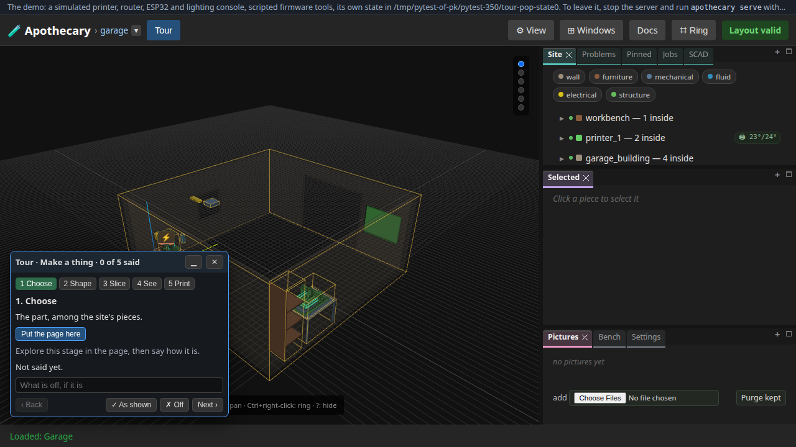
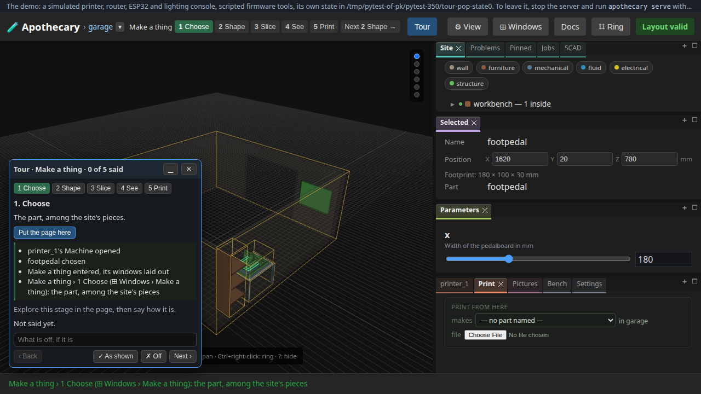
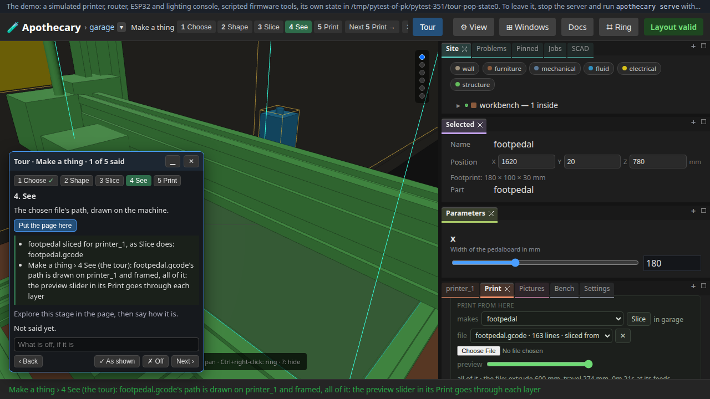
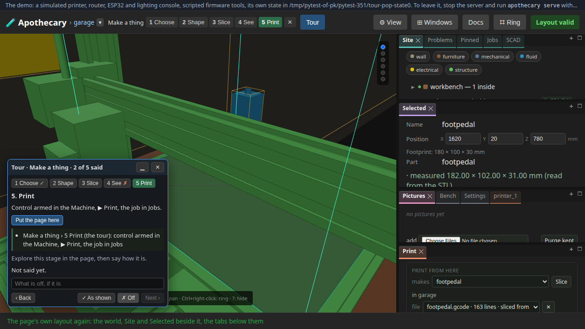

# 39 — The tour over the page (a prototype)

Written by `tests/e2e/test_tour_popover.py`, and
rewritten by every run of the browser suite (`uv run apothecary test
all`), though not by the quicker `apothecary test run`.
Each numbered step is written as the run reaches it, after the assertions
before it pass, and what a step shows is what the run had then. The
opening, the notes under it and the list of what the page does not show
are the test's fixed words. Editing the page by hand is editing the output
of a program: the next run puts it back.

A prototype of the tour as a box over the page, on one journey, Make a thing: each stage put on by the page -- the machine opened, the piece chosen, the stage entered, the piece sliced where a stage needs its file -- for a person to explore, and one word kept on the stage. The box is above the windows, so a view or a journey lays them out beneath it.

**Runtime-bound.** It drives a real browser against a real server of its own that says it is the demo, its printer a simulation and its slicer a script that answers as OrcaSlicer's command line does.

Its pictures draw every part that OpenSCAD version 2021.01, the OpenSCAD its server runs, can build from an STL it built; a part it cannot build is drawn from an STL already there, or as its box.

---

## 1. Tour, in the header, opens a box over the page

Tour in the header: a box above the windows, on Make a thing's first stage nobody has said anything of. Nothing in the page has moved: no Machine is open and no journey is entered.



```
Tour · Make a thing · 0 of 5 said
```

## 2. Put the page here opens what the stage needs and enters it

Put the page here: printer_1's Machine is opened and the footpedal chosen, as a person would do each, and Make a thing is entered at Choose, its windows laid out and its rail in the header. The box says what it did, then what the page said. The stage is there to explore.



```
printer_1's Machine opened
footpedal chosen
Make a thing entered, its windows laid out
Make a thing › 1 Choose (⊞ Windows › Make a thing): the part, among the site's pieces
```

## 3. ✓ As shown keeps the word and puts the next stage on

✓ As shown: the server keeps it with the commit it runs, and the box goes to Shape and puts the page there, Parameters in front.

```
Make a thing › 2 Shape (the tour): its numbers, in Parameters
```

## 4. See is put on from nothing: the piece sliced, its path drawn

See, chosen on the box: the stage draws the chosen file's path, and no file is kept, so the page does the stage before it -- the footpedal sliced for printer_1, as Slice does -- and the path is drawn on the machine and framed.



```
footpedal sliced for printer_1, as Slice does: footpedal.gcode
Make a thing › 4 See (the tour): footpedal.gcode's path is drawn on printer_1 and framed, all of it: the preview slider in its Print goes through each layer
```

## 5. ✗ Off keeps what is off, and only with it

✗ Off with the box empty is refused; with what is off typed, it is kept, and the box goes to Print and puts the page there, the Machine and Jobs in front.

```
Make a thing › 5 Print (the tour): control armed in the Machine, ▶ Print, the job in Jobs
```

## 6. A view laid out moves the windows, and not the box

The Default view laid out from ⊞ Windows: every window goes where that view has it, and the box is where it was, open on the stage it showed.



```
Tour · Make a thing · 2 of 5 said
```

## What this page does not show

- **What to try at a stage.** The box gives the stage's own line from the rail; what its tests check there is not yet read into it.
- **Any journey but Make a thing**, and **a server that is not the demo**, where the box puts nothing on.

Run it yourself:

```sh
uv run pytest tests/e2e/test_tour_popover.py --start-server   # this page alone
uv run apothecary test all                                    # with every browser test
```
