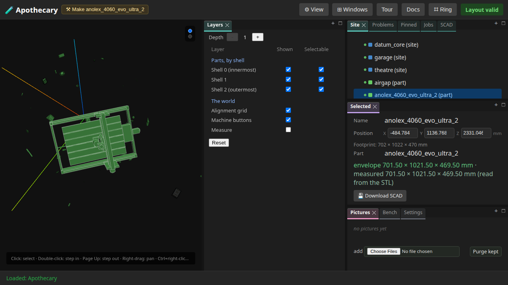
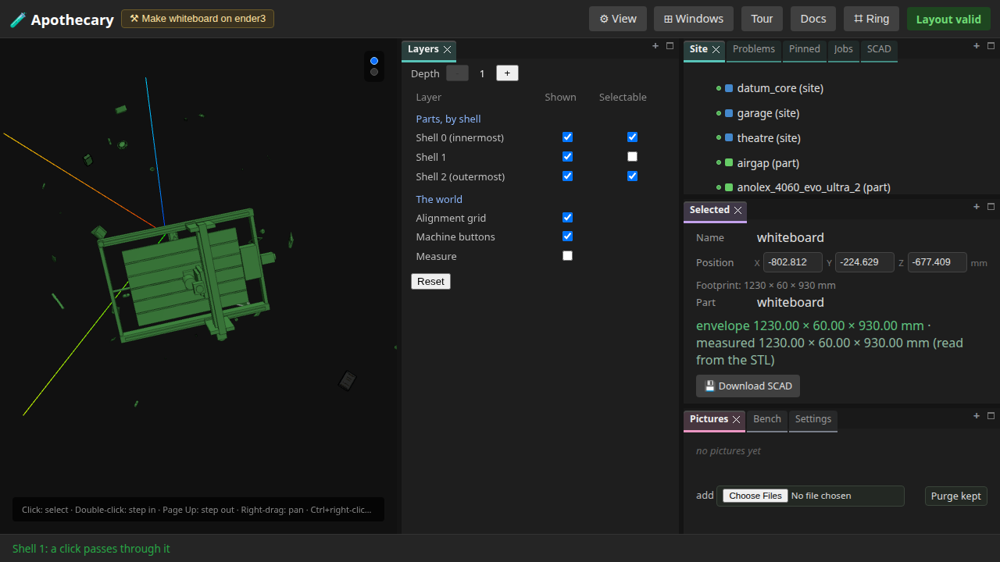

# 40 — Layers and depth

Written by `tests/e2e/test_layers.py`, and
rewritten by every run of the browser suite (`uv run apothecary test
all`), though not by the quicker `apothecary test run`.
Each numbered step is written as the run reaches it, after the assertions
before it pass, and what a step shows is what the run had then. The
opening, the notes under it and the list of what the page does not show
are the test's fixed words. Editing the page by hand is editing the output
of a program: the next run puts it back.

A click in the world picks the nearest thing under it; in the universe, a sphere of shells, where the view lines a piece of an outer shell up in front of one of an inner shell, that is the outer one. The Layers window, beside the world, says which layers a click may pick and which the world draws, and how many levels down a click reaches. [docs/viewer.md](../docs/viewer.md#layers) is the reference.

**Runtime-bound.** It drives a real browser against a real server of its own, on the universe as the code has it. What is chosen is kept by the browser, as a person's settings are; nothing is kept on the server.

Its pictures draw every part that OpenSCAD version 2021.01, the OpenSCAD its server runs, can build from an STL it built; a part it cannot build is drawn from an STL already there, or as its box.

---

## 1. A click on the outer shell picks the outer shell's piece

The Layers window beside the world, every layer shown and selectable; the view turned until an outer shell's piece stands in front of an inner one, a click there selects the outer one.



## 2. With the outer shell not selectable, the click selects what is behind

The outer shell's Selectable ticked off, its Shown still on: the shell is drawn as it was, and the same click selects the piece behind it.



## What this page does not show

- **Another browser.** The choice is this browser's own.
- **What changes on every run.** Moments are blanked in the pictures.

Run it yourself:

```sh
uv run pytest tests/e2e/test_layers.py --start-server   # this page alone
uv run apothecary test all                              # with every browser test
```
