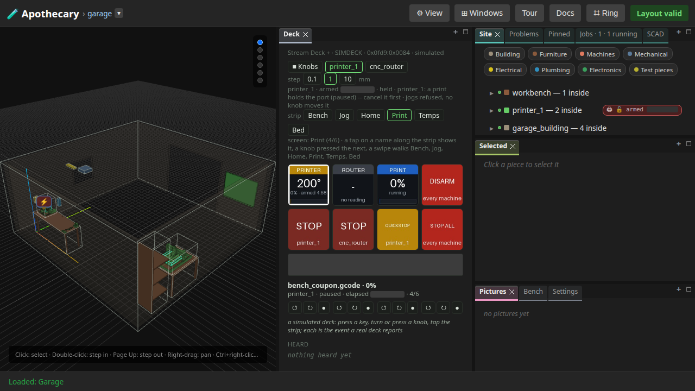
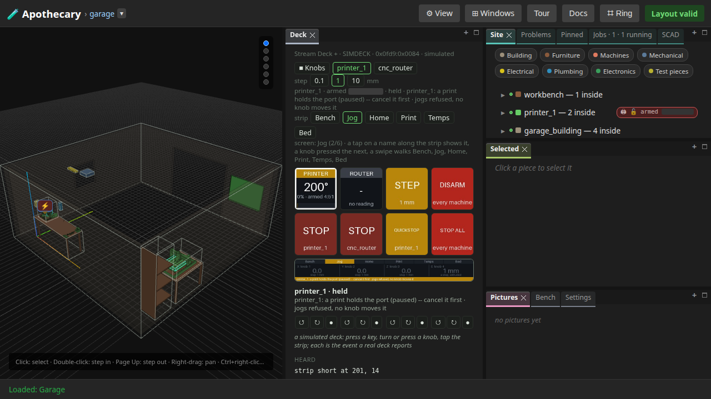
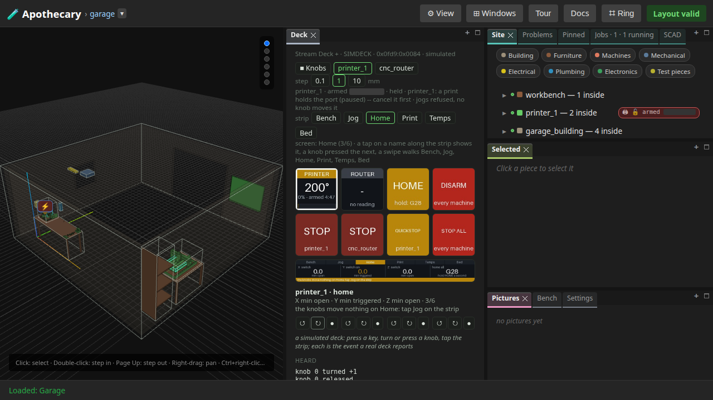
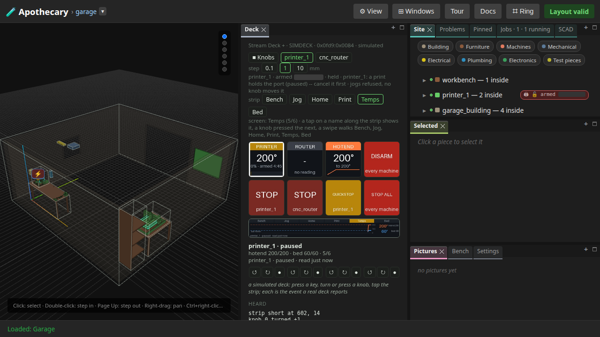
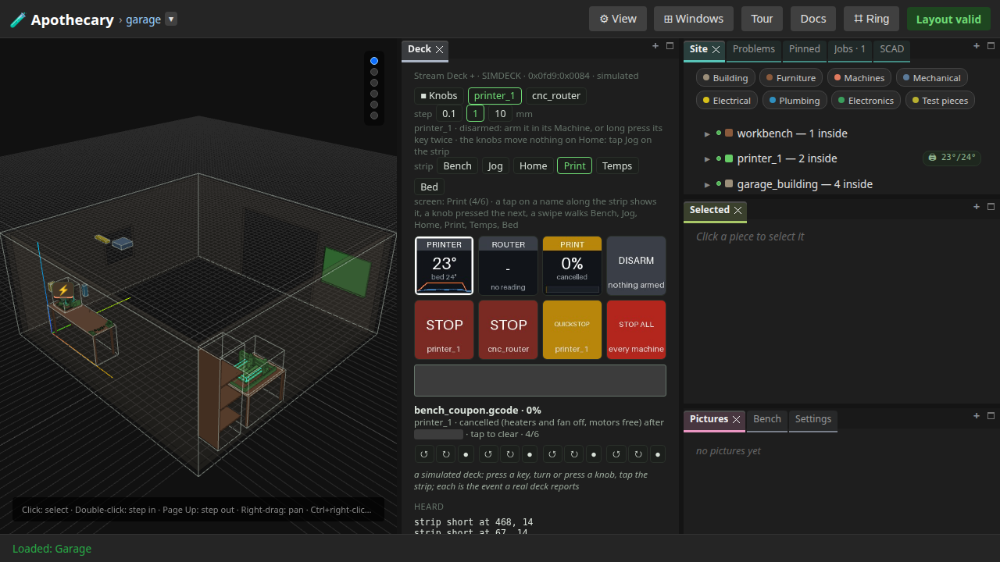

# 41 — The deck while a print streams

Written by `tests/e2e/test_deck_screens.py`, and
rewritten by every run of the browser suite (`uv run apothecary test
all`), though not by the quicker `apothecary test run`.
Each numbered step is written as the run reaches it, after the assertions
before it pass, and what a step shows is what the run had then. The
opening, the notes under it and the list of what the page does not show
are the test's fixed words. Editing the page by hand is editing the output
of a program: the next run puts it back.

The Stream Deck + has six screens, named along the top of its touch strip: the Bench, with both machines, then the chosen machine's Jog, Home, Print, Temps and Bed. A tap on a name shows that screen and a knob pressed shows the next. While a print streams the deck shows how far it is, the printer's heaters as a graph and what each machine is doing on its key. The deck in this page is simulated and so is the printer; each tap and press is the event a real deck reports.

**Runtime-bound.** It drives a real browser against a real server of its own, with one simulated deck whose layout is started and the simulated printer pinned to its node. No HID device or serial port is opened and nothing reaches the network.

Its pictures draw every part that OpenSCAD version 2021.01, the OpenSCAD its server runs, can build from an STL it built; a part it cannot build is drawn from an STL already there, or as its box.

---

## 1. A print begun brings Print forward

The simulated printer is streaming a kept file. The strip names the file, how far it is as a number and a bar, the stage and how long it has run, with Print lit among the six screens' names along its top; no time remaining is shown, since the job's record carries none. The third key is the screen's own, the print's number, and the printer's key carries the print's bar. The print is paused where it is so the picture can be read.



```
bench_coupon.gcode · 0%
printer_1 · paused · elapsed ‒:‒‒ · 4/6
```

## 2. A tap on Jog shows the knobs, which say a print holds the port

A tap on a name along the top of the strip shows that screen. The knobs' screen no longer looks live: what each knob moves is greyed, the print holds the port, the server refuses a jog, and the strip says so in the server's own words, as the window's line for the knobs does. Print was brought forward once for this print and is not brought forward again.



## 3. A knob pressed shows Home, where a turn moves nothing

Pressing a knob shows the next screen, and from the last the first. Home says where each axis stands and its switch as the last poll read it, and the third key is HOME, held a second to home every axis through the page's own path. The knobs move a machine on Jog alone: turned here, they send nothing and the strip says so.



## 4. Temps draws the heaters as they rise

The printer's hotend and bed over the last ten minutes, each as it was read and what it was asked to reach dashed, the newest written at the right. The graph is drawn from the polls anyone made -- here the deck's own, while the printer's control is armed -- and the deck asks for nothing to draw it. The third key is the hotend's number.



## 5. The Bench shows both machines

The first screen is both machines, half the strip each: its state, its numbers and its job's bar. The printer's control was let go first, as the Site's row says; a machine armed says so here with the time it has left. The knobs move nothing here.


```
Bench · printer_1 paused · cnc_router no reading
printer_1: hotend 200/200 · bed 60/60 · cnc_router: not polled yet · 1/6
```

## 6. A print that ended stays on Print until a touch

The print was cancelled. The strip says how it ended and after how long, and keeps saying it: nothing about the print clears it but a touch of this screen.



```
bench_coupon.gcode · 0%
printer_1 · cancelled (heaters and fan off, motors free) after ‒:‒‒ · tap to clear · 4/6
```

## What this page does not show

- **The clocks.** Print says how long a print has run, which differs on every run; the server draws it into the strip's picture, so where it shows the strip is greyed in the picture and its words are written under it, the time as ‒:‒‒. The graph on Temps and the spark line on the printer's key are drawn from the polls of this run, so their shape differs from run to run.
- **A real deck.** What only it shows -- a finger's tap on a name, a knob's press, the strip's brightness under a hand -- is section J of the bench checklist (docs/bench-checklist.md).
- **A cut, Home's and Bed's keys.** A router's job is the same record, and its screens are Cut, Status and Table; HOME and PROBE held send the page's own home and probe. tests/test_firmware_deck_control.py holds them.

Run it yourself:

```sh
uv run pytest tests/e2e/test_deck_screens.py --start-server   # this page alone
uv run apothecary test all                                    # with every browser test
```
