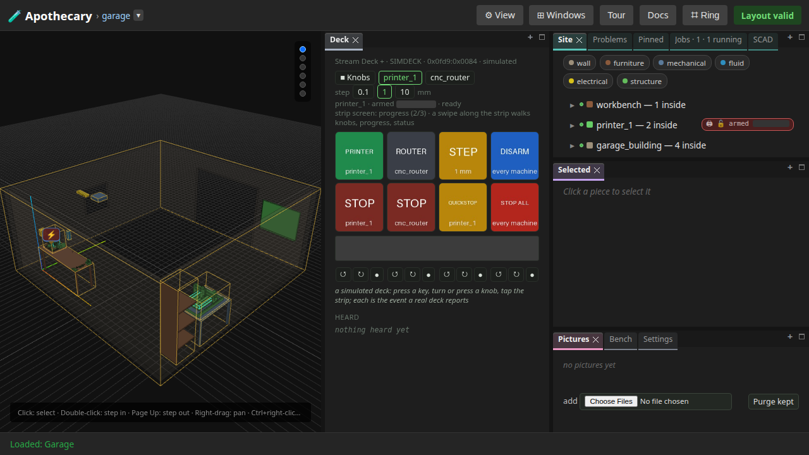
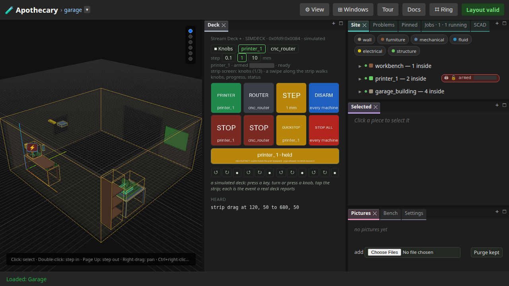
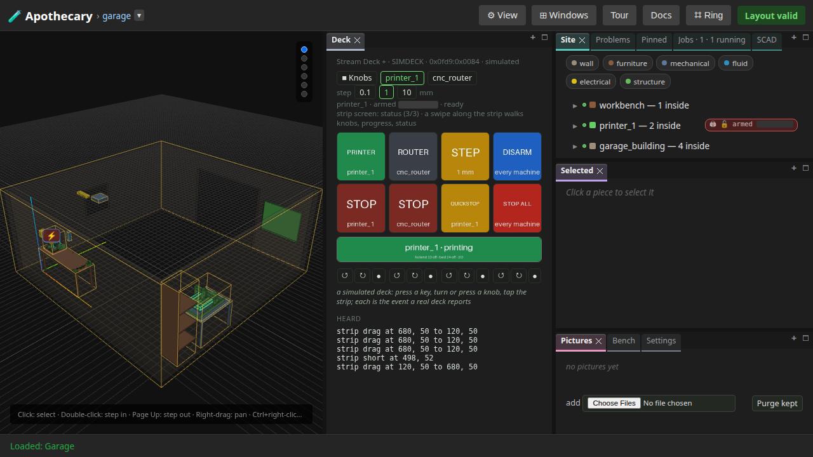
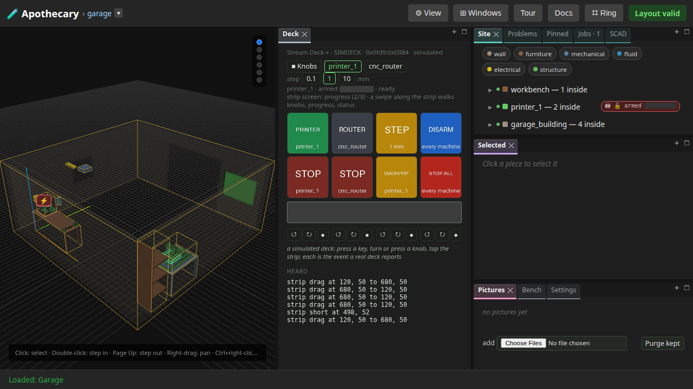

# 41 — The deck while a print streams

Written by `tests/e2e/test_deck_screens.py`, and
rewritten by every run of the browser suite (`uv run apothecary test
all`), though not by the quicker `apothecary test run`.
Each numbered step is written as the run reaches it, after the assertions
before it pass, and what a step shows is what the run had then. The
opening, the notes under it and the list of what the page does not show
are the test's fixed words. Editing the page by hand is editing the output
of a program: the next run puts it back.

While a print streams, the Stream Deck +'s touch strip shows how far it is and what the printer is doing, and a swipe along the strip switches screens: the knobs', Progress and Status. The deck in this page is simulated and so is the printer; the drag a swipe makes is the event a real deck reports.

**Runtime-bound.** It drives a real browser against a real server of its own, with one simulated deck whose layout is started and the simulated printer pinned to its node. No HID device or serial port is opened and nothing reaches the network.

Its pictures draw every part that OpenSCAD version 2021.01, the OpenSCAD its server runs, can build from an STL it built; a part it cannot build is drawn from an STL already there, or as its box.

---

## 1. A print begun brings Progress forward on the strip

The simulated printer is streaming a kept file. The strip names the file, how far it is as a number and a bar, the stage and how long it has run; no time remaining is shown, since the job's record carries none. The print is paused where it is so the picture can be read.



```
bench_coupon.gcode · 0%
printer_1 · paused · elapsed ‒:‒‒ · 2/3
```

## 2. Swiped back to the knobs, which say a print holds the port

A drag along the strip, most of its length, is a swipe. The knobs' screen no longer looks live: the print holds the port, the server refuses a jog, and the strip says so in the server's own words. Progress was brought forward once for this print and is not brought forward again.



## 3. On to Status, the last screen

Another swipe forward shows the printer's state, its temperatures and the first thing it asks of a person, read from the newest status anyone's poll made. A swipe past the last screen moves nothing, and a tap on the strip changed nothing.



## 4. A print that ended stays on Progress until a touch

The print was cancelled. The strip says how it ended and after how long, and keeps saying it: nothing about the print clears it but a touch of this screen.



```
bench_coupon.gcode · 0%
printer_1 · cancelled (cancelled; heaters and fan off, motors free) after ‒:‒‒ · tap to clear · 2/3
```

## What this page does not show

- **Progress's clock.** The strip says how long a print has run, which differs on every run; the server draws it into the strip's picture, so where Progress shows the strip is greyed in the picture and its words are written under it, the time as ‒:‒‒.
- **A real deck.** What only it shows -- how the device reports a finger drawn along its strip, and the strip's brightness under a hand -- is section J of the bench checklist (docs/bench-checklist.md).
- **A cut.** A router's job is the same record; tests/test_firmware_deck_control.py holds its screens.

Run it yourself:

```sh
uv run pytest tests/e2e/test_deck_screens.py --start-server   # this page alone
uv run apothecary test all                                    # with every browser test
```
