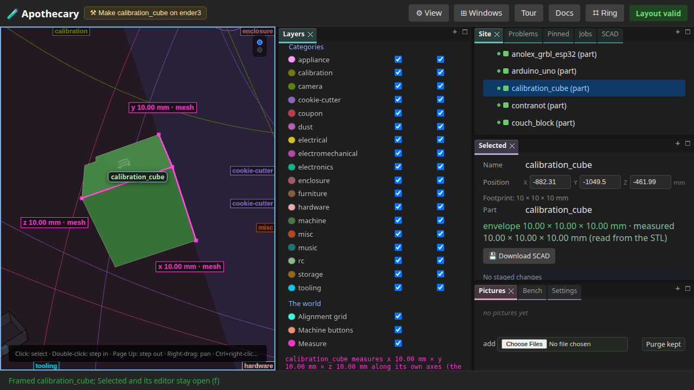
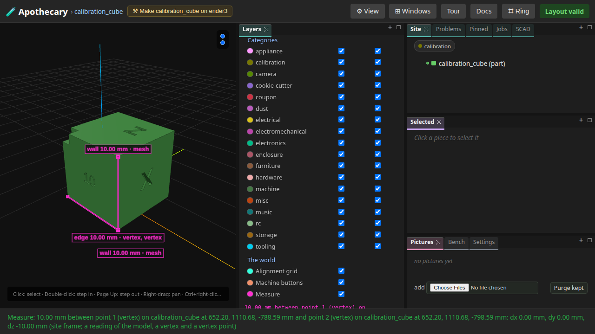
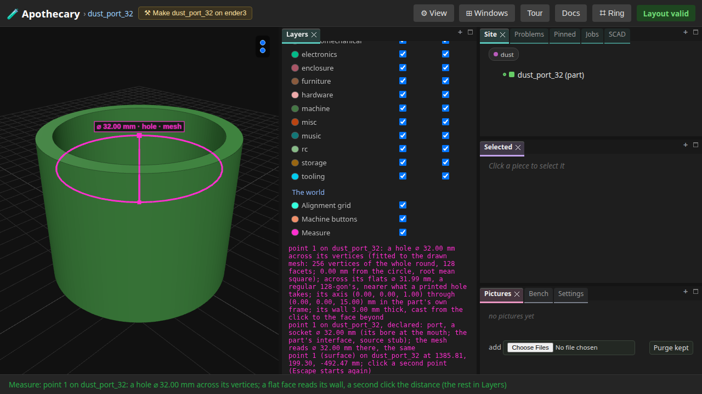
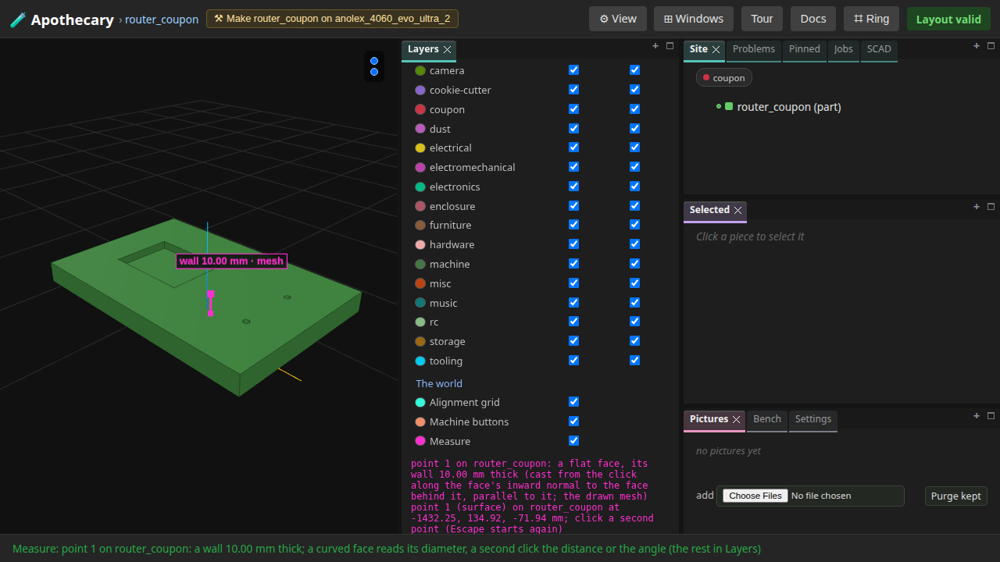

# 42 — Measuring in the world

Written by `tests/e2e/test_measure.py`, and
rewritten by every run of the browser suite (`uv run apothecary test
all`), though not by the quicker `apothecary test run`.
Each numbered step is written as the run reaches it, after the assertions
before it pass, and what a step shows is what the run had then. The
opening, the notes under it and the list of what the page does not show
are the test's fixed words. Editing the page by hand is editing the output
of a program: the next run puts it back.

The Measure layer, ticked in the Layers window, makes the selection read its size along its own axes, each number with where it comes from, and a click in the world drops a point to measure between rather than selecting, and reads the shape under it from the mesh drawn: a curved face a diameter, a flat face a wall. A reading is of the model and of the mesh drawn, not of a made part. [docs/viewer.md](../docs/viewer.md#layers) is the reference.

**Runtime-bound.** It drives a real browser against a real server of its own, on the universe as the code has it. A measurement is kept nowhere: Measure is off after a reload.

Its pictures draw every part that OpenSCAD version 2021.01, the OpenSCAD its server runs, can build from an STL it built; a part it cannot build is drawn from an STL already there, or as its box.

---

## 1. The selection reads its size, with its source

Measure ticked, the calibration cube selected from Site's rows and framed with `f`: a dimension line along each of its own axes, each length labelled with where it comes from, and the same words as text under the Layers window's rows.



## 2. Two clicks read the distance between the points

Two corners of the cube clicked, each snapped to a vertex where one is near: the line between them, its straight length, and dx, dy and dz in the site's millimetres, each point saying whether it is a vertex or the surface.



## 3. A click inside a bore reads its diameter, beside the declared socket

The dust port stepped into and framed, a click on the far side of its bore: the circle fitted to the bore's facets, drawn round its axis at the click with the line across it, labelled. The reading under the Layers window's rows says it is a hole, what it was fitted to and how well, and the socket the part declares on the same axis, with how far apart the two are; the status line says it in a line, and how to read the others.



## 4. A click on a flat face reads the wall behind it

The router coupon, a plate, stepped into and framed, a click on its top: the line from the click through the plate to the face beneath, labelled with the wall's thickness; the reading under the Layers window's rows says the two faces are parallel.



## What this page does not show

- **A made part.** A reading is of the model's declared bounds and of the mesh drawn; a printed part differs by what the printer does, and a printed hole is smaller than its mesh's.
- **What it cannot tell.** A steep cone, a sphere drawn as triangles, a face too small for the pointer: the reading says why and gives no number (`test_a_face_that_cannot_decide_says_why_and_gives_no_number`).
- **What changes on every run.** Moments are blanked in the pictures.

Run it yourself:

```sh
uv run pytest tests/e2e/test_measure.py --start-server   # this page alone
uv run apothecary test all                               # with every browser test
```
