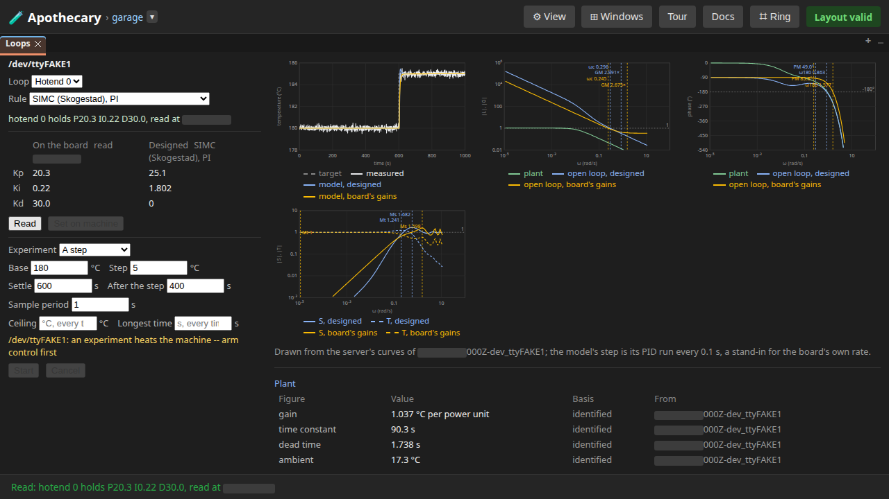
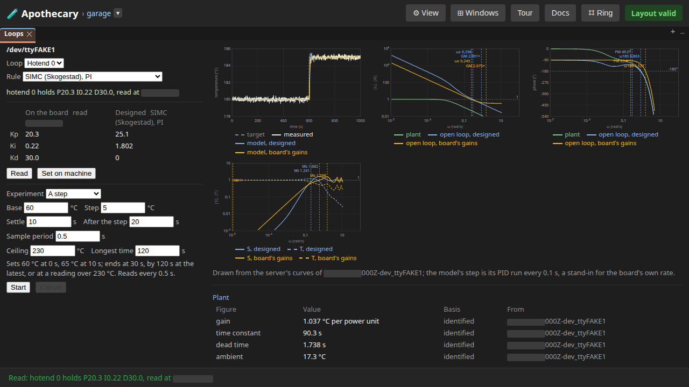
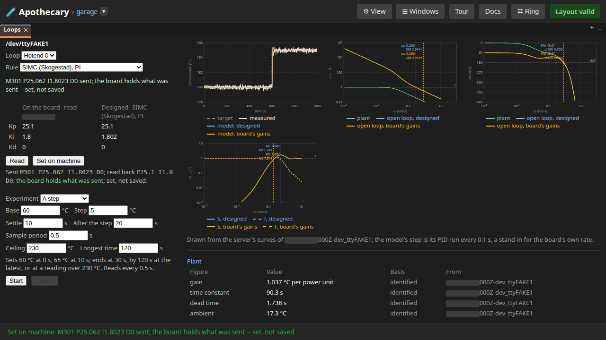

# 48 — A heater's loop in the page

Written by `tests/e2e/test_loops_window.py`, and
rewritten by every run of the browser suite (`uv run apothecary test
all`), though not by the quicker `apothecary test run`.
Each numbered step is written as the run reaches it, after the assertions
before it pass, and what a step shows is what the run had then. The
opening, the notes under it and the list of what the page does not show
are the test's fixed words. Editing the page by hand is editing the output
of a program: the next run puts it back.

The Loops window shows a heater loop of the printer whose Machine is open: what the board holds beside the controller a named rule designs for the plant the server identified, the newest kept experiment's plots and figures, and an experiment to run, its ceiling and its longest time typed every time. Every number in it is the server's. [docs/control-loops.md](../docs/control-loops.md#the-loops-window) is the reference.

**Runtime-bound.** It drives a real browser against a real server of its own, its printer simulated with its heaters modelled and run five times faster than the clock. The kept step its pictures draw was recorded in the test's own process from the simulated hotend's model under the board's own gains, so its figures are the same on every run; the numbers are the simulator's and no heater's.

Its pictures draw every part that OpenSCAD version 2021.01, the OpenSCAD its server runs, can build from an STL it built; a part it cannot build is drawn from an STL already there, or as its box.

---

## 1. A kept step, its design and the board's gains

The Loops window, its stack over the layout: the newest kept step of hotend 0, the gains the board answered with beside the PI controller SIMC designs for the plant the server identified, the step measured beside the model's, the open loop over frequency with its crossovers marked, and the margins and the step's measures, each with its basis. Start is greyed: the latch is down.



## 2. A ceiling and a longest time typed, and the plan

Armed, Start waited for the two figures nothing states for a person -- the ceiling no reading may pass and the longest the experiment may run -- in the server's words; typed, the server says the plan: the targets it sets and when, and its end.



## 3. The designed gains set on the board, and read back

Set on machine sent the designed gains (M301) and read them back (M503): the board holds what was sent, to the hundredth it prints. Set, not saved: the board's memory is written only when a request asks for it by name, and this window never asks.



## 4. A step run from the window

Start ran the planned step; the surfaces' stream told its progress as it ran, never falling, and its end: done, the heater turned off and its target read back as 0. The window then drew the new step's document and curves, every figure and mark the server's. The simulated heater runs five times faster than the clock the step keeps, so the plant it finds is five times quicker than the simulator's own, and the board's gains, which are per simulated second, are not the gains round it.

## What this page does not show

- **A real heater.** Nothing here reaches a board; the bench checklist's steps do.
- **The step it runs, in a picture.** Its samples are read on the clock and differ from run to run; the step is asserted, not pictured.
- **Saving the gains.** The window never asks the board to keep them; the reference says how a person does.

Run it yourself:

```sh
uv run pytest tests/e2e/test_loops_window.py --start-server   # this page alone
uv run apothecary test all                                    # with every browser test
```
