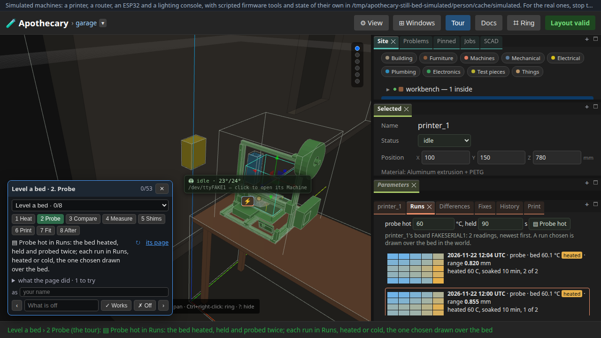
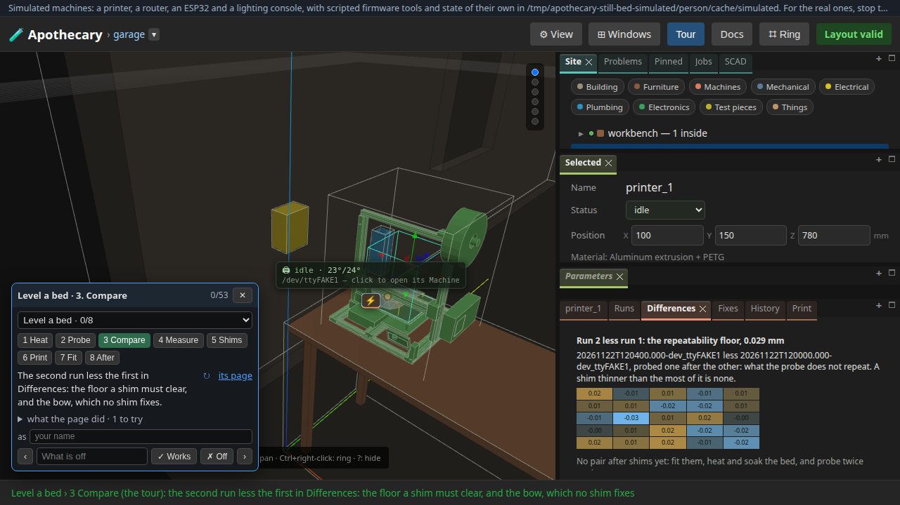
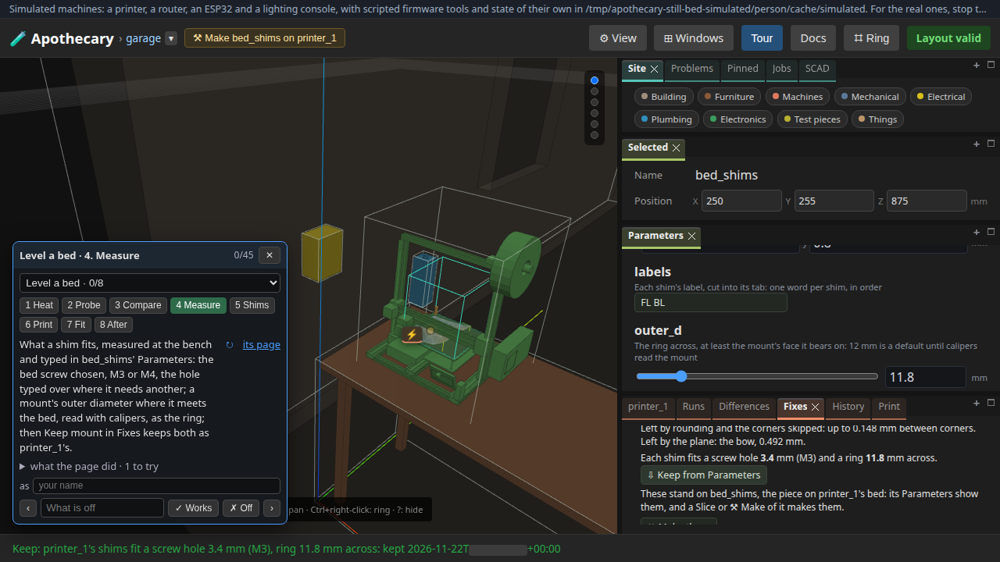
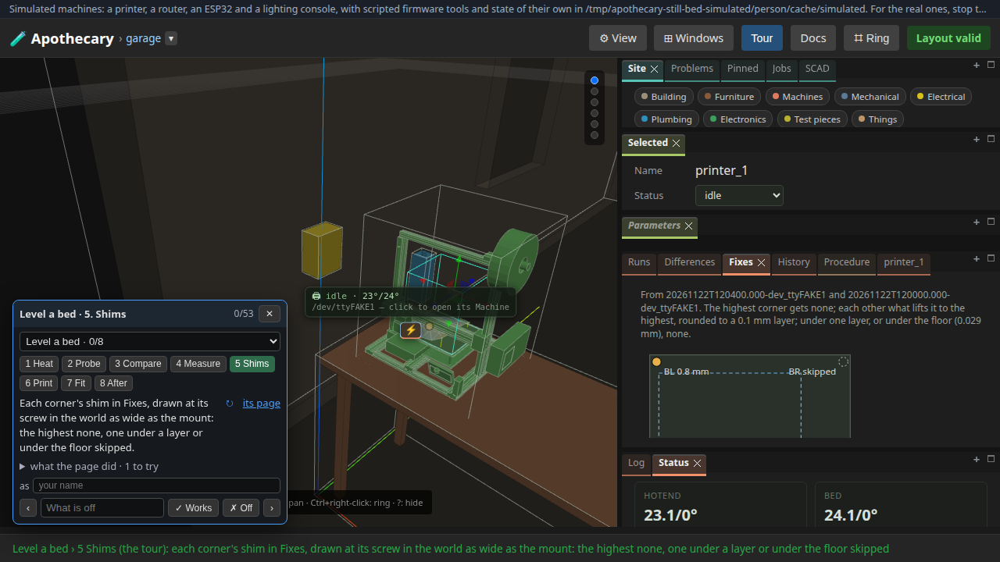
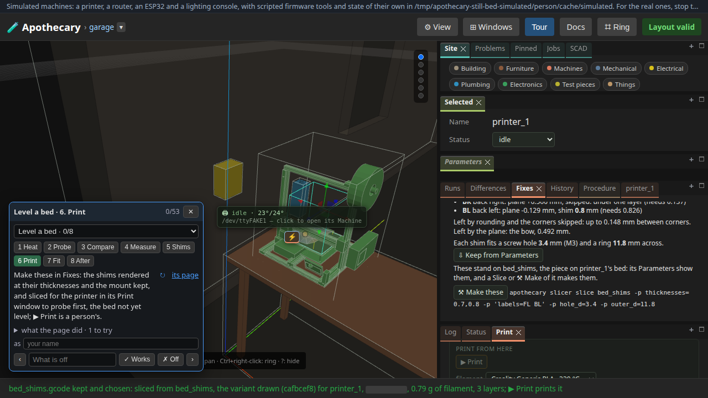
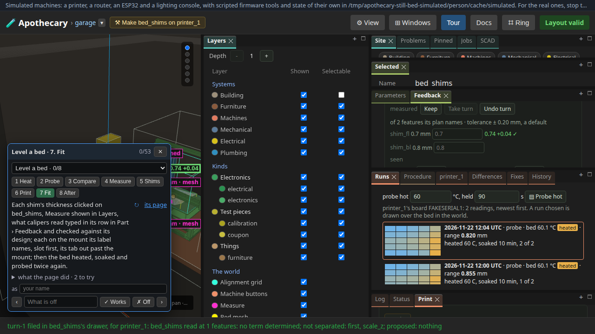
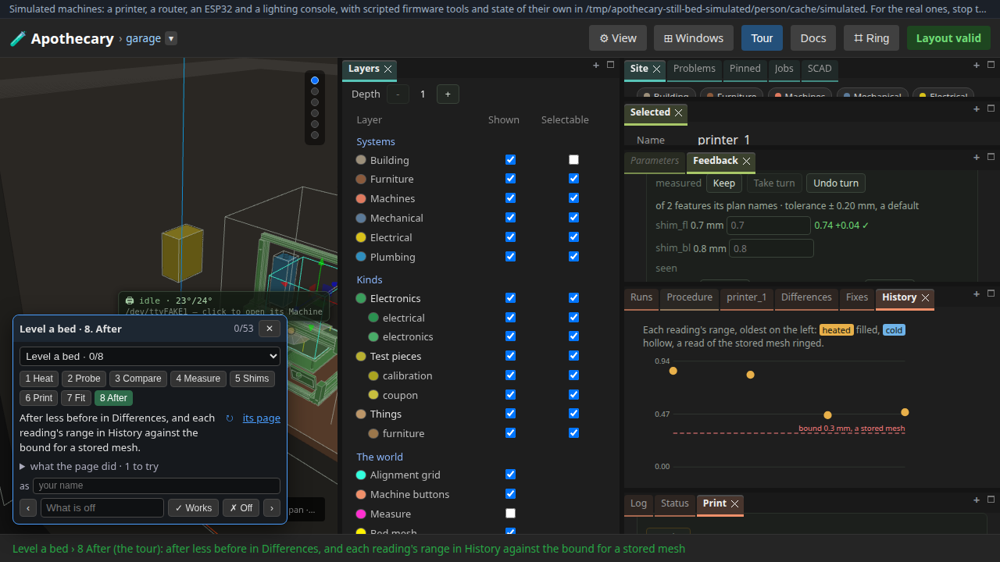

# 53 — A bed levelled in the page

Written by `tests/e2e/test_level_a_bed.py`, and
rewritten by every run of the browser suite (`uv run apothecary test
all`), though not by the quicker `apothecary test run`.
Each numbered step is written as the run reaches it, after the assertions
before it pass, and what a step shows is what the run had then. The
opening, the notes under it and the list of what the page does not show
are the test's fixed words. Editing the page by hand is editing the output
of a program: the next run puts it back.

The tour's *Level a bed* on printer_1: its bed readings in Runs, the second of a heated pair less the first in Differences, what a shim fits measured and kept, the shims in Fixes and drawn at their screws in the world, sliced for the printer, a shim's thickness read against its design, and the pair taken after them set against the pair before in Differences and History. [docs/bed-shims.md](../docs/bed-shims.md#in-the-page) is the reference.

**Runtime-bound.** It drives a real browser against `apothecary serve --simulated`, started as a person starts it, with a script that answers as OrcaSlicer's command line does. The readings are written into its state folder as a bench keeps them: a heated pair made up from printer_1's recorded probe of 2026-09-26 with a probe's noise of about a hundredth, seeded, and a pair after the shims, the shims' lift added as a rigid plate would take it. The numbers are this page's and no bed's.

Its pictures draw every part that OpenSCAD version 2021.01, the OpenSCAD its server runs, can build from an STL it built; a part it cannot build is drawn from an STL already there, or as its box.

---

## 1. Two heated runs, one drawn over the bed

Runs lists printer_1's readings, newest first, each a small heatmap of its grid with its bed temperature marked heated, its range and its note. The older is chosen, and drawn over the bed in the world on the Bed mesh layer. Above them, Probe hot holds the filament's bed temperature and a hold of 90 s.



## 2. The floor, and the bow no shim fixes

Differences: the second run less the first, which is the probe's repeatability and the least a shim must be; no pair after shims yet; and what the plane leaves, the plate's bow, over the bound for a stored mesh, so no shim brings a reading under it.



## 3. What a shim fits, measured and kept

bed_shims in Parameters, at the thicknesses the readings call for, which Fixes stood on the piece: M3 chosen as its bed screw, which sets the hole, and 11.8 typed as the ring, what calipers read across the mount. Keep mount in Fixes keeps both as printer_1's, in the state folder; neither is marked a default now.



## 4. The shims at their screws, as wide as the mount

Fixes draws the bed from above: each screw where printer_1's profile puts it, the highest corner with none, a corner under a layer skipped, the others their shim's thickness. In the world the shims stand at their screws, 11.8 mm across as kept, after a reload as before it.



## 5. The shims sliced for the printer

Make these slices bed_shims as it is drawn, at the shims' thicknesses and the mount kept, for printer_1 in its Print window, where Print a part goes on. ▶ Print is a person's, armed.



## 6. A shim's thickness read against its design

Fit, Measure shown in Layers: bed_shims, drawn as the shims sliced, wears each shim's thickness across its ring. One clicked brings its row in Part › Feedback, on the slice Make these kept; what calipers read is typed and kept with Enter, checked against the thickness designed within the default ± 0.20 mm, since bed_shims' print settings state none, and the shim's line and label in the world wear the page's colour for within.



## 7. After less before, and the range over the readings

The pair after the shims less the pair before, in Differences, and each reading's range in History against the bound for a stored mesh: the tilt taken out, the bow left.



## What this page does not show

- **Heating, probing and fitting.** They are a person's, at the printer; the tour names them at their stages and does none.
- **A real bed's readings.** Every probe here is made up; the bench checklist's boxes take the real ones.
- **What changes on every run.** Moments are blanked in the pictures.

Run it yourself:

```sh
uv run pytest tests/e2e/test_level_a_bed.py --start-server   # this page alone
uv run apothecary test all                                   # with every browser test
```
