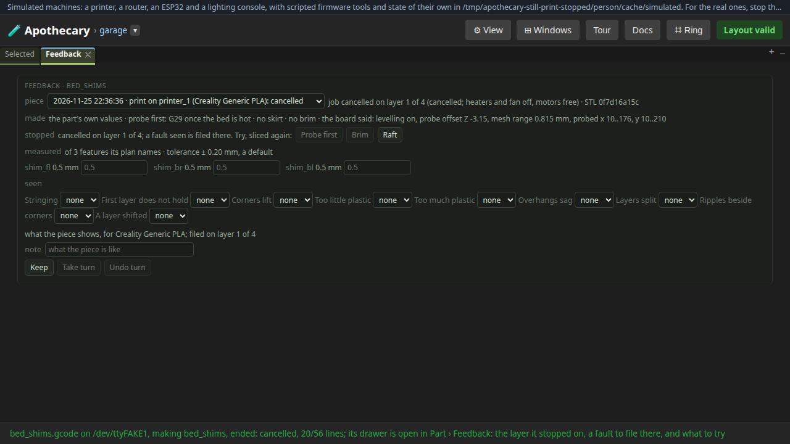
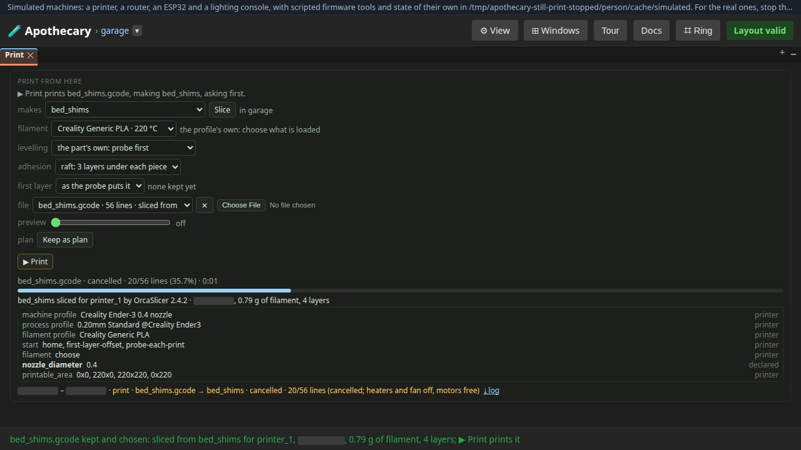
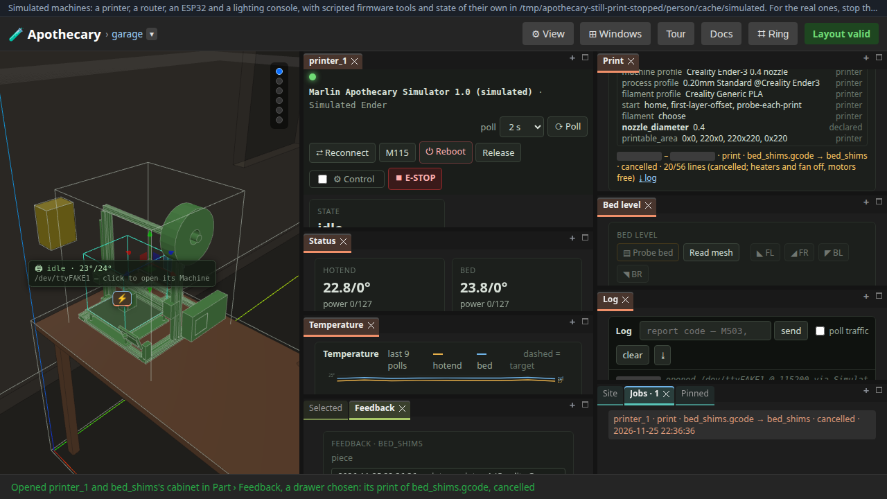
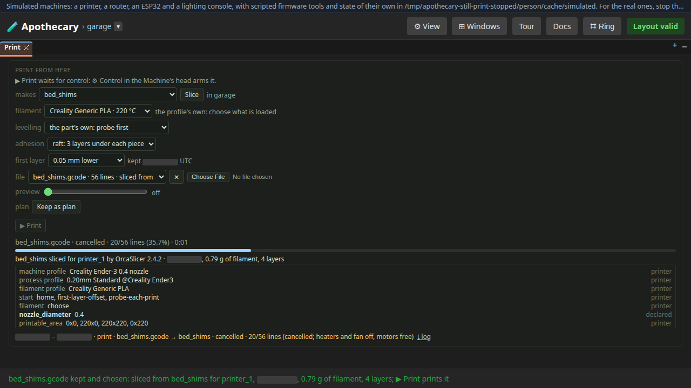

# 54 — A print that stopped

Written by `tests/e2e/test_a_print_that_stopped.py`, and
rewritten by every run of the browser suite (`uv run apothecary test
all`), though not by the quicker `apothecary test run`.
Each numbered step is written as the run reaches it, after the assertions
before it pass, and what a step shows is what the run had then. The
opening, the notes under it and the list of what the page does not show
are the test's fixed words. Editing the page by hand is editing the output
of a program: the next run puts it back.

A print of bed_shims on printer_1 cancelled on its first layer, as a person cancels a first layer that will not hold: its piece's drawer opened by itself in Part › Feedback, saying the layer it stopped on, a fault filed there, the piece tried again on a raft, Site's Jobs opening the Machine and the drawer together, and the printer's first layer kept 0.05 mm lower and the piece sliced with it. [docs/cabinet.md](../docs/cabinet.md) and [docs/slicer.md](../docs/slicer.md#a-printers-first-layer-offset) are the reference.

**Runtime-bound.** It drives a real browser against `apothecary serve --simulated`, started as a person starts it, with a script that answers as OrcaSlicer's command line does, each move of its file followed by a dwell so the print is seen running. The simulated printer prints; the test cancels it once a line of its first layer is sent.

Its pictures draw every part that OpenSCAD version 2021.01, the OpenSCAD its server runs, can build from an STL it built; a part it cannot build is drawn from an STL already there, or as its box.

---

## 1. Cancelled on its first layer, its drawer open where it stopped

The print is cancelled once a line of its first layer is sent. Its end opens the piece's drawer in Part › Feedback, which says it was cancelled on layer 1 of the file's layers and how the piece was made, in the Print window's words: the part's own values, probe first, no skirt and no brim, as bed_shims declares, and what the board said of its levelling as the print began -- on, its probe's offset, the mesh's range and where the probe found the grid. It offers what to try: Raft, slicing the piece again; Probe first is greyed, the piece made with it already as bed_shims declares, and Brim greyed, bed_shims declaring none. Feedback is maximised here from its stack, so the drawer is seen whole.



## 2. Tried again on a raft

First layer, bad, is kept as a look and filed on the layer the print stopped on. Raft slices the piece again for printer_1 in its Print window, its adhesion row on a raft and its levelling the part's own, which bed_shims declares probe first; ▶ Print is a person's. Print is maximised here from its stack.



## 3. A job's row opens its Machine and its drawer

Site's Jobs lists the cancelled print. Its row selects printer_1 and opens its Machine, and opens the piece's drawer in Part › Feedback beside it: the job's own drawer, chosen among bed_shims's pieces. Its row in the Print window's own jobs opens the drawer too.



## 4. The first layer kept lower

A first layer that did not hold, its lines round and apart, is a nozzle too high over the bed. The Print window's first layer row keeps printer_1's first-layer offset 0.05 mm lower, as it is chosen, and Slice makes the piece again with it: every slice made for printer_1 after takes it as its z_offset, on top of the probe's own offset. A one-layer square, first_layer_square, says which way to go. Print is maximised here from its stack.



## What this page does not show

- **Why a first layer does not hold.** A level bed, a clean one, and which way the nozzle's height is off are the bench's, read on a one-layer square (`first_layer_square`); the page says where the print stopped, offers what to slice again with, and keeps the height chosen.
- **What changes on every run.** Moments are blanked in the pictures.

Run it yourself:

```sh
uv run pytest tests/e2e/test_a_print_that_stopped.py --start-server   # this page alone
uv run apothecary test all                                            # with every browser test
```
