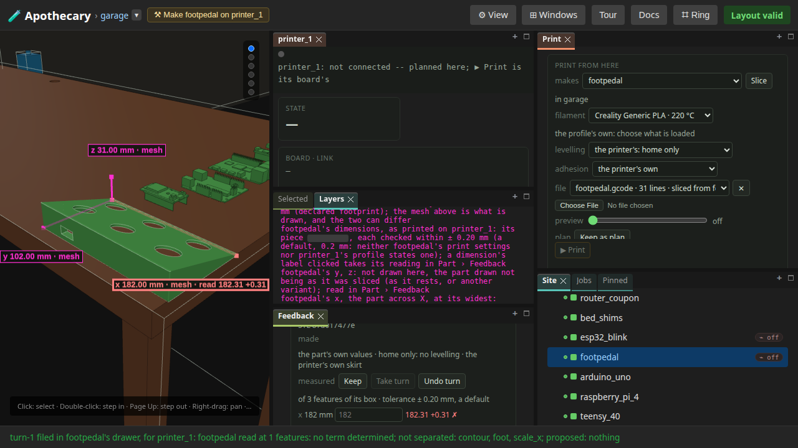
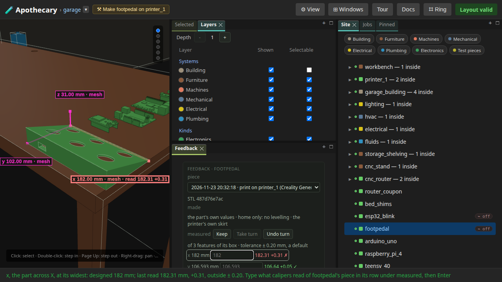

# 55 — A printed piece checked against its design

Written by `tests/e2e/test_a_piece_against_its_design.py`, and
rewritten by every run of the browser suite (`uv run apothecary test
all`), though not by the quicker `apothecary test run`.
Each numbered step is written as the run reaches it, after the assertions
before it pass, and what a step shows is what the run had then. The
opening, the notes under it and the list of what the page does not show
are the test's fixed words. Editing the page by hand is editing the output
of a program: the next run puts it back.

A part's dimensions are what a person reads of a piece of it with calipers. With the Measure layer shown, a part's piece selected wears them in the world; a dimension's label clicked brings Part › Feedback on the piece, its row ready for what calipers read; and the reading, kept in the piece's drawer, is checked against the design, there and on the dimension in the world. [docs/cabinet.md](../docs/cabinet.md#dimensions) is the reference.

**Runtime-bound.** It drives a real browser against a real server of its own, the slicer a scripted OrcaSlicer: the footpedal is sliced for printer_1, and nothing is printed, armed or sent. The readings are typed as a person types them.

Its pictures draw every part that OpenSCAD version 2021.01, the OpenSCAD its server runs, can build from an STL it built; a part it cannot build is drawn from an STL already there, or as its box.

---

## 1. A dimension clicked, read, and checked against its design

Measure shown and the footpedal selected and framed. Its x is a dimension of the piece as sliced, marked on the part; its label clicked brought Part › Feedback on its kept slice with x's row given the caret, and what calipers read was typed and kept with Enter. Feedback's row and the filed check say how far it is from the design, outside the default ± 0.20 mm, and x's line and label in the world wear the page's colour for outside. The part is drawn as it rests, so its y and z are read in Feedback alone, as the reading under Layers says.



## 2. Kept: the readings on the part after a reload

The page reloaded, Measure shown again and the footpedal selected: x wears its reading from the piece's drawer, outside its tolerance, and its label clicked again says its designed size and its last reading. Feedback's rows say the same of the same drawer, y read within.



## What this page does not show

- **A part that names a plan.** The print coupon's dimensions are its plan's features, each drawn along the line its jaws close on; this page reads a box's (`tests/test_cabinet.py`, `tests/test_measure_world.py`).
- **A tolerance from the part or the printer.** The footpedal's print settings and printer_1's profile state none, so the default is used and said (`test_the_tolerance_is_the_part_s_else_the_printer_s_profile_s_else_a_default`).
- **What changes on every run.** Moments are blanked in the pictures.

Run it yourself:

```sh
uv run pytest tests/e2e/test_a_piece_against_its_design.py --start-server   # this page alone
uv run apothecary test all                                                  # with every browser test
```
