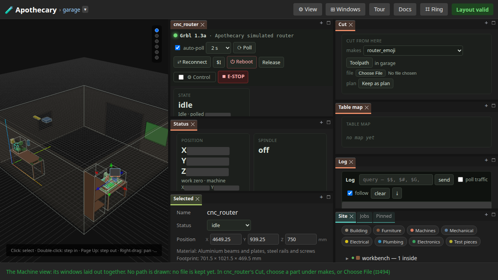
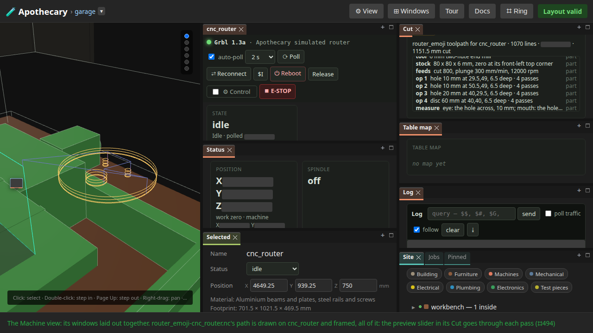
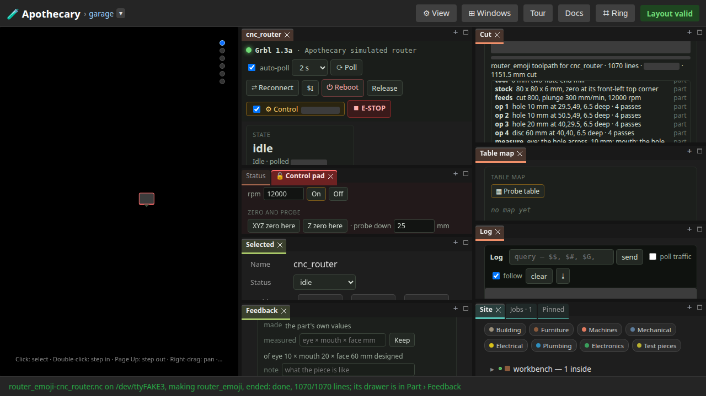
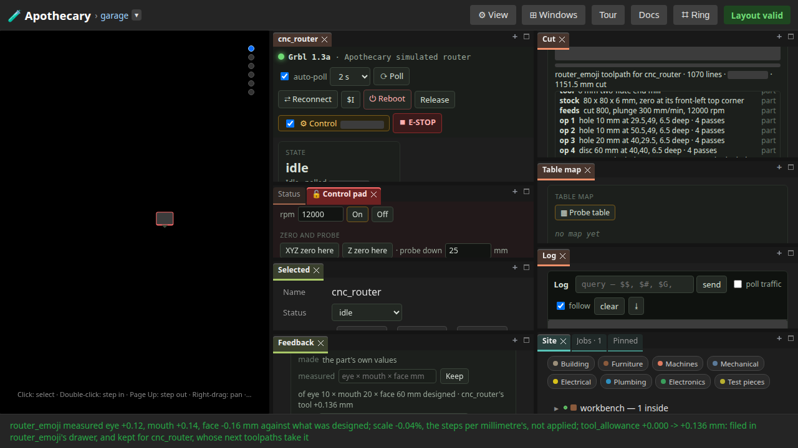
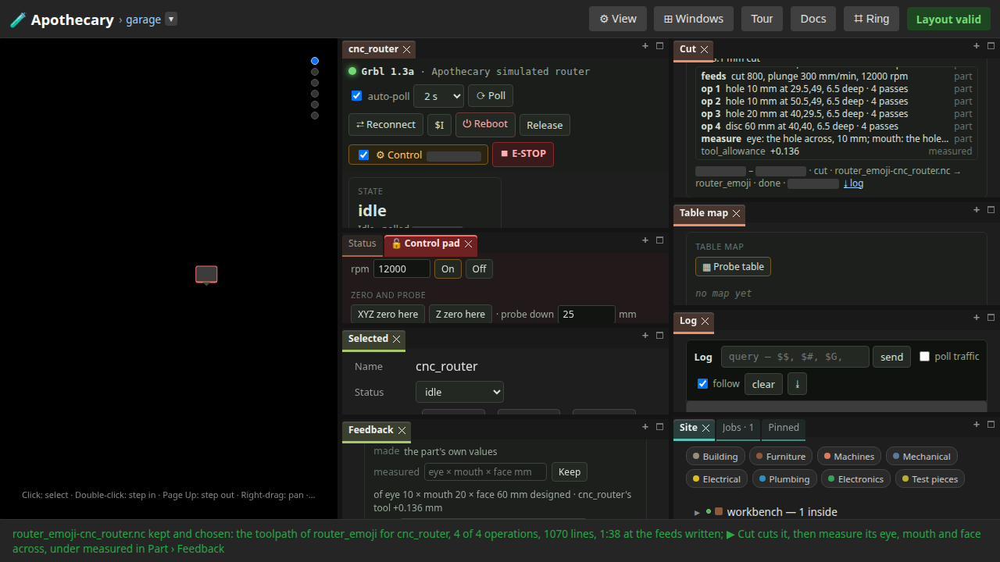

# 56 — A router calibrated by a face

Written by `tests/e2e/test_router_ui.py`, and
rewritten by every run of the browser suite (`uv run apothecary test
all`), though not by the quicker `apothecary test run`.
Each numbered step is written as the run reaches it, after the assertions
before it pass, and what a step shows is what the run had then. The
opening, the notes under it and the list of what the page does not show
are the test's fixed words. Editing the page by hand is editing the output
of a program: the next run puts it back.

The router's calibration piece, a 😮 (`parts/router_emoji`), from makes to the allowance kept, as the tour's *Calibrate a router* goes: chosen in the Cut window, its toolpath written and saying what a person measures of the piece, cut, its drawer opened in its cabinet at the cut's end, its eye, mouth and face measured across and kept, and the next toolpath taking the tool's allowance they give. [docs/cam.md](../docs/cam.md#measured-by-hand-fed-back) is the reference; [page 20](20-a-part-through-the-router.md) measures the same piece in this process, and [page 24](24-a-cut-from-the-card.md) goes round the Cut card on the coupon.

**Runtime-bound.** It drives a real browser against a real server of its own. The router is the simulated GRBL controller on a fake port, pinned to cnc_router's controller as the garage's real one is; its moves take a twentieth of real time, and it cuts exactly its tool's diameter, so the sizes typed are made up, as a real tool's might read. Nothing opens a real port, and the real router is section I of [docs/bench-checklist.md](../docs/bench-checklist.md).

Its pictures draw every part that OpenSCAD version 2021.01, the OpenSCAD its server runs, can build from an STL it built; a part it cannot build is drawn from an STL already there, or as its box.

---

## 1. router_emoji, the 😮, under makes in the router's Cut window

cnc_router's Machine opened from its Device line, and router_emoji chosen under makes in its Cut window: a part the router makes, though no piece of the garage stands for it. Its face is cut around from outside, its two eyes and its mouth bored, each a circle calipers read across. Toolpath is there, since it says how it is cut.



## 2. Toolpath writes its cut, draws it, and says what to measure

Toolpath writes the 😮's cut from what it declares, keeps it and chooses it, and the path is drawn on the table: the eyes and the mouth bored, then the face cut around. The card's measure row says what a person measures of the piece once it is cut, each as designed: an eye, the mouth and the face across, as the status line said when the toolpath was kept. No tool_allowance is in the card: the router keeps none yet.



## 3. Armed, zeroed, ▶ Cut: at the cut's end its drawer opens in Part › Feedback

⚙ Control armed, the tool jogged over the stock's front-left corner and the pad's XYZ zero here, then ▶ Cut, asked first, streams it to the end. The job is done and in the card's history, and the piece's drawer opens in its cabinet, Part › Feedback: its measured row names what to type, in order, and what was designed.



## 4. An eye, the mouth and the face measured, and kept

The three sizes typed under measured as calipers read them, and Keep. Each is checked against what was designed: the holes came out big and the face small by about the same, which is the tool's, and what is left the same way on both, in proportion, is the scale, said and not applied. The tool's allowance is kept for cnc_router and its 6 mm tool, and the measurement filed in the piece's drawer.



## 5. Toolpath again takes the allowance: tool_allowance, measured

Toolpath pressed again writes the 😮 with the tool as wide as it cuts: the card says tool_allowance +0.136, its origin measured, and the face's path stands a little further out. Every later toolpath for cnc_router with a 6 mm tool takes it.



## What this page does not show

- **A real piece.** The simulated router cuts nothing, and the sizes typed are made up: a tool cutting about 0.14 mm wider than its diameter. The bench checklist's section I is the 😮 cut from stock and read with calipers.
- **The scale.** What the sizes say of the steps per millimetre is said and not applied: it is the controller's `$100` and `$101`, which nothing here changes.
- **A measurement refused.** A size more than 5% off what was designed is refused and nothing is kept; [page 20](20-a-part-through-the-router.md) shows it.
- **What changes on every run.** Moments, the lines streamed and the tool's position are blanked in the pictures.

Run it yourself:

```sh
uv run pytest tests/e2e/test_router_ui.py --start-server   # this page alone
uv run apothecary test all                                 # with every browser test
```
